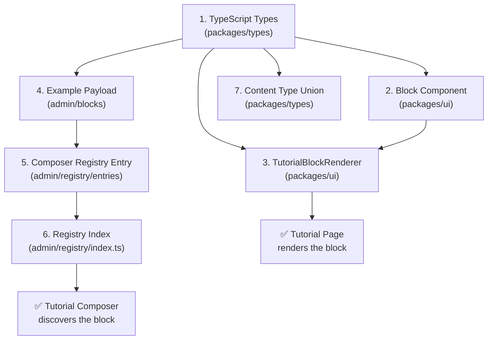

# New Tutorial Block — Complete Integration Guide

> **What does a new block need to appear in Tutorial Composer and render on the Tutorial Page?**
>
> This guide shows the **exact files to create** and the **exact files to modify**, derived from how I1, C1, and D1 are actually implemented.

---

## The Integration Chain

A new block must be registered at **7 integration points** to flow from Composer to learner:



---

## 7 Files You Need (Using Objective O1 as Example)

### FILE 1 — TypeScript Block Type Definition

> **Where:** [`packages/types/src/tutorial-rich-document/blocks/content-blocks.ts`](file:///e:/onlinewebsites/quiz-platform/packages/types/src/tutorial-rich-document/blocks/content-blocks.ts)

Add the type definitions following the I1/C1/D1 pattern:

```typescript
// ──────────────────────────────────────────
// Objective O1 Block
// ──────────────────────────────────────────

/**
 * Objective O1 - Page Structure
 * Author content contract for Objective O1 version
 */
export interface ObjectiveO1Page {
  title: string;
  description: string;
  objectives: Array<{
    text: string;
    bloomLevel?: 'remember' | 'understand' | 'apply' | 'analyze' | 'evaluate' | 'create';
    icon?: string;
  }>;
  prerequisite?: string;
}

/**
 * Objective O1 - Author Content
 * Wraps page structure in content.page
 */
export interface ObjectiveO1AuthorContent {
  page: ObjectiveO1Page;
}

/**
 * Objective O1 Block
 * Canonical block with version envelope
 */
export interface ObjectiveO1Block extends BaseBlock {
  type: 'objective';        // ← Block family name
  version: 'O1';            // ← Version code
  content: ObjectiveO1AuthorContent;
}

/**
 * Objective Block (Version Union)
 * All Objective block versions
 */
export type ObjectiveBlock = ObjectiveO1Block;
// Future versions:
// | ObjectiveO2Block
// | ObjectiveO3Block
```

> [!IMPORTANT]
> **Key pattern from I1/C1/D1:** Every versioned block has three layers:
> 1. `XxxPage` — the raw content structure
> 2. `XxxAuthorContent` — wraps it as `{ page: XxxPage }`
> 3. `XxxBlock extends BaseBlock` — adds `type`, `version`, `content`

---

### FILE 2 — Export the Type from Block Union

> **Where:** [`packages/types/src/tutorial-rich-document/blocks/content-blocks.ts`](file:///e:/onlinewebsites/quiz-platform/packages/types/src/tutorial-rich-document/blocks/content-blocks.ts) (bottom of file)

Add `ObjectiveBlock` to the `ContentBlock` union:

```diff
 export type ContentBlock =
   | HeadingBlock
   | ParagraphBlock
   | ListBlock
   | CodeBlock
   | TableBlock
   | ImageBlock
   | CalloutBlock
   | DefinitionBlock
   | IntroductionBlock
+  | ObjectiveBlock
   | ExampleBlock
   | QuoteBlock
   | SummaryBlock
   | DiagramBlock
   | ComparisonBlock;
```

And export the types from [`blocks/index.ts`](file:///e:/onlinewebsites/quiz-platform/packages/types/src/tutorial-rich-document/blocks/index.ts):

```diff
+// Export version-specific Objective block types from content-blocks
+export type {
+  ObjectiveO1Page,
+  ObjectiveO1AuthorContent,
+  ObjectiveO1Block,
+  ObjectiveBlock,
+} from './content-blocks';
```

---

### FILE 3 — Add to TutorialPageContentType

> **Where:** [`packages/types/src/tutorial-page-content.types.ts`](file:///e:/onlinewebsites/quiz-platform/packages/types/src/tutorial-page-content.types.ts) (line 4)

```diff
-export type TutorialPageContentType = 'definition' | 'code' | 'summary' | 'introduction';
+export type TutorialPageContentType = 'definition' | 'code' | 'summary' | 'introduction' | 'objective';
```

Also add the payload type and map entry:

```typescript
export interface TutorialObjectivePayload {
  page: {
    title: string;
    description: string;
    objectives: Array<{
      text: string;
      bloomLevel?: string;
      icon?: string;
    }>;
    prerequisite?: string;
  };
}
```

```diff
 export type TutorialContentPayloadByType = {
   definition: TutorialDefinitionPayload;
   code: TutorialCodePayload;
   summary: TutorialSummaryPayload;
   introduction: TutorialIntroductionPayload;
+  objective: TutorialObjectivePayload;
 };
```

---

### FILE 4 — React Block Component (NEW FILE)

> **Where:** `packages/ui/src/tutorial/blocks/ObjectiveBlock.tsx` (new file)

Follow the exact pattern from [DefinitionBlock.tsx](file:///e:/onlinewebsites/quiz-platform/packages/ui/src/tutorial/blocks/DefinitionBlock.tsx):

```tsx
import React from 'react';
import type { BlockComponentProps, DomainTheme } from '../types';

// ─── Version Router ──────────────────────────────────
export function ObjectiveBlock({ block, theme, runtimeContext }: BlockComponentProps) {
  if (!block || block.type !== 'objective') return null;

  // Version must be present
  if (!('version' in block) || !block.version) {
    throw new Error('ObjectiveBlock requires a version field.');
  }

  // Version routing
  switch (block.version) {
    case 'O1':
      return <ObjectiveO1View block={block} theme={theme} runtimeContext={runtimeContext} />;
    default: {
      const _exhaustive: never = block.version as never;
      throw new Error(`Unsupported Objective version: ${block.version}`);
    }
  }
}

// ─── O1 View ─────────────────────────────────────────
/**
 * ObjectiveO1View
 *
 * Single authoritative Objective O1 renderer for ALL brands.
 * Used by:
 *   - Composer Preview
 *   - SUIA Student Page
 *   - RTH Student Page
 *   - All other brand learner pages
 *
 * Only theme.primary and theme.secondary vary by brand.
 * There is NO ObjectiveO1-SUIA.tsx or ObjectiveO1-RTH.tsx.
 */
function ObjectiveO1View({ block, theme, runtimeContext }: BlockComponentProps) {
  const content = (block as any).content?.page;
  if (!content) return null;

  // Theme-driven colors (brand-independent)
  const primary = theme?.primary || '#6366f1';
  const secondary = theme?.secondary || '#818cf8';

  // UBRC identity (Universal Block Runtime Context)
  const blockId = runtimeContext?.blockId || block.id;
  const blockType = runtimeContext?.blockType || 'objective';
  const blockVersion = runtimeContext?.blockVersion || 'O1';

  return (
    <article
      data-block-id={blockId}
      data-block-type={blockType}
      data-block-version={blockVersion}
      className="my-6 rounded-2xl border border-slate-200 overflow-hidden"
    >
      {/* Header */}
      <div
        className="px-6 py-4"
        style={{ background: `linear-gradient(135deg, ${primary}, ${secondary})` }}
      >
        <h3 className="text-lg font-bold text-white">
          {content.title || 'Learning Objectives'}
        </h3>
        {content.description && (
          <p className="text-sm text-white/80 mt-1">{content.description}</p>
        )}
      </div>

      {/* Objectives List */}
      <div className="px-6 py-4 space-y-3">
        {content.objectives?.map((obj: any, i: number) => (
          <div key={i} className="flex items-start gap-3">
            <div
              className="flex h-6 w-6 shrink-0 items-center justify-center rounded-full text-white text-xs font-bold mt-0.5"
              style={{ backgroundColor: primary }}
            >
              {i + 1}
            </div>
            <div>
              <p className="text-sm text-slate-800">{obj.text}</p>
              {obj.bloomLevel && (
                <span className="inline-block mt-1 px-2 py-0.5 rounded text-[10px] font-medium bg-slate-100 text-slate-500 uppercase">
                  {obj.bloomLevel}
                </span>
              )}
            </div>
          </div>
        ))}
      </div>

      {/* Prerequisite */}
      {content.prerequisite && (
        <div className="px-6 py-3 border-t border-slate-100 bg-slate-50">
          <p className="text-xs text-slate-500">
            <strong>Prerequisite:</strong> {content.prerequisite}
          </p>
        </div>
      )}
    </article>
  );
}
```

> [!IMPORTANT]
> **Critical requirements from the spec (copied from I1/C1/D1):**
> - ✅ `data-block-id`, `data-block-type`, `data-block-version` — UBRC attributes
> - ✅ Uses `theme.primary` / `theme.secondary` — brand-independent
> - ✅ ONE file for ALL brands — no SUIA/RTH variants
> - ✅ Version router with exhaustive switch
> - ❌ Does NOT import ILS, LSNB, or RSSB
> - ❌ Does NOT contain navigation or progress UI

---

### FILE 5 — Add to TutorialBlockRenderer

> **Where:** [`packages/ui/src/tutorial/TutorialBlockRenderer.tsx`](file:///e:/onlinewebsites/quiz-platform/packages/ui/src/tutorial/TutorialBlockRenderer.tsx)

Add import + case:

```diff
 import { ComparisonBlock } from './blocks/ComparisonBlock';
+import { ObjectiveBlock } from './blocks/ObjectiveBlock';
 import { TwoColumnBlock } from './blocks/TwoColumnBlock';
```

Add the case in the `switch(block.type)` statement (before `default`):

```diff
       case 'comparison':
         return <ComparisonBlock block={block} depth={depth} theme={theme} className={className} runtimeContext={runtimeContext} renderChild={renderChild} />;
+      case 'objective':
+        return <ObjectiveBlock block={block} depth={depth} theme={theme} className={className} runtimeContext={runtimeContext} renderChild={renderChild} />;
       case 'two-column':
```

---

### FILE 6 — Example Payload for Composer (NEW FILE)

> **Where:** `apps/skillhubcore-admin/src/app/(admin)/tools/tutorial-page-content/blocks/objective/O1/objectiveO1.examples.ts` (new file)

```typescript
import type { TutorialObjectivePayload } from '@quiz/types';

/**
 * O1 Objective Block - Example Authoring Payload
 * Used as default payload when creating new Objective blocks in Composer.
 */
export const objectiveO1Example: TutorialObjectivePayload = {
  page: {
    title: 'Learning Objectives',
    description: 'By the end of this lesson, you will be able to:',
    objectives: [
      {
        text: 'Define what a function is and explain its purpose in JavaScript',
        bloomLevel: 'understand',
      },
      {
        text: 'Write functions using declarations, expressions, and arrow syntax',
        bloomLevel: 'apply',
      },
      {
        text: 'Use parameters, default values, and rest parameters effectively',
        bloomLevel: 'apply',
      },
      {
        text: 'Analyze the difference between scope, closures, and hoisting',
        bloomLevel: 'analyze',
      },
    ],
    prerequisite: 'Basic JavaScript variables and data types',
  },
};
```

---

### FILE 7 — Composer Registry Entry (NEW FILE)

> **Where:** `apps/skillhubcore-admin/src/app/(admin)/tools/tutorial-page-content/registry/entries/objective.registry.ts` (new file)

```typescript
import type { BlockRegistryEntry } from '../types';
import { objectiveO1Example } from '../../blocks/objective/O1/objectiveO1.examples';

/**
 * Objective Block Registry
 *
 * Owns metadata for all Objective block versions (O1, O2, O3, ...)
 */
export const objectiveRegistry: BlockRegistryEntry = {
  id: 'objective',
  label: 'Objective',
  versions: [
    {
      id: 'v1',
      code: 'O1',
      label: 'O1 - Bullet Objectives',
      description: 'Concise bullet points of lesson goals with Bloom taxonomy levels',
      getDefaultPayload: () => objectiveO1Example,
    },
  ],
};
```

---

### FILE 8 — Register in Registry Index

> **Where:** [`apps/skillhubcore-admin/src/app/(admin)/tools/tutorial-page-content/registry/index.ts`](file:///e:/onlinewebsites/quiz-platform/apps/skillhubcore-admin/src/app/(admin)/tools/tutorial-page-content/registry/index.ts)

```diff
 import { introductionRegistry } from './entries/introduction.registry';
+import { objectiveRegistry } from './entries/objective.registry';

 export function getBlockTypes(): BlockRegistryEntry[] {
   return [
     definitionRegistry,
     codeRegistry,
     summaryRegistry,
     introductionRegistry,
+    objectiveRegistry,
   ];
 }
```

---

## Summary — The Complete Checklist

```text
NEW BLOCK INTEGRATION CHECKLIST

Types (packages/types)
  ☐ Define XxxO1Page interface
  ☐ Define XxxO1AuthorContent interface  
  ☐ Define XxxO1Block extends BaseBlock with type + version
  ☐ Define XxxBlock version union type
  ☐ Add to ContentBlock union
  ☐ Export from blocks/index.ts
  ☐ Add to TutorialPageContentType union
  ☐ Add payload type + map entry

Component (packages/ui)
  ☐ Create ObjectiveBlock.tsx
  ☐ Version router (switch on block.version)
  ☐ O1 view with UBRC data attributes
  ☐ Theme-driven (theme.primary / theme.secondary)
  ☐ NO ILS imports
  ☐ NO navigation/progress UI
  ☐ NO hardcoded brand colors

Renderer (packages/ui)
  ☐ Import ObjectiveBlock in TutorialBlockRenderer
  ☐ Add case 'objective' in switch statement

Composer (apps/skillhubcore-admin)
  ☐ Create example payload file
  ☐ Create registry entry file  
  ☐ Register in registry/index.ts
```

---

## How It Flows End-to-End

```text
AUTHORING (Tutorial Composer)
  │
  │ 1. Composer calls getBlockTypes()
  │ 2. User sees "Objective" in block selector
  │ 3. User clicks → getDefaultPayload() returns objectiveO1Example
  │ 4. User edits the Objective content
  │ 5. Composer saves to TutorialDocument.blocks[]
  │
  ▼
STORAGE (Database)
  │
  │ Block stored as JSON: { type: "objective", version: "O1", content: {...} }
  │
  ▼
RENDERING (Tutorial Page)
  │
  │ 1. TutorialPageShell loads TutorialDocument
  │ 2. For each block, calls TutorialBlockRenderer
  │ 3. switch(block.type) matches 'objective'
  │ 4. ObjectiveBlock component renders
  │ 5. Version router dispatches to ObjectiveO1View
  │ 6. UBRC attributes emitted → ActiveBlockContext detects
  │ 7. ILSProvider observes passively
  │ 8. Theme.primary/secondary applied from brand config
  │
  ▼
LEARNER sees the Objective block
```
