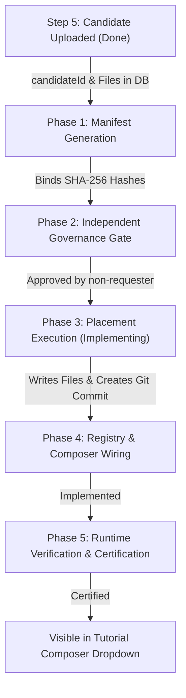

Viewed page.tsx:1-120
Viewed candidate.py:580-640
Viewed candidate.py:641-720
Viewed candidate.py:721-780
Viewed candidate.py:781-840
Viewed candidate.py:841-890
Viewed candidate.py:960-1030
Viewed candidate.py:1031-1090
Viewed comparator.py:130-180
Viewed comparator.py:240-300
Viewed comparator.py:301-336
Viewed repository_adapter.py:150-210
Viewed repository_adapter.py:211-240
Ran command: `python -c "
import app.main
import asyncio
from app.persistence.database import get_db_session
from app.persistence.repositories import PostgresCandidateRepository, PostgresWorkflowRepository

async def check():
    async for session in get_db_session():
        cand_repo = PostgresCandidateRepository(session)
        wf_repo = PostgresWorkflowRepository(session)
        c = await cand_repo.get('0f270387-f215-4ce5-b576-60559ecf0e9e')
        wf = await wf_repo.get('f69a49f8-6b72-4616-bb88-2bab63942bc6')
        print('Candidate:', c.candidate_id, 'Family:', c.block_family, 'Target Ver:', c.target_version, 'UploadedBy:', c.uploaded_by)
        print('Workflow:', wf.workflow_id, 'Current State:', wf.current_state, 'Target Family:', wf.target_family, 'Target Ver:', wf.target_version)

asyncio.run(check())
"`
Used tool: manage_task
Ran command: `python -c "
import app.main
import asyncio
from app.persistence.database import get_db_session
from app.persistence.repositories import PostgresCandidateRepository, PostgresWorkflowRepository
from app.api.routes.candidate import model_to_candidate

async def check():
    async for session in get_db_session():
        cand_repo = PostgresCandidateRepository(session)
        wf_repo = PostgresWorkflowRepository(session)
        c_model = await cand_repo.get('0f270387-f215-4ce5-b576-60559ecf0e9e')
        c = model_to_candidate(c_model)
        wf = await wf_repo.get('f69a49f8-6b72-4616-bb88-2bab63942bc6')
        print('Candidate:', c.candidateId, 'Target Ver:', c.target_version, 'UploadedBy:', c.uploadedBy)
        print('Workflow:', wf.workflow_id, 'Current State:', wf.current_state, 'Target Family:', wf.target_family, 'Target Ver:', wf.target_version)

asyncio.run(check())
"`
Used tool: manage_task
Viewed candidate.py:75-100
Edited candidate.py
Viewed candidate.py:75-90
Edited candidate.py
Ran command: `python -c "
with open('app/api/routes/candidate.py', 'rb') as f:
    data = f.read()
print('CRLF count:', data.count(b'\r\n'), 'LF count:', data.count(b'\n'))
"`
Ran command: `python -c "
with open('app/api/routes/candidate.py', 'r', encoding='utf-8') as f:
    text = f.read()

target = '''    files = [CandidateFile(
        filename=f[\"filename\"],
        content=f[\"content\"],
        contentType=f[\"contentType\"]
    ) for f in model.files]'''

replacement = '''    files = [CandidateFile(
        filename=f[\"filename\"],
        content=f[\"content\"],
        contentType=f[\"contentType\"],
        hash=f.get(\"hash\") or hashlib.sha256(f[\"content\"].encode(\"utf-8\")).hexdigest()
    ) for f in model.files]'''

assert target in text, 'target not found'
text = text.replace(target, replacement, 1)

with open('app/api/routes/candidate.py', 'w', encoding='utf-8', newline='') as f:
    f.write(text)

print('Updated successfully')
"`
Created fix_candidate.py
Ran command: `python scratch/fix_candidate.py`

Here is the complete end-to-end roadmap to implement **Option 1** through Project LLM.

---

## Complete End-to-End Roadmap (Option 1)

---

### Phase 1: Placement Manifest Generation & Workflow Binding
**Current State**: Candidate `0f270387-f215-4ce5-b576-60559ecf0e9e` is uploaded and its 8 files are stored in PostgreSQL.

* **Action**: In Step 6 UI, trigger **Generate Placement Manifest** (`POST /candidates/{candidateId}/manifest`).
* **What happens behind the scenes**:
  1. The backend `CanonicalComparator` evaluates the candidate’s features against the repository snapshot.
  2. It generates a cryptographic `PlacementManifest` specifying:
     - `decision`: `ADD`
     - `targetPath`: canonical target directory for Objective blocks.
     - `manifestHash`: SHA-256 of all manifest fields.
  3. The server binds `manifestId` and `manifestHash` directly to workflow `f69a49f8-6b72-4616-bb88-2bab63942bc6`.
  4. Workflow automatically advances:
     $$\text{CANDIDATE\_RECEIVED} \longrightarrow \text{CANDIDATE\_AUDIT} \longrightarrow \text{PLACEMENT} \longrightarrow \text{INTEGRATION\_PLANNED} \longrightarrow \mathbf{AWAITING\_IMPLEMENTATION\_APPROVAL}$$

---

### Phase 2: Independent Implementation Approval Gate (Security Invariant)
**Requirement**: Anti-self-approval rule prevents the uploader from approving their own candidate. All SHA-256 hashes must be sealed.

* **Action**: An independent authorized principal (e.g. `qa_lead` or `governance_admin`) records an approval for this workflow.
* **Binding Checks Enforced**:
  - `workflow_id`: `f69a49f8-6b72-4616-bb88-2bab63942bc6`
  - `candidate_sha256`: computed SHA-256 from uploaded files
  - `manifest_id` & `manifest_sha256`: computed SHA-256 from Phase 1
  - `requester_id` $\neq$ `approved_by` (strictly verified)
* **State Transition**:
  $$\text{AWAITING\_IMPLEMENTATION\_APPROVAL} \longrightarrow \mathbf{IMPLEMENTING}$$

---

### Phase 3: Approved Placement Execution
**Action**: Trigger **Execute Approved Placement** (`POST /candidates/{candidateId}/execute`) from Step 6.

* **What happens behind the scenes**:
  1. The backend verifies the workflow is in `IMPLEMENTING` and checks the approval bindings via `ApprovalEnforcer`.
  2. `PlacementExecutor` calls `RepositoryAdapter` to place the files:
     - `ObjectiveO1Block.tsx` $\longrightarrow$ `packages/ui/src/tutorial/blocks/ObjectiveO1Block.tsx`
     - `objective-o1.schema.json` & `objective-o1.schema.ts` $\longrightarrow$ `packages/ui/src/tutorial/schemas/`
     - `ObjectiveO1Block.test.tsx` $\longrightarrow$ Component test suite
  3. Git operations record the change in a candidate branch (`candidate/0f270387-...`) and produce machine-readable evidence records.
  4. Workflow state advances:
     $$\text{IMPLEMENTING} \longrightarrow \mathbf{IMPLEMENTED}$$

---

### Phase 4: Registry & Tutorial Composer Registration
**Objective**: Enable the block in the UI dropdown. The Tutorial Composer reads its block options dynamically from the TypeScript registry.

* **Target Files**:
  1. [TutorialPageContentType](file:///e:/onlinewebsites/quiz-platform/packages/shared/src/types/tutorial/page-content.ts) (or `@quiz/types`):
     - Register `objective` / `O1` in the type union.
  2. **Registry Entry** (`apps/skillhubcore-admin/.../registry/entries/objective.registry.ts`):
     - Configure label: `"Objective (O1)"`
     - Category: `"Learning Goals"`
     - Icon & default props from `objective-o1.schema.json`.
  3. [registry/index.ts](file:///e:/onlinewebsites/quiz-platform/apps/skillhubcore-admin/src/app/\(admin\)/tools/tutorial-page-content/registry/index.ts):
     - Export `objectiveRegistry` in `BLOCK_REGISTRY` and return it in `getBlockTypes()`.
  4. [TutorialBlockRenderer.tsx](file:///e:/onlinewebsites/quiz-platform/apps/skillhubcore-admin/src/components/tutorial/TutorialBlockRenderer.tsx):
     - Dispatch block type `'objective'` to `<ObjectiveO1Block />`.

---

### Phase 5: Runtime Verification & Final Certification
**Action**: Run verification tests and finalize governance.

* **Verification Steps**:
  1. Automated test run: execute `ObjectiveO1Block.test.tsx` and run schema validation.
  2. Browser/UBRC render check: verify `data-block-type="objective"` and `data-block-version="O1"` render cleanly.
  3. Workflow state advances:
     $$\text{IMPLEMENTED} \longrightarrow \text{CERTIFYING} \longrightarrow \mathbf{CERTIFIED}$$
* **User Result**:
  - Step 6 displays the live green **Certified** badge with real commit SHA and test results.
  - A button appears: **"Launch in Tutorial Composer"**.
  - Navigating to `http://skillhubcore.localhost:3007/tools/tutorial-page-content` shows **Objective (O1)** directly in the block selection dropdown, ready to compose tutorials.

---

### Immediate Next Step
To begin Phase 1:
Would you like to **generate the Placement Manifest** for Candidate `0f270387-f215-4ce5-b576-60559ecf0e9e` now so we can inspect the generated manifest and prepare the Phase 2 approval record?

Ran command: `python -c "
import app.main
import asyncio
from app.persistence.database import get_db_session
from app.persistence.repositories import PostgresWorkflowRepository, PostgresManifestRepository

async def check():
    async for session in get_db_session():
        wf_repo = PostgresWorkflowRepository(session)
        mf_repo = PostgresManifestRepository(session)
        wf = await wf_repo.get('f69a49f8-6b72-4616-bb88-2bab63942bc6')
        manifests = await mf_repo.list_by_candidate('0f270387-f215-4ce5-b576-60559ecf0e9e')
        print('Current Workflow State:', wf.current_state if wf else 'Not found')
        print('Manifests count:', len(manifests))
        for m in manifests:
            print('  Manifest ID:', m.manifest_id, 'Decision:', m.decision, 'Target Path:', m.target_path, 'Hash:', m.manifest_hash)

asyncio.run(check())
"`
Used tool: manage_task

**No, none of the 5 phases have been completed yet.** 

Right now, we are at the **entry point of Phase 1**.

Here is the exact live status checked from PostgreSQL:

| Phase | Description | Status | Current DB Evidence |
| :--- | :--- | :---: | :--- |
| **Prerequisite** | Candidate Upload & Ingestion (Step 5) | **Done** | Candidate `0f270387...` stored, 8/8 files hashed |
| **Phase 1** | Placement Manifest Generation | **Not Started (Ready)** | Workflow State: `CANDIDATE_RECEIVED` Manifests in DB: `0` |
| **Phase 2** | Independent Governance Approval Gate | **Pending Phase 1** | Waiting for manifest hash to be generated and bound |
| **Phase 3** | Placement Execution (`/execute`) | **Pending Phase 2** | Fail-closed: blocked until approved |
| **Phase 4** | Registry & Tutorial Composer Registration | **Pending Phase 3** | Waiting for physical placement |
| **Phase 5** | Canonical Verification & Final Certification | **Pending Phase 4** | Canonical sequence: `IMPLEMENTED` $\rightarrow$ `VERIFYING` $\rightarrow$ `CERTIFICATION_READY` $\rightarrow$ `AWAITING_GATE_2` $\rightarrow$ `CERTIFIED` |

---

### To Start Phase 1 Right Now:
1. Open the Step 6 page in your browser:
   **[http://skillhubcore.localhost:3007/tools/project-llm/integration-certification?workflowId=f69a49f8-6b72-4616-bb88-2bab63942bc6&candidateId=0f270387-f215-4ce5-b576-60559ecf0e9e](http://skillhubcore.localhost:3007/tools/project-llm/integration-certification?workflowId=f69a49f8-6b72-4616-bb88-2bab63942bc6&candidateId=0f270387-f215-4ce5-b576-60559ecf0e9e)**
2. Under the **Repository Integration** tab, click **"Generate placement plan"**.

Once clicked, Phase 1 will execute, generate the manifest, and move the workflow state to `AWAITING_IMPLEMENTATION_APPROVAL`.

