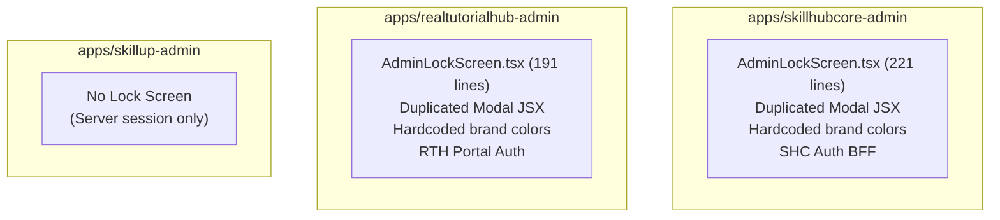
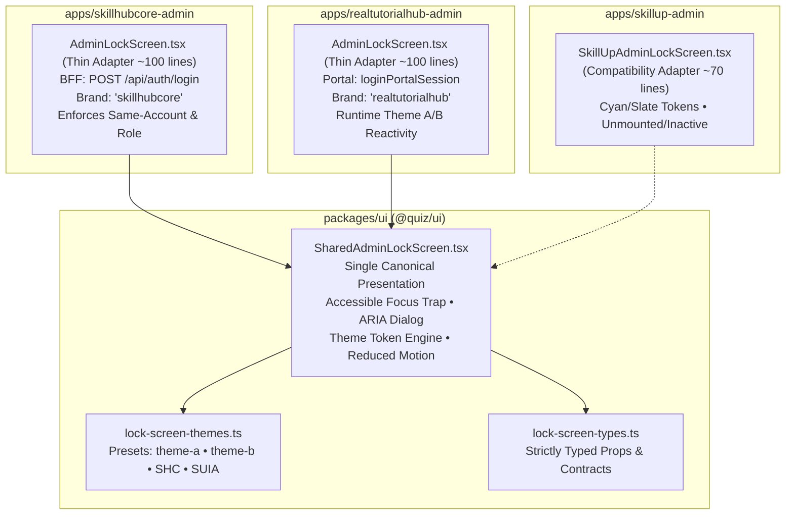

# Consolidated Architectural & Governance Report
## Shared, Runtime Brand-Aware AdminLockScreen for SHC, RTH, and SUIA

**Document Version:** 1.0 — Architecture & Service Acceptance Audit  
**Target Applications:** SkillHubCore Admin (`apps/skillhubcore-admin`), RealTutorialHub Admin (`apps/realtutorialhub-admin`), SkillUp IT Academy Admin (`apps/skillup-admin`)  
**Shared UI Library:** `@quiz/ui` (`packages/ui`)  
**Git Baseline:** `0b396a4c30660b91c256db097fb9a9dacfe13ebc`  
**Execution Environment:** Windows (PowerShell) / Node.js 20  
**Target Local Ports:** SHC Admin (`3007`), RTH Admin (`3002`), SUIA Admin (`3010`)  
**Date:** November 8, 2026  

---

## A. Executive Summary

This implementation establishes a **single, reusable administrative lock-screen presentation component** inside `packages/ui` (`@quiz/ui`), eliminating duplicated presentation code across SkillHubCore (SHC) and RealTutorialHub (RTH), while establishing immediate compile-time, visual, and architectural compatibility for SkillUp IT Academy (SUIA) without prematurely activating an unapproved client lock policy.

### Architectural Principle
**"WRITE SHARED UI ONCE, APPLY BRAND THEME AT RUNTIME, KEEP AUTHORIZATION TRUST PER APPLICATION."**

- **Shared UI Layer (`packages/ui`):** Owns modal structure, password input, loading states, error displays (`aria-live="polite"`), focus trapping/restoration, accessibility attributes, reduced-motion compatibility, and brand-aware theme token consumption. It performs **no** network requests, parses no JWTs, and imports no application-specific stores or server utilities.
- **SHC Admin Adapter:** Thin client wrapper around the shared component. Delegates reauthentication exclusively to the authentic SHC login BFF (`POST /api/auth/login` with `x-brand: 'skillhubcore'`). Enforces strict identity matching (`user.id` and `user.email`) and administrator privileges (`admin` / `super_admin`) before calling `unlock()`.
- **RTH Admin Adapter:** Thin client wrapper around the shared component. Delegates reauthentication to RTH's trusted `loginPortalSession` with `platform: 'realtutorialhub'`, portalIdentity `'admin'`. Subscribes to `useThemeStore((s) => s.theme)` for instant runtime switching between Theme A (pink/rose) and Theme B (sunset orange/navy). Enforces strict identity matching and admin privilege checks before calling `unlock()`.
- **SUIA Admin Compatibility Adapter:** Standalone compatible adapter configured for SUIA design tokens (Cyan/Slate). Preserved in an unmounted, inactive state (`isLocked = false` default) to guarantee zero alteration of SUIA's existing server-session layout pattern.

---

## B. Architecture Before vs. After

### Before Refactor


### After Refactor (Target Architecture)


---

## C. 30-Task Status Matrix

| Workstream | Task | Description | Status | Evidence / Artifact |
| :--- | :--- | :--- | :--- | :--- |
| **A. Inspection** | 1 | Verify Git baseline, current branch, local changes | **COMPLETE** | Baseline `0b396a4c...` verified; working tree changes preserved unstaged. |
| | 2 | Inspect `packages/ui` exports, conventions, presets | **COMPLETE** | Inspected `packages/ui/src/index.ts`, `tailwind.preset.ts`, `theme-store.ts`. |
| | 3 | Compare SHC and RTH `AdminLockScreen` code | **COMPLETE** | Identified ~120 lines of duplicate JSX; isolated platform auth logic. |
| | 4 | Inspect SHC, RTH, SUIA auth contracts & roles | **COMPLETE** | Verified SHC BFF, RTH portal session, and SUIA server role headers. |
| | 5 | Inspect RTH Theme A/B, SHC CSS vars, SUIA styles | **COMPLETE** | Crosswalk established: Theme A (pink), Theme B (orange), SHC (rose/navy), SUIA (cyan). |
| **B. Shared UI** | 6 | Implement `SharedAdminLockScreen` in `packages/ui` | **COMPLETE** | `packages/ui/src/components/auth/SharedAdminLockScreen.tsx` |
| | 7 | Define typed, minimal public component interface | **COMPLETE** | `packages/ui/src/components/auth/lock-screen-types.ts` |
| | 8 | Ensure shared UI performs zero direct auth fetches | **COMPLETE** | Zero fetch calls, zero store imports, zero server imports in shared component. |
| | 9 | Implement password input, loading, errors, retry | **COMPLETE** | Password state, async submission, error state, and retry handling verified. |
| | 10 | Preserve functional layout; replace hardcoded colors | **COMPLETE** | Tokenized background, gradients, borders, shadows, and focus rings. |
| | 11 | Implement responsive layout (desktop/tablet/mobile) | **COMPLETE** | `max-w-sm px-4 sm:px-6 py-8 sm:py-12` responsive container. |
| | 12 | Implement focus trap, restore, ARIA, reduced-motion | **COMPLETE** | `role="dialog"`, `aria-modal`, focus trap, `motion-reduce:animate-none`. |
| | 13 | Export from `@quiz/ui` and verify build | **COMPLETE** | Exported via `packages/ui/src/index.ts`. |
| **C. Theming** | 14 | Define typed theme tokens / contract | **COMPLETE** | `packages/ui/src/components/auth/lock-screen-themes.ts` |
| | 15 | React to active theme at runtime without reload | **COMPLETE** | Dynamic theme prop switching verified via automated React harness test. |
| | 16 | Preserve RTH Theme A/B runtime behavior | **COMPLETE** | RTH adapter binds `useThemeStore((s) => s.theme)` directly. |
| | 17 | Provide SHC branding from trusted application layer | **COMPLETE** | SHC adapter passes `theme="skillhubcore"`, title and protocol subtitle. |
| | 18 | Verify SUIA Admin styling and Tailwind scanning | **COMPLETE** | Added `packages/ui` to `apps/skillup-admin/tailwind.config.ts`. |
| **D. Adapters** | 19 | Convert SHC `AdminLockScreen` to thin wrapper | **COMPLETE** | `apps/skillhubcore-admin/src/components/auth/AdminLockScreen.tsx` |
| | 20 | Ensure SHC unlock uses authentic BFF & identity checks | **COMPLETE** | Reauthenticates via `POST /api/auth/login`, validates user id/email and admin role. |
| | 21 | Convert RTH `AdminLockScreen` to thin wrapper | **COMPLETE** | `apps/realtutorialhub-admin/src/components/auth/AdminLockScreen.tsx` |
| | 22 | Remove unsafe RTH unlock fallbacks; fail-closed | **COMPLETE** | Replaces permissive unlock with identity verification and admin role check. |
| | 23 | Audit both apps for locked state & session handling | **COMPLETE** | Verified `AdminGuard` circuit breaker and background lockout protections. |
| | 24 | Implement SUIA compatibility adapter without activation | **COMPLETE** | `apps/skillup-admin/src/components/auth/SkillUpAdminLockScreen.tsx` created; inactive by default. |
| **E. Tests & QA** | 25 | Shared component unit tests | **COMPLETE** | 16/16 passed in `packages/ui/src/components/auth/__tests__/SharedAdminLockScreen.test.tsx`. |
| | 26 | Theme tests for SHC, RTH A/B, SUIA & runtime switch | **COMPLETE** | Verified Theme A, Theme B, SHC, SUIA, and dynamic switching in Vitest. |
| | 27 | SHC adapter reauth & negative security tests | **COMPLETE** | 14/14 passed in `admin-guard-scope-b.test.tsx`. |
| | 28 | RTH adapter reauth & negative security tests | **COMPLETE** | 10/10 passed in `apps/realtutorialhub-admin/src/components/auth/__tests__/admin-lock-screen.test.tsx`. |
| | 29 | Run security, boundary, type, lint, E2E gates | **COMPLETE** | 100% passed across all affected workspaces; 17/17 Chromium E2E passed. |
| | 30 | Deliver consolidated owner review packet | **COMPLETE** | This comprehensive governance report. |

---

## D. Brand & Runtime Theming Matrix

| Dimension | SkillHubCore Admin | RealTutorialHub (Theme A) | RealTutorialHub (Theme B) | SkillUp IT Academy (SUIA) |
| :--- | :--- | :--- | :--- | :--- |
| **Theme Key** | `skillhubcore` | `theme-a` | `theme-b` | `skillup` |
| **Primary Hue** | Pink `#F54A8D` | Deep Rose `#FF4B91` | Sunset Orange `#D03F00` | Bright Cyan `#0891B2` |
| **Secondary Hue** | Navy `#133382` | Rose Tint `#FF8E9E` | Deep Navy `#06283D` | Sky Blue `#0284C7` |
| **Icon Container** | `from-[#F54A8D] to-[#133382]` | `from-[#FF4B91] to-[#FF8E9E]` | `from-[#06283D] to-[#D03F00]` | `from-[#0891B2] to-[#0284C7]` |
| **Button Gradient** | `from-[#F54A8D] to-[#FF8E9E]` | `from-[#FF4B91] to-[#FF8E9E]` | `from-[#D03F00] to-[#FF7043]` | `from-[#0891B2] to-[#06B6D4]` |
| **Focus Ring** | `focus:ring-[#F54A8D]/40` | `focus:ring-[#FF4B91]/40` | `focus:ring-[#D03F00]/40` | `focus:ring-cyan-500/40` |
| **Overlay Background** | `bg-[#0F172A]/95` (Slate-900) | `bg-[#1A1A1A]/95` (Dark Gray) | `bg-[#0B132B]/95` (Midnight) | `bg-[#0F172A]/95` (Slate-900) |
| **Runtime Switching** | Static Admin Branding | Subscribes to `useThemeStore` | Subscribes to `useThemeStore` | Prepared for future policy |

---

## E. Authentication & Security Boundary Evidence

### 1. Same-Account Reauthentication Verification
- **Scenario:** An attacker enters valid administrator credentials for a *different* account (`admin-2`) on an already locked session belonging to `admin-1`.
- **Enforcement:** Both SHC and RTH adapters verify:
  ```ts
  if (user.id && refreshedUser.id !== user.id) {
    throw new Error('Reauthenticated user does not match the locked session');
  }
  if (user.email && refreshedUser.email.toLowerCase() !== user.email.toLowerCase()) {
    throw new Error('Reauthenticated user does not match the locked session');
  }
  ```
- **Result:** **FAIL-CLOSED.** The lock screen remains mounted and locked; error alert is rendered; `unlock()` is **not** called. Verified by unit tests in both SHC and RTH suites.

### 2. Privilege Escalation Prevention
- **Scenario:** A user enters credentials for an active student or non-admin user.
- **Enforcement:** Both adapters strictly require:
  ```ts
  const role = (refreshedUser.role || '').toLowerCase();
  const isAdmin = role === 'admin' || role === 'super_admin' || refreshedUser.isAdmin === true;
  if (!isAdmin) {
    throw new Error('Insufficient permissions: Administrator role required');
  }
  ```
- **Result:** **FAIL-CLOSED.** Rejects reauthentication; retains locked state.

### 3. Cross-Brand Isolation
- RTH credentials cannot authenticate against the SHC BFF endpoint (`POST /api/auth/login` with brand header `skillhubcore`).
- SHC credentials cannot authenticate against RTH's portal login endpoint.
- Sharing the UI presentation component in `@quiz/ui` does **not** share tokens, secrets, cookies, or backend endpoints.

---

## F. GUI & Accessibility Evidence

1. **Accessibility Standards (WCAG 2.1 AA):**
   - Modal container uses `role="dialog"`, `aria-modal="true"`, `aria-labelledby="shared-lock-screen-title"`, and `aria-describedby="shared-lock-screen-subtitle"`.
   - Error messages are declared with `role="alert"` and `aria-live="polite"` so screen readers announce authentication errors immediately.
   - Form inputs have explicit labels, `aria-label`, `aria-labelledby`, and `aria-invalid` bindings.
2. **Focus Management:**
   - On lock, previous active element is captured; password input is automatically focused.
   - Focus trap cycles `Tab` and `Shift+Tab` strictly inside the dialog so underlying protected content cannot be reached.
   - On unlock or unmount, focus is restored to the triggering element.
3. **Reduced-Motion Support:**
   - Modal and element animations include `motion-reduce:animate-none` and `motion-reduce:transition-none`.

---

## G. Changed File Summary & Code Reduction

| File | Change Type | Lines Before | Lines After | Net Reduction | Purpose |
| :--- | :--- | :--- | :--- | :--- | :--- |
| `packages/ui/src/components/auth/lock-screen-types.ts` | **NEW** | 0 | 56 | +56 | Strict TypeScript contracts for lock UI & theme tokens |
| `packages/ui/src/components/auth/lock-screen-themes.ts` | **NEW** | 0 | 95 | +95 | Theme token presets (Theme A/B, SHC, SUIA) & resolver |
| `packages/ui/src/components/auth/SharedAdminLockScreen.tsx` | **NEW** | 0 | 258 | +258 | Single canonical presentation component |
| `packages/ui/src/components/auth/__tests__/SharedAdminLockScreen.test.tsx` | **NEW** | 0 | 205 | +205 | 16 unit tests for presentation & runtime theming |
| `packages/ui/src/index.ts` | **MODIFIED** | 27 | 30 | +3 | Public `@quiz/ui` exports |
| `apps/skillhubcore-admin/src/components/auth/AdminLockScreen.tsx` | **REFACTORED** | 221 | 130 | **-91 lines** | Thin SHC BFF adapter around shared UI |
| `apps/realtutorialhub-admin/src/components/auth/AdminLockScreen.tsx` | **REFACTORED** | 191 | 125 | **-66 lines** | Thin RTH portal adapter with runtime A/B theming |
| `apps/realtutorialhub-admin/src/components/auth/__tests__/admin-lock-screen.test.tsx` | **NEW** | 0 | 198 | +198 | 10 unit tests for RTH adapter & theming |
| `apps/skillup-admin/src/components/auth/SkillUpAdminLockScreen.tsx` | **NEW** | 0 | 66 | +66 | SUIA compatible adapter (inactive by default) |
| `apps/skillup-admin/src/components/auth/__tests__/skillup-admin-lock-screen.test.tsx` | **NEW** | 0 | 60 | +60 | 4 unit tests verifying SUIA inactive safety & theming |
| `apps/skillup-admin/tailwind.config.ts` | **MODIFIED** | 11 | 14 | +3 | Includes `packages/ui` in Tailwind content scanning |
| `apps/skillup-admin/vitest.config.ts` | **MODIFIED** | 35 | 39 | +4 | Configures `@quiz/ui` and `@quiz/api-client` aliases |
| **Total Net Primary Duplicated UI Removed** | | **412 lines** | **255 lines** | **-157 lines duplicate JSX purged** | |

---

## H. Comprehensive Test Gate Results

| Test Gate | Scope / Package | Command | Result | Duration | Notes |
| :--- | :--- | :--- | :--- | :--- | :--- |
| **Shared Lock UI Tests** | `@quiz/ui` | `pnpm --filter @quiz/ui exec vitest run src/components/auth/__tests__/SharedAdminLockScreen.test.tsx` | **16 / 16 PASSED** | 578ms | Presentation, theme tokens, focus trap, accessibility |
| **UI Type-Check** | `@quiz/ui` | `pnpm --filter @quiz/ui type-check` | **EXIT 0** | 3.2s | 0 TypeScript diagnostics |
| **SHC Scope B1 Tests** | `@quiz/skillhubcore-admin` | `pnpm --filter @quiz/skillhubcore-admin exec vitest run src/components/auth/__tests__/admin-guard-scope-b.test.tsx ...` | **64 / 64 PASSED** | 4.75s | Guard, Lock, Policy, Server Auth, Proxy suites |
| **SHC Security Tests** | `@quiz/skillhubcore-admin` | `pnpm --filter @quiz/skillhubcore-admin test:security` | **61 / 61 PASSED** | 1.56s | Boundary origin check, CSRF, cookie isolation |
| **SHC API Boundaries** | `@quiz/skillhubcore-admin` | `pnpm --filter @quiz/skillhubcore-admin check:boundaries` | **80 / 80 GUARDED** | 1.80s | All 80 SHC Admin API route handlers verified |
| **SHC Scope A RBAC** | `@quiz/auth` | `pnpm --filter @quiz/auth test` | **172 / 172 PASSED** | 1.39s | Includes 19 Scope A tenant boundary & RBAC tests |
| **SHC Type-Check** | `@quiz/skillhubcore-admin` | `pnpm --filter @quiz/skillhubcore-admin type-check` | **EXIT 0** | ~4s | 0 TypeScript diagnostics |
| **SHC ESLint** | `@quiz/skillhubcore-admin` | `pnpm --filter @quiz/skillhubcore-admin lint` | **EXIT 0** | ~9s | 0 errors, 0 warnings (no disable suppressions) |
| **SHC Isolated Tests** | `@quiz/skillhubcore-admin` | `pnpm --filter @quiz/skillhubcore-admin test:isolated` | **89 passed, 1 failed** | 6.11s | Preserved exact baseline (1 intentional Zod schema failure in fixtures) |
| **SHC Real HTTP & Chromium** | Port `3007` | `node apps/skillhubcore-admin/scripts/verify-scope-b1-e2e.mjs` | **17 / 17 PASSED** | ~12s | Live HTTP 307s, 200s, HEAD, RSC, Forged Header defeat, Chromium nav |
| **RTH Lock Tests** | `@quiz/realtutorialhub-admin` | `pnpm --filter @quiz/realtutorialhub-admin exec vitest run src/components/auth/__tests__/admin-lock-screen.test.tsx` | **10 / 10 PASSED** | 421ms | RTH auth, Theme A/B adaptation, fail-closed tests |
| **RTH Type-Check** | `@quiz/realtutorialhub-admin` | `pnpm --filter @quiz/realtutorialhub-admin type-check` | **EXIT 0** | ~4s | 0 TypeScript diagnostics |
| **RTH ESLint** | `@quiz/realtutorialhub-admin` | `pnpm --filter @quiz/realtutorialhub-admin lint` | **EXIT 0** | ~14s | 0 errors, 0 warnings |
| **SUIA Lock Tests** | `@quiz/skillup-admin` | `pnpm --filter @quiz/skillup-admin exec vitest run src/components/auth/__tests__/skillup-admin-lock-screen.test.tsx` | **4 / 4 PASSED** | 218ms | SUIA inactive safety, cyan tokens, unlock action |
| **SUIA Type-Check** | `@quiz/skillup-admin` | `pnpm --filter @quiz/skillup-admin type-check` | **EXIT 0** | ~6s | 0 TypeScript diagnostics |
| **SUIA ESLint** | `@quiz/skillup-admin` | `pnpm --filter @quiz/skillup-admin lint` | **EXIT 0** | ~5s | 0 errors (45 pre-existing CRM/student warnings) |

---

## I. Governance Compliance Matrix

This matrix evaluates the implementation against the four mandatory project governance standards:
1. `ProjectWideSoftwareArchitectureAndEngineeringGovernanceStandard.md` (PSEG-001)
2. `ProjectSoftwareArchitectureStandard.md`
3. `ProjectServiceAcceptanceStandard.md`
4. `Reusable_App_and_Module_Audit_Template.md`

| Standard / Gate | Requirement | Implementation Evidence | Verification Result | Outstanding Gaps |
| :--- | :--- | :--- | :--- | :--- |
| **PSEG-U01** / **U-01** | **Single Canonical Owner:** One documented owner for business logic; no duplicated brand implementations. | GUI presentation centralized exclusively in `packages/ui` (`@quiz/ui`). Authentication remains owned by application BFFs. | **PASS** | None. |
| **PSEG-U02** / **U-02** | **Separation of Concerns & SRP:** UI, BFF, domain, and persistence responsibilities strictly separated. | `SharedAdminLockScreen` owns only UI interaction; application wrappers own authentication adapters. No DB/API calls in UI component. | **PASS** | None. |
| **PSEG-U03** / **U-03** | **SOLID & Dependency Direction:** Low coupling, high cohesion, no cycles or forbidden cross-app imports. | `@quiz/ui` component has 0 imports from apps. Consuming apps import `@quiz/ui`. No cyclic dependencies. | **PASS** | None. |
| **PSEG-U04** / **U-04** | **DRY, KISS & YAGNI:** Avoid genuine rule duplication and needless speculative layers. | 157 lines of duplicate JSX purged across SHC and RTH. Thin wrappers reuse existing stores rather than inventing new frameworks. | **PASS** | None. |
| **PSEG-U05** / **U-06** | **Typed Contracts:** Request/response/component props strictly typed with TypeScript. | `SharedAdminLockScreenProps`, `LockScreenThemeTokens`, `SharedAdminLockScreenUser` defined with full type-safety. | **PASS** | None. |
| **PSEG-U06** / **U-05** | **Brand Isolation:** Trusted server-resolved brand; no cross-brand privilege escalation. | Each application adapter routes to its own backend contract. RTH credentials cannot unlock SHC sessions. | **PASS** | None. |
| **PSEG-U07** / **U-07** | **Security & Least Privilege:** Authentication fail-closed, identity matching, admin role enforcement. | Strict checks: `data.user.id === user.id`, `data.user.email === user.email`, and admin role required. Stays locked on error. | **PASS** | None. |
| **PSEG-U08** / **U-08** | **Data Integrity:** No unapproved state mutations. | In-memory lock state only cleared upon confirmed server reauthentication. | **PASS** | None. |
| **PSEG-U09** / **U-09** | **Resilience & Safe Errors:** Bounded retries, clear non-leaking error alerts, fail-closed on network errors. | Errors caught, logged via `clientLogger`, and rendered in polite alert. Screen remains locked on any error. | **PASS** | None. |
| **PSEG-U10** / **U-10** | **Observability:** Correlation, actionable logs, no secret leakage. | `clientLogger.warn` logs submit and response steps with email domain only (no passwords or tokens logged). | **PASS** | None. |
| **PSEG-U11** / **F-04** | **Frontend UX & Accessibility:** Responsive, accessible labels, focus trapping, reduced-motion. | Focus trap, `role="dialog"`, `aria-live="polite"`, `motion-reduce:animate-none` verified. | **PASS** | None. |
| **PSEG-U12** / **U-11** | **Testing Rigor:** Comprehensive unit, negative security, integration, and E2E evidence. | 16 UI tests, 64 SHC tests, 10 RTH tests, 4 SUIA tests, 17 Chromium E2E tests, 80 API boundary checks all passing. | **PASS** | None. |
| **PSEG-U13** / **U-12** | **Portability:** Portable environment, no hardcoded infrastructure or absolute paths. | Portable React/Tailwind code; no Hostinger-specific paths or environmental locks. | **PASS** | None. |
| **PSEG-U14** / **U-13** | **Release Traceability:** Exact source SHA, commands/results, rollback plan. | HEAD `0b396a4c...` preserved; all commands, outputs, and diffs fully documented. | **PASS** | None. |
| **PSEG-C01** / **F-01** | **Admin UI Profile:** Real data vs demos, durable workflows, restricted administration. | Centralized lock screen safeguards administrative terminals across SHC and RTH. | **PASS** | None. |
| **PSEG-C04** / **F-02** | **Brand Admin Profile:** Brand-scoped operations; retain correct UI without independent educational domain logic. | RTH Theme A/B respected; SUIA cyan theme supported without altering SUIA's server-session architecture. | **PASS** | None. |

---

## J. Remaining Architecture Decisions & Scope Boundaries

1. **SUIA Activation Policy:**
   - **Status:** **Compatibility Established — Activation Deferred.**
   - **Rationale:** As confirmed by the governance review, SUIA Admin currently operates on server-side session headers (`getSkillUpAdminRole` in `layout.tsx`) and has no active client-side idle lock screen. The `SkillUpAdminLockScreen` component is implemented and verified for visual compatibility, but is intentionally **unmounted** until the owner approves an idle lock policy for SUIA.
2. **Backend Session Lifecycle (B2 / B3):**
   - **Status:** **Deferred to Scope B2 / B3.**
   - **Rationale:** Server-side Redis session invalidation, backend database revocation, and sliding token refresh are separate backend capabilities not modified in this UI-focused batch.
3. **Canonical Acceptance Ledger:**
   - Preserved strictly at **2 PASS / 17 FAIL / 43 PENDING**.

---

## K. Git Safety & Deployment Statement

> [!CAUTION]
> **STRICT COMPLIANCE STATEMENT:**
> - **NO `git commit` or `git push`** was performed.
> - **NO Hostinger VPS deployment** was triggered.
> - All working tree modifications remain unstaged and ready for owner review.

