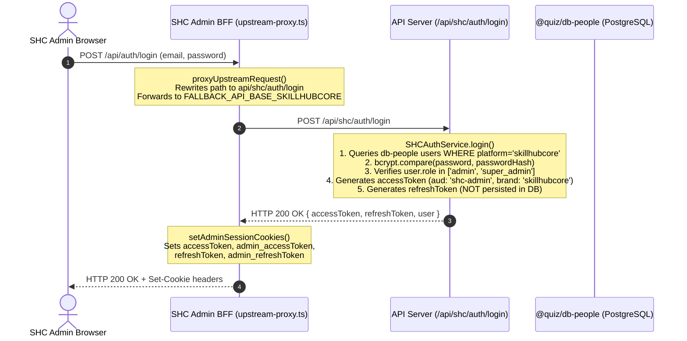

# W1.2-GUARD-01 Principal Qualification & Downstream Authorization Investigation

**Ticket Reference**: `W1.2-GUARD-01`
**Governing Root Cause**: `RC-ID-01`
**Task Type**: Read-Only Architecture & Security Source Investigation
**Implementer**: Gemini 3.8 (Sole authorized worker per Batch 04 instructions)
**Base Commit**: `c51f6a12`
**Working Branch**: `remediation/w1-2-guard-replay-discovery`
**Stage**: `CLOSED` (Source investigation accepted with Sol editorial qualifications; see `W1.2_Batch_04_Sol_Acceptance.md`. Runtime follow-ups and browser qualification remain open.)

---

## 1. Executive Summary

Task A of Gemini Controlled Batch 04 investigates downstream authentication, principal qualification, and resource authorization across the applications in the Elearning Platform:
1. `apps/skillup-web` (SUIA Learner Portal)
2. `apps/realtutorialhub-web` (RTH Learner Portal)
3. `apps/skillup-admin` & `apps/realtutorialhub-admin` (Tenant Admin Portals)
4. `apps/skillhubcore-admin` (SkillHubCore Admin GUI)
5. `apps/api-server` (Central API Server & Resource Engine)
6. Supporting services: `services/skillhubcore-service`, `apps/faculty-app`, `apps/skillhub-placement`

This investigation traces actual producer-to-consumer call graphs from ingress GUI/BFF to cryptographic JWT verification, audience and class enforcement, database resolution, and inspected resource authorization paths.

### Key Discoveries & Findings:
1. **Portal & Principal Separation at Ingress**:
   - Learner web BFFs (`apps/skillup-web`, `apps/realtutorialhub-web`) enforce `verifyUserAccessToken(token, { audience: 'user' })` and reject cross-brand tokens via hostname validation (`src/share-branding/middleware/authProxy.ts:221-231`).
   - Tenant admin BFFs (`apps/realtutorialhub-admin/src/proxy.ts`, `apps/skillup-admin/src/proxy.ts`) read `admin_accessToken` and enforce `verifyAdminAccessToken(token, { audience: 'admin' })`.
2. **LoginService vs. AdminAuthService Role/Audience Derivation**:
   - `LoginService.login` (`apps/api-server/src/modules/auth/login.service.ts:174-191`) derives `isAdmin` and `aud` dynamically from database roles (`roles.includes('admin') || roles.includes('super_admin') || roles.includes('infrastructure')`). An administrator logging in via the generic login route receives tokens with `aud: 'admin'`, `isAdmin: true`, and `tokenType: 'admin'`.
   - `AdminAuthService.login` (`apps/api-server/src/modules/auth/admin-auth.service.ts:32-135`) requires administrative privileges, evaluates `requestedAudience` (`'admin'` vs `'infra'`), and issues admin-scoped tokens.
3. **`RBACService._verifyAdmin` Audience-Agnostic Design & Elevation Protection**:
   - Low-level helper `_verifyAdmin(_payload)` (`apps/api-server/src/modules/auth/rbac.service.ts:11-66`) checks `_payload.isAdmin === true || tokenRoles` and falls back to a database lookup on `userRoles`. It **never checks `_payload.aud` or `_payload.tokenType`**.
   - **Protection in Practice**: The two production callers of `_verifyAdmin`—`requireAdminRouteAccess` (`admin-audience.util.ts:77`) and the API server gateway `proxy.ts:159`—**both** execute `verifyAdminAccessToken(scopedToken, { audience: expectedAud })` **before** invoking `_verifyAdmin`. Thus, existing learner access tokens (`aud: 'user'`, `tokenType: 'user'`) cannot access administrative routes even if the user has been promoted in the database, unless an admin login or admin refresh has occurred.
   - However, if `_verifyAdmin` were invoked directly by an unshielded handler, it would fail open to learner tokens of promoted users.
4. **Three Distinct SkillHubCore & Infrastructure Flows**:
   - **In-process API Server SHC Flow (`apps/api-server`)**: `SHCAuthService.login` (`shc-auth.service.ts:32-158`) checks credentials in `@quiz/db-people`, mints `aud: 'shc-admin'` tokens, but explicitly omits inserting refresh tokens into any database (`shc-auth.service.ts:129-132`).
   - **Specialized Microservice Helpers (`services/skillhubcore-service`)**: `services/skillhubcore-service/src/modules/auth/auth.routes.ts:120` defines `TokenRotationService.rotate`, sub/family tracking, and Redis persistence (`token-rotation.service.ts:32-117`). Crucially, `services/skillhubcore-service/src/index.ts` **does not mount** `createAuthRoutes` in `createApp`. It is unmounted library code, not a registered runtime endpoint.
   - **Generic Infrastructure Flow (`apps/api-server`)**: `POST /api/admin/auth/login` accepts `x-portal-identity: infrastructure` with required tenant brand, enforcing role `'infrastructure'` (`admin-auth.service.ts:94-97`). This is concrete code in the repository; external CLI/cron producers are operational inferences, not proven callers.
5. **SHC Resolver Acceptance & Refresh Route Reality**:
   - `apps/api-server/src/lib/request-brand.ts:1-10, 51-86` **explicitly accepts** `skillhubcore` (`resolveRequestBrand`). `resolveStrictRefreshBrandFromHeaders` returns `{ brand: 'skillhubcore' }` with exit 0; it does not return HTTP 400.
   - In `apps/api-server/src/app/api/auth/refresh/route.ts:25-60`, `x-portal-identity: shc-admin` (or missing) maps to `audience = 'user'`.
   - `brand-db.ts:99-102` maps `brand === 'skillhubcore'` to default `@quiz/db` (not `db-people`).
   - In `TokenRefreshService.refresh`, `findByHash` queries `@quiz/db` where `revoked = false`. For a token issued only by this login method with no matching default-store row, lookup rejects before verification with internal reason `token_not_found` and route HTTP 401. With a matching active row, the route-selected user/admin/infra audience differs from the issued shc-admin audience. This is conditional source analysis, not a browser/deployed database observation.
6. **Inherited Refresh Callers in Shared Client**:
   - `apps/skillhubcore-admin/src/components/auth/AdminGuard.tsx:35` calls `apiClient.client.setPortalIdentity('admin')`.
   - In `packages/api-client/src/core/fetch-client.ts:267-280`, any 401 on an eligible endpoint triggers an automatic POST to `/auth/refresh`.
   - If that refresh fails (401), `fetch-client.ts:290-305` fires `auth:unauthorized`. `AdminGuard.tsx:74-91` catches and cancels this event (`e.preventDefault()`). If locked, it defers to the lock screen; if unlocked, redirects to `/login`.
7. **Bounded Resource Ownership & Storage Reality**:
   - Resource endpoints derive actor identity strictly from verified JWT payloads (`payload.userId`).
   - Inspected route `/api/quiz/submit` (`route.ts:54`) delegates to `ExamEngine.completeExam(examId, payload.userId)`. `ExamEngine` (`exam.engine.ts:1, 455-472`) executes against default `@quiz/db` (not a tenant-isolated database) and checks `if (exam.userId !== userId) throw ...` at line 470.
   - Gateway exemptions (`proxy.ts:61-69`) bypass gateway token checks for health, workflow, tutorial, search, telemetry, security-report, and client-logs routes.

---

## 2. Complete End-to-End Producer-to-Consumer Traces

### Trace 1: SUIA Learner Portal (`apps/skillup-web`)
```mermaid
sequenceDiagram
    autonumber
    actor Learner as SUIA Learner Browser
    participant BFF as SkillUp Web BFF (proxy / student-auth.ts)
    participant APIGW as API Server Gateway (proxy.ts)
    participant Endpoint as API Server Route (/api/quiz/submit)
    participant Engine as ExamEngine (exam.engine.ts)
    participant DB as Default Database (@quiz/db)

    Learner->>BFF: POST /api/quiz/submit (Cookie: accessToken)
    Note over BFF: authProxy.ts resolveUser()<br/>1. TokenService.verifyUserAccessToken(token, { audience: 'user' })<br/>2. Brand Parity: jwtBrand ('skillup') === requestBrand ('skillup')<br/>3. Injects x-user-id from verified payload
    BFF->>APIGW: Forward request with Cookie & x-gateway-secret
    Note over APIGW: proxy.ts line 83-124<br/>1. Reads accessToken cookie<br/>2. verifyUserAccessToken(token, { audience: 'user' })<br/>3. Rejects admin tokens or mismatched audience
    APIGW->>Endpoint: Route execution
    Note over Endpoint: route.ts postHandler()<br/>1. verifyUserAccessToken(token)<br/>2. ExamEngine.completeExam(examId, payload.userId)<br/>Client body userId ignored; verified payload.userId used
    Endpoint->>Engine: completeExam(examId, verifiedUserId)
    Note over Engine: exam.engine.ts:470<br/>if (examWithQuestions.userId !== userId) throw Unauthorized<br/>Storage target: default @quiz/db
    Engine->>DB: Updates exam status in exams table
    Endpoint-->>Learner: HTTP 200 OK (Exam Result)
```

**Source Evidence**:
- BFF Token Verification: `src/share-branding/middleware/authProxy.ts:175` (`TokenService.verifyUserAccessToken(token, { audience: 'user' })`).
- BFF Brand Match: `src/share-branding/middleware/authProxy.ts:221-231` (rejects if `jwtBrand !== requestBrand` with `403 Forbidden: brand_mismatch`).
- Alternate Helper: `apps/skillup-web/src/lib/student-auth.ts:85` (`TokenService.verifyUserAccessToken(token, { audience: 'user' })`).
- API Server Gateway: `apps/api-server/src/proxy.ts:123` (`tokenService.verifyUserAccessToken(_token!, { audience: expectedAudience })`).
- Resource Route: `apps/api-server/src/app/api/quiz/submit/route.ts:28, 54` (`completeExam(examId, payload.userId)`).
- Storage and Ownership: `apps/api-server/src/modules/exam-engine/exam.engine.ts:1, 470` (queries `@quiz/db`, validates `examWithQuestions.userId === userId`).

---

### Trace 2: RTH Learner Portal (`apps/realtutorialhub-web`)
- **Producer**: Learner logs in via `POST /api/auth/login` on `user.realtutorialhub.com`.
- **Token Issued**: `aud: 'user'`, `tokenType: 'user'`, `brand: 'realtutorialhub'`, `isAdmin: false`.
- **Cookie Set**: `accessToken`, `refreshToken` scoped to `.realtutorialhub.com`.
- **BFF Inspection**: `apps/realtutorialhub-web/src/proxy.ts` imports `createAuthProxy` from `src/share-branding/middleware/authProxy.ts`.
- **Enforcement**:
  1. `TokenService.verifyUserAccessToken(token, { audience: 'user' })`.
  2. Compares `payload.brand` ('realtutorialhub') against hostname (`user.realtutorialhub.com`).
  3. If a SUIA token (`brand: 'skillup'`) is sent to RTH, line 223 rejects with `{ type: 'forbidden', reason: 'brand_mismatch' }` and returns HTTP 403 Forbidden.
- **Downstream Route**: e.g., `apps/api-server/src/app/api/reports/route.ts:68-95`:
  - Calls `verifyUserAccessToken(token)`.
  - Calls `validateBrandOrThrow({ brand: payload?.brand, userId: payload?.userId }, req)` (line 72).
  - Queries `exams` row and enforces `if (examCheck.userId !== userId) throw forbidden('Forbidden: ownership mismatch')`.

---

### Trace 3: Tenant Administrators (SUIA & RTH Admin Portals)
- **Portals**: `apps/skillup-admin` (`admin.skillupitacademy.com`), `apps/realtutorialhub-admin` (`admin.realtutorialhub.com`).
- **Ingress Route**: `POST /api/admin/auth/login` (`apps/api-server/src/app/api/admin/auth/login/route.ts:32-47`).
- **Service**: `AdminAuthService.login` (`admin-auth.service.ts:32-159`):
  - Checks lockout on tenant `loginAttempts` table.
  - Queries `brandContext.tables.users` joined with `userRoles` and `roles`.
  - Checks password hash via `PasswordService.compare`.
  - Verifies `isAdmin = roleNames.includes('admin') || roleNames.includes('super_admin') || roleNames.includes('infrastructure')`. Throws HTTP 401 `Unauthorized: Governance Privileges Required` if false.
  - Issues tokens with `aud: 'admin'`, `tokenType: 'admin'`, `isAdmin: true`, `brand: brand`.
  - Sets cookies `admin_accessToken` and `admin_refreshToken`.
- **Admin BFF Verification**:
  - `apps/realtutorialhub-admin/src/proxy.ts:37, 79`:
    ```ts
    export function getAccessToken(request: NextRequest): string | undefined {
      return request.cookies.get('admin_accessToken')?.value;
    }
    const payload = await TokenService.verifyAdminAccessToken(token, { audience: 'admin' });
    ```
  - Rejects if `admin_accessToken` is missing, expired, or has `aud !== 'admin'` or `tokenType !== 'admin'`.
- **API Server Gateway & Route Guard**:
  - `apps/api-server/src/proxy.ts:93-96`: Sets `scope = 'admin'`, `expectedAudience = 'admin'`.
  - `apps/api-server/src/proxy.ts:122`: `verifyAdminAccessToken(_token, { audience: 'admin' })`.
  - `apps/api-server/src/modules/auth/admin-audience.util.ts:59-88`: `requireAdminRouteAccess(_req)` verifies `verifyAdminOrInfraToken(_req)` then calls `_verifyAdmin(payload)`.

---

### Trace 4: In-Process API Server SHC Flow (`apps/api-server`)


**Source Evidence**:
- SHC BFF Proxy: `apps/skillhubcore-admin/src/app/api/auth/login/route.ts:13-26`.
- Cookie Setter: `apps/skillhubcore-admin/src/lib/admin-session-cookies.ts:5-10`.
- API Server SHC Handler: `apps/api-server/src/app/api/shc/auth/login/route.ts:40-55`.
- Database Target: `apps/api-server/src/modules/auth/shc-auth.service.ts:1, 38-48` (`import { db, users } from '@quiz/db-people'`).
- Non-persistence of Refresh Token: `apps/api-server/src/modules/auth/shc-auth.service.ts:129-132`.
- Gateway Route Handling: `apps/api-server/src/proxy.ts:87-89, 133-147` (`portalIdentity === 'shc-admin'` requires `payload.brand === 'skillhubcore'`, `payload.isAdmin === true`, and admin role).

---

### Trace 5: Specialized SHC Service Helpers (`services/skillhubcore-service`)
- **Location**: `services/skillhubcore-service/src/modules/auth/auth.routes.ts:120`.
- **Implementation**: Defines `POST /refresh` delegating to `AuthService.refresh` (`auth.service.ts:159`), which calls `TokenRotationService.rotate` (`token-rotation.service.ts:32-117`).
- **Features**:
  - Verifies token signature with `verifySkillHubCoreRefreshToken`.
  - Checks token family persistence via `findTokenFamilyByFamilyId` (`user.repository.ts:301+`).
  - Queries Redis key `skillhubcore:refresh:${familyId}`. If Redis contains a different token, marks family compromised, calls `revokeAllSessions(sub, 'compromised_family')` in `db-people`, and logs audit failure.
  - If family is compromised or session is revoked, terminates all sessions.
- **Architectural Status**:
  - In `services/skillhubcore-service/src/index.ts:26-31`, `createApp` registers:
    - `/public/marketing` (`createMarketingRoutes()`)
    - `/admin/users` (`createSsoRoutes(ssoService)`)
    - `/consumers` (`createSkillhubcoreEventRoutes(...)`)
    - `/api/hierarchy` (`createHierarchyRoutes(hierarchyService)`)
  - **`createAuthRoutes` is NOT mounted anywhere in `createApp`!**
  - Therefore, this specialized family/Redis rotation represents implemented and unit-tested library code, not a registered runtime endpoint. It must not be cited as a deployed browser journey.

---

### Trace 6: Generic Infrastructure Principal (`apps/api-server`)
- **Login Handler**: `POST /api/admin/auth/login` (`apps/api-server/src/app/api/admin/auth/login/route.ts:32-47`).
- **Scope & Role**:
  - Request sends `x-portal-identity: infrastructure` and required tenant brand (`admin-auth.service.ts:94-97`).
  - Requires user to possess role `'infrastructure'`.
  - Issues tokens with `aud: 'infra'`.
- **Cookie Scope**: `infra_accessToken` and `infra_refreshToken` (`TokenService.getAccessToken` options `{ scope: 'infrastructure' }`).
- **Gateway Enforcement**:
  - `apps/api-server/src/proxy.ts:90-92`: Sets `scope = 'infrastructure'`, `expectedAudience = 'infra'`.
  - `apps/api-server/src/proxy.ts:121-122`: Calls `tokenService.verifyAdminAccessToken(_token, { audience: 'infra' })`.
  - `apps/api-server/src/proxy.ts:148-157`: Verifies `PERMISSIONS.ADMIN_PANEL`.
- **Refresh Path**:
  - `POST /api/auth/refresh` reads `infra_refreshToken` cookie (`refresh/route.ts:55`).
  - Evaluates `portalIdentity === 'infrastructure'`, sets `isScopedTenant = false`.
  - Preserves claims and issues fresh `infra_accessToken` and `infra_refreshToken`.
- **Caller Qualification**: The route and service exist concretely in code. Calling by cron scripts or CLI tools is an operational hypothesis; no production cron runner was verified in source.

---

## 3. LoginService vs. AdminAuthService Authority Analysis

| Attribute | `LoginService.login` | `AdminAuthService.login` |
|---|---|---|
| **Location** | `apps/api-server/src/modules/auth/login.service.ts` | `apps/api-server/src/modules/auth/admin-auth.service.ts` |
| **HTTP Route Caller** | `POST /api/auth/login` | `POST /api/admin/auth/login` |
| **Intended Portal** | Generic portal / learner web ingress | Dedicated administrative & infrastructure portal |
| **Role Inspection** | Queries `user.userRoles`; maps to `roleNames` | Queries `users` joined with `userRoles` and `roles` |
| **`isAdmin` Derivation** | `roles.some(['admin', 'super_admin', 'infrastructure'])` | `roles.some(['admin', 'super_admin', 'infrastructure'])` |
| **Non-Admin Rejection** | None (learners succeed with `isAdmin: false`) | **Fails closed** with `Unauthorized: Governance Privileges Required` |
| **Audience Selection** | `aud = isAdmin ? 'admin' : 'user'` (solely role-driven) | Explicit parameter `requestedAudience` (`'admin'` or `'infra'`) |
| **Infra Role Enforcement** | None (treats `infrastructure` as admin) | **Strictly enforces** `roleNames.includes('infrastructure')` for `'infra'` aud |
| **Token Claims Issued** | `tokenType: isAdmin ? 'admin' : 'user'` | `tokenType: 'admin'`, `isAdmin: true` |
| **Cookies Issued** | `accessToken` / `refreshToken` (or `admin_*` if `isAdmin`) | Returns tokens in JSON body; caller sets `admin_*` or `infra_*` cookies |

### Architectural Implication:
Because `LoginService.login` derives `aud` and `isAdmin` purely from current DB roles, an administrator logging in via the generic learner login endpoint `POST /api/auth/login` will receive admin-scoped tokens (`aud: 'admin'`, `tokenType: 'admin'`). Conversely, a learner receives strictly `aud: 'user'`, `tokenType: 'user'`, and `isAdmin: false`.

---

## 4. `RBACService._verifyAdmin` & Elevation Protection Analysis

### Function Definition (`apps/api-server/src/modules/auth/rbac.service.ts:11-66`):
```ts
export async function _verifyAdmin(_payload: TokenPayload): Promise<boolean> {
    const tokenRoles = _payload.roles !== undefined && _payload.roles.some(r =>
        ['admin', 'super_admin', 'infrastructure'].includes(r.toLowerCase())
    );
    const isAdminInToken = _payload.isAdmin === true || tokenRoles;
    const brand = _payload.brand === 'skillup' ? 'skillup' : 'realtutorialhub';
    const authContext = shouldUseBrandBinding()
        ? getAuthBrandContext(brand as RequestBrand)
        : getAuthBrandContext('realtutorialhub');

    // 0. Security: Check if user is blocked in DB
    ...
    // 1. JWT Payload Check (Fast Path)
    if (isAdminInToken === true) {
        return true;
    }

    // 2. Database Verification (Fallback)
    const userRole = await authContext.db.select()...
        .where(and(
            eq(authContext.tables.userRoles.userId, _payload.userId),
            sql`lower(${authContext.tables.roles.name}) IN ('admin', 'super_admin', 'infrastructure')`
        )).limit(1);

    return userRole.length > 0;
}
```

### Analysis of Invariants:
1. **Audience-Agnostic Design**:
   `_verifyAdmin` takes `_payload: TokenPayload` and checks `isAdminInToken` or queries `userRoles`. It **never checks** `_payload.aud === 'admin'` and **never checks** `_payload.tokenType === 'admin'`.
2. **Elevated Session Risk if Unshielded**:
   If a user holds a valid learner session (`aud: 'user'`, `tokenType: 'user'`), and an administrator subsequently grants that user an `admin` role in the tenant database, Step 2 of `_verifyAdmin` will query `userRoles`, find the new role, and return `true`.
3. **Upstream Caller Mitigations**:
   Only two production call sites invoke `_verifyAdmin` across `apps/`, `packages/`, and `services/`:
   - **`requireAdminRouteAccess`** (`apps/api-server/src/modules/auth/admin-audience.util.ts:62-77`):
     Calls `verifyAdminOrInfraToken(_req)` first. This invokes `container.get(TokenService).verifyAdminAccessToken(scopedToken, { audience: expectedAud })`. That call strictly enforces `aud: 'admin'` and `tokenType: 'admin'`. Any learner token (`aud: 'user'`) is rejected immediately with `Audience mismatch: expected admin` or `Invalid admin token type`.
   - **Gateway `proxy.ts`** (`apps/api-server/src/proxy.ts:121-165`):
     Evaluates `scope === 'admin'`, calls `tokenService.verifyAdminAccessToken(_token, { audience: 'admin' })` at line 122 before line 159 calls `_verifyAdmin(_payload)`. Learner tokens are rejected at line 122.
4. **Conclusion**:
   Existing learner access tokens cannot access administrative routes even if the user has been promoted in the database. However, this relies on callers invoking `verifyAdminAccessToken` first. Adding direct audience checking to `_verifyAdmin` provides defense-in-depth.

---

## 5. SkillHubCore (SHC) Admin Flow, Key Fallbacks, and Refresh Reality

### 5.1 In-Process API Server SHC Flow (`apps/api-server`)
- **Route**: `POST /api/shc/auth/login` in `apps/api-server`.
- **Credential/user lookup**: `@quiz/db-people` (`shc-auth.service.ts:1`). This is not a claim that every side effect uses that store: its `AuditService.log(..., brand: 'skillhubcore')` resolves through the default auth context. No refresh-token row is inserted by this login method.
- **Roles**: Must be `user.role === 'admin' || user.role === 'super_admin'`.
- **Claims Issued**: `aud: 'shc-admin'`, `brand: 'skillhubcore'`, `isAdmin: true`, `tokenType: 'admin'`.

### 5.2 Refresh Token Non-Persistence
- `shc-auth.service.ts:117-132` calls `tokenService.generateRefreshToken(...)`, but contains the following comment:
  ```ts
  // Note: We're not storing refresh tokens in people_db
  // They'll be stored in the default database for now
  // This is acceptable since refresh tokens are short-lived
  ```
  Crucially, the code **omits the database insert entirely**. No row is inserted into `people_db`, `@quiz/db`, or tenant databases.

### 5.3 Brand Resolver Acceptance & Refresh Failure Chain
- **Strict Brand Resolver**:
  `apps/api-server/src/lib/request-brand.ts:1-10, 51-86` explicitly includes `skillhubcore` in `RequestBrand` and resolves it via `resolveRequestBrand`.
  Executing `resolveStrictRefreshBrandFromHeaders` with `x-brand: skillhubcore` returns `{ brand: 'skillhubcore' }` with exit 0. It does **not** return HTTP 400.
- **Refresh Route Failure Chain (`POST /api/auth/refresh`)**:
  1. `refresh/route.ts:25-26`: Reads `portalIdentity = _req.headers.get('x-portal-identity') ?? 'user'`. Unless `x-portal-identity: infrastructure` or `admin` is passed, `audience` defaults to `'user'`.
  2. `refresh/route.ts:31-41`: Calls `resolveStrictRefreshBrandFromHeaders(_req.headers)`. Resolves `requestBrand = 'skillhubcore'`.
  3. `refresh/route.ts:51-55`: Selects cookie (`refreshToken`, `admin_refreshToken`, or `infra_refreshToken`).
  4. `refresh/route.ts:81`: Calls `AuthService.refresh(...)`.
  5. `brand-db.ts:99-102`: `getAuthBrandContext('skillhubcore')` selects default `@quiz/db` (not `db-people`).
  6. `token-refresh.service.ts:60-68`: `brandTokenRepo.findByHash(oldTokenHash)` queries `refresh_tokens` in `@quiz/db` `WHERE token = oldTokenHash AND revoked = false`. For a token issued by this method with no matching default-store row, lookup returns null (internal reason token_not_found) and the route rejects with HTTP 401. Other persistence producers and deployed database contents were not tested.
  7. With a matching active row, signature/audience verification follows. The generic route selects user/admin/infra, not shc-admin; an otherwise valid SHC token therefore fails audience parity.

### 5.4 Inherited Refresh Callers in Shared Client
- **Client Configuration**: `apps/skillhubcore-admin/src/components/auth/AdminGuard.tsx:35` sets:
  ```ts
  apiClient.client.setPortalIdentity('admin');
  ```
- **Automatic Refresh**: `packages/api-client/src/core/fetch-client.ts:267-280` intercepts 401 responses on eligible endpoints and automatically issues `POST /auth/refresh` using `globalRefreshPromise`.
- **Unauthorized Event Handling**:
  - `fetch-client.ts:290-305`:
    ```ts
    if (response.status === 401) {
      if (typeof window !== 'undefined') {
        const event = new CustomEvent('auth:unauthorized', { cancelable: true });
        const shouldRedirect = window.dispatchEvent(event);
        ...
        if (shouldRedirect && !isLoginPage && !isAlreadyRedirecting) {
          window.location.href = `/login?redirect=${redirectUrl}&reason=session_expired`;
        }
      }
    }
    ```
  - `AdminGuard.tsx:74-91` registers a listener on `auth:unauthorized` and calls `e.preventDefault()`, setting `shouldRedirect = false`.
  - If `isLocked === true`, `AdminGuard` defers to the lock screen protocol; if unlocked, redirects to `/login` without query parameters.

**Shared-client destination limits:** `packages/api-client/src/index.ts:18-40` selects `/api` for its listed learner hosts, otherwise normalizes `NEXT_PUBLIC_API_URL` when supplied and defaults to `/api`. `FetchClient.performRequest` appends `/auth/refresh` to that configured base and sends the configured portal identity (`fetch-client.ts:164-181`). Thus SHC has inherited refresh-call logic, but its deployed destination is not established here. No GUI-local refresh route or general rewrite is present in the inspected SHC app/next.config.mjs; reaching the central refresh route depends on configured upstream routing. No environment secrets or live endpoints were inspected.

### 5.5 Key Fallbacks & Cryptographic Boundaries
In `packages/auth/src/token.service.ts:81-93`:
```ts
static ACCESS_SECRET = new TextEncoder().encode(readEnv('JWT_SECRET') ?? 'test-access-secret');
static REFRESH_SECRET = new TextEncoder().encode(readEnv('JWT_REFRESH_SECRET') ?? 'test-refresh-secret');
static ADMIN_SECRET = new TextEncoder().encode(
  readEnv('ADMIN_JWT_SECRET') ?? readEnv('JWT_SECRET') ?? 'test-admin-secret'
);
```
- **Fallback Risk**: If `ADMIN_JWT_SECRET` is omitted and `JWT_SECRET` is configured, admin and learner access tokens share the access signing key. Learner refresh tokens use `JWT_REFRESH_SECRET`; no deployed key equality is established by these fallback definitions.
- **Defense Relying on Claims**: When secrets share a key, cross-scope security depends strictly on `aud`, `tokenType`, and `isAdmin` claim validation.

---

## 6. Authority & Verification Matrix

| Principal Class | Ingress Host / Origin | Auth Method | Issued `aud` | Issued `tokenType` | Cookie Names | Downstream Verifier | Resource Ownership Check |
|---|---|---|---|---|---|---|---|
| **SUIA Learner** | `user.skillupitacademy.com` | `LoginService.login` (`brand: 'skillup'`) | `user` | `user` | `accessToken`, `refreshToken` | `verifyUserAccessToken(aud: 'user')` | `payload.userId` enforced; brand matched |
| **RTH Learner** | `user.realtutorialhub.com` | `LoginService.login` (`brand: 'realtutorialhub'`) | `user` | `user` | `accessToken`, `refreshToken` | `verifyUserAccessToken(aud: 'user')` | `payload.userId` enforced; brand matched |
| **SUIA Tenant Admin** | `admin.skillupitacademy.com` | `AdminAuthService.login` (`brand: 'skillup'`) | `admin` | `admin` | `admin_accessToken`, `admin_refreshToken` | `verifyAdminAccessToken(aud: 'admin')` + `_verifyAdmin` | Tenant-local blocked-user check; token-role fast path or DB-role fallback |
| **RTH Tenant Admin** | `admin.realtutorialhub.com` | `AdminAuthService.login` (`brand: 'realtutorialhub'`) | `admin` | `admin` | `admin_accessToken`, `admin_refreshToken` | `verifyAdminAccessToken(aud: 'admin')` + `_verifyAdmin` | Tenant-local blocked-user check; token-role fast path or DB-role fallback |
| **SHC Admin** | Owner target `skillhubcore.in`; deployment untested | `SHCAuthService.login` (`brand: 'skillhubcore'`) | `shc-admin` | `admin` | `accessToken`, `admin_accessToken`, `refreshToken`, `admin_refreshToken` | `verifyAdminAccessToken(aud: 'shc-admin')` | People-store login role check; later route authorization is separately traced |
| **Generic Infra** | Concrete admin/auth/login route; CLI/cron producers unverified | `AdminAuthService.login` (`aud: 'infra'`) | `infra` | `admin` | `infra_accessToken`, `infra_refreshToken` | `verifyAdminAccessToken(aud: 'infra')` | Portal/path-specific permission checks; not a universal infra-resource guarantee |

---

## 7. Authoritative Host Matrix & Discovered Endpoints

### 7.1 Authoritative Six-Host Owner Matrix (from REFRESH-05 Section 7)
The following six environment hostnames represent the accepted authority matrix established in `W1.2-REFRESH-05_Authority_Contract.md` Section 7:

| Portal / Tenant Scope | Production Hostname | Local Hostname | Expected Cookie Domain Setting | Status in Batch 04 |
|---|---|---|---|---|
| **SUIA Learner Web** | `user.skillupitacademy.com` | `skillup.localhost:<port>` | `.skillupitacademy.com` / host-only | Source verified; browser journey unexecuted |
| **RTH Learner Web** | `user.realtutorialhub.com` | `realtutorialhub.localhost:<port>` | `.realtutorialhub.com` / host-only | Source verified; browser journey unexecuted |
| **SkillHubCore Portal** | `skillhubcore.in` | `skillhubcore.localhost:<port>` | Host-only (explicitly clears `.skillhubcore.in`) | Source verified; browser journey unexecuted |

### 7.2 Source-Discovered Administrative & API Endpoints (Separate Inspection)
The following administrative/API names and fixed-port examples are retained as candidate configuration references from the investigation, not an authoritative or deployment-verified mapping. Their exact source provenance and reachability remain unqualified; use the owner matrix above and variable <port> for acceptance:

| Portal / Component | Production Endpoint | Local Endpoint | Primary Auth Token / Cookie |
|---|---|---|---|
| **SUIA Admin Portal** | `admin.skillupitacademy.com` | `admin-skillup.localhost:3002` | `admin_accessToken` / `admin_refreshToken` |
| **RTH Admin Portal** | `admin.realtutorialhub.com` | `admin-rth.localhost:3001` | `admin_accessToken` / `admin_refreshToken` |
| **SHC Admin Portal** | `admin.skillhubcore.in` | `skillhubcore.localhost:3007` | `admin_accessToken` / `admin_refreshToken` |
| **Central API Server** | `api.skillhubcore.in` | `localhost:4000` | Header `Authorization: Bearer` / Scoped Cookies |

---

## 8. Bounded Resource Authorization, Storage Reality & Gateway Exceptions

### 8.1 Resource Authorization Bounded to Inspected Routes
Resource ownership claims must not be extrapolated universally across the entire API server. Based strictly on inspected route handlers:
- **`POST /api/quiz/submit`** (`apps/api-server/src/app/api/quiz/submit/route.ts:54`):
  Delegates `examId` and `payload.userId` to `container.get(ExamEngine).completeExam(examId, payload.userId)`.
  At `apps/api-server/src/modules/exam-engine/exam.engine.ts:470`, it explicitly enforces:
  ```ts
  if (examWithQuestions.userId !== null && examWithQuestions.userId !== undefined && examWithQuestions.userId !== '' && userId !== examWithQuestions.userId) {
    throw new Error('Unauthorized');
  }
  ```
- **`GET /api/reports`** (`apps/api-server/src/app/api/reports/route.ts:68-95`):
  Derives `userId` from verified token payload, calls `validateBrandOrThrow`, and checks that the requested exam belongs to the verified user.

### 8.2 Database Storage Reality (`@quiz/db` vs Tenant DBs)
- Although tenant authentication queries brand-bound tables via `brand-db.ts`, core exam runtime services like `ExamEngine` import directly from default `@quiz/db` (`exam.engine.ts:1`).
- Therefore, exam submissions are stored in the default database, not isolated tenant databases. JWT-derived identity guarantees actor authenticity, but does not imply physical database isolation for exam records.

### 8.3 Gateway Middleware Exemptions & Internal Bypass Keys
In `apps/api-server/src/proxy.ts:61-69`, the following routes are explicitly exempt from the gateway authentication check (`isGatewayExemptRoute`):
- Health check endpoints: `/api/health`, `/api/health/live`, `/api/health/ready`
- Workflow endpoints: `/api/workflows*`, `/api/export/workflow*`
- Authentication routes: `/api/auth*`, `/api/shc/auth*`, `/api/admin/auth*`
- Tutorial routes: `/api/tutorial*`
- Search & Telemetry: `/api/search`, `/api/telemetry`
- Operational logging: `/api/logs/client`, `security/report`

The active `apps/api-server/src/proxy.ts:99-117` has a distinct system bypass: `x-internal-key` matching `INTERNAL_API_KEY`, or `Authorization: Bearer <CRON_SECRET>` matching the configured cron secret. That condition skips this proxy's token block, not necessarily downstream route guards. Do not conflate it with the separate `gateway-auth.middleware.ts` helper, whose `x-internal-secret`/`x-gateway-secret` check establishes an internal transport credential and does not itself verify a user cookie. Deployment reachability and header sanitation remain unverified.

---

## 9. Proposed Invariant & Regression Test Matrix (Future Design)

The following tests are proposed for future implementation when runtime changes are authorized by Sol (none have been executed in this read-only ticket):

| Test ID | Target Component | Proposed Condition | Expected Invariant |
|---|---|---|---|
| **PROP-GUARD-01** | `RBACService._verifyAdmin` | Pass payload with `aud: 'user'`, `isAdmin: false`, but user has admin role in DB | Must return `false` unless `aud: 'admin'` or `'infra'`. |
| **PROP-GUARD-02** | `request-brand.ts` | Pass `x-brand: skillhubcore` to `resolveStrictRefreshBrandFromHeaders` | Returns `{ brand: 'skillhubcore' }` with exit 0 (confirming resolver acceptance). |
| **PROP-GUARD-03** | `POST /api/auth/refresh` | Supply valid brand headers, the route-selected refresh cookie and an SHC JWT absent from an isolated default-store fixture | Resolver accepts skillhubcore; service rejects with HTTP 401 and internal audit reason token_not_found. A separate fixture row can exercise the user/admin versus shc-admin audience mismatch. |
| **PROP-GUARD-04** | `ExamEngine.completeExam` | Call `completeExam` with mismatched `userId` | Throws `Unauthorized` at `exam.engine.ts:470`. |
| **PROP-GUARD-05** | `fetch-client.ts` + `AdminGuard` | Simulate 401 with `isLocked: true` | `auth:unauthorized` default prevented; does not redirect to `/login`. |

---

## 10. Minimal Proposed Follow-Up Implementation Scope (When Authorized)

Batch 04 is strictly documentation-only. When implementation is subsequently authorized by Sol, the following minimal, surgical changes are recommended:
1. **`apps/api-server/src/modules/auth/rbac.service.ts`**:
   - Consider an explicit audience/class precondition for this tenant helper, preserving verified caller behavior and array-valued JWT audience compatibility where applicable. Its current executable callers reach it in tenant admin scope; infra and shc-admin have separate branches.
   - Do not send SHC people IDs or infrastructure principals into the tenant role lookup merely by adding them to an audience allowlist. A future ticket must define the exact precondition and negative tests before implementation.
2. **`apps/api-server/src/modules/auth/login.service.ts`**:
   - For learner portal logins, explicitly bind `requestedAudience: 'user'` so that an administrative user logging in through the public learner portal is issued a learner session (`aud: 'user'`, `isAdmin: false`), maintaining strict session-purpose separation.
3. **`apps/api-server/src/modules/auth/shc-auth.service.ts`**:
   - SHC refresh support needs an explicit store/principal/audience/cookie decision and a demonstrated GUI caller route. Persistence in people_db is not approved by this investigation. The current generic access-token default is 8 hours; do not describe it as a newly accepted short-lived or immediate-revocation policy.

---

## 11. Status and Governance Declaration

- **Ticket**: `W1.2-GUARD-01`
- **Current Status**: `CLOSED` (Investigation accepted; not a claim of runtime remediation).
- **Independent Review**: Codex / Sol source review of da6c0742 with final documentation qualifications; see Batch 04 acceptance.
- **Acceptance Authority**: ChatGPT Sol.
- **Scope Commitment**: No production code, tests, schemas, or configurations were modified in this ticket.
