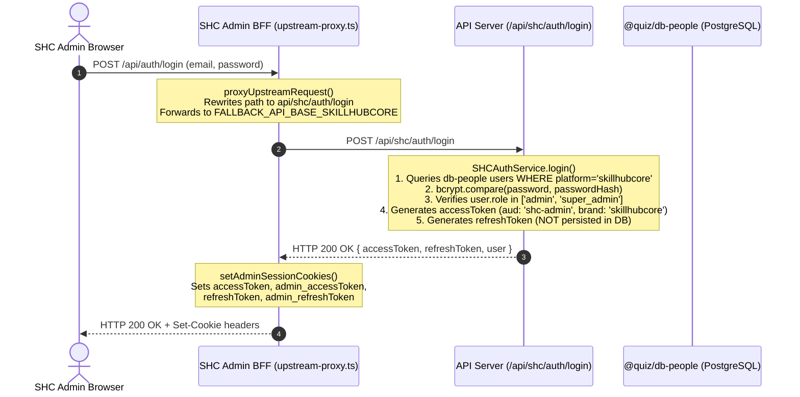

# W1.2-GUARD-01 Principal Qualification & Downstream Authorization Investigation

**Ticket Reference**: `W1.2-GUARD-01`  
**Governing Root Cause**: `RC-ID-01`  
**Task Type**: Read-Only Architecture & Security Source Investigation  
**Implementer**: Gemini 3.8 (Sole authorized worker per Batch 04 instructions)  
**Base Commit**: `c51f6a12`  
**Working Branch**: `remediation/w1-2-guard-replay-discovery`  
**Stage**: `IMPLEMENTED_UNVERIFIED` (Investigation complete; pending distinct read-only review and Sol acceptance)  

---

## 1. Executive Summary

Task A of Gemini Controlled Batch 04 performs an exhaustive, source-backed investigation into downstream authentication and resource authorization across all applications in the Elearning Platform:
1. `apps/skillup-web` (SUIA Learner Portal)
2. `apps/realtutorialhub-web` (RTH Learner Portal)
3. `apps/skillup-admin` & `apps/realtutorialhub-admin` (Tenant Admin Portals)
4. `apps/skillhubcore-admin` (SkillHubCore Admin GUI)
5. `apps/api-server` (Central API Server & Resource Engine)
6. Supporting portals: `apps/faculty-app`, `apps/skillhub-placement`

This investigation traces actual producer-to-consumer call graphs from ingress GUI/BFF to cryptographic JWT verification, audience and class enforcement, tenant database resolution, and final resource-level authorization.

### Key Discoveries & Findings:
1. **Portal & Principal Separation at Ingress**:
   - Learner web BFFs (`apps/skillup-web`, `apps/realtutorialhub-web`) enforce `verifyUserAccessToken(token, { audience: 'user' })` and reject cross-brand tokens via hostname validation (`src/share-branding/middleware/authProxy.ts:221-231`).
   - Tenant admin BFFs (`apps/realtutorialhub-admin/src/proxy.ts`, `apps/skillup-admin/src/proxy.ts`) strictly read `admin_accessToken` and enforce `verifyAdminAccessToken(token, { audience: 'admin' })`.
2. **LoginService vs. AdminAuthService Role/Audience Derivation**:
   - `LoginService.login` (`apps/api-server/src/modules/auth/login.service.ts:174-191`) determines `isAdmin` and `aud` dynamically from database roles (`roles.includes('admin') || roles.includes('super_admin') || roles.includes('infrastructure')`). If an administrator logs in via the generic login route, it issues tokens with `aud: 'admin'`, `isAdmin: true`, and `tokenType: 'admin'`.
   - `AdminAuthService.login` (`apps/api-server/src/modules/auth/admin-auth.service.ts:32-135`) requires the user to already hold administrative privileges, validates `requestedAudience` (`'admin'` vs `'infra'`), and issues admin-scoped tokens.
3. **`RBACService._verifyAdmin` Audience-Agnostic Design & Elevation Protection**:
   - Low-level helper `_verifyAdmin(_payload)` (`apps/api-server/src/modules/auth/rbac.service.ts:11-66`) checks `_payload.isAdmin === true || tokenRoles` and falls back to a database lookup on `userRoles`. It **never checks `_payload.aud` or `_payload.tokenType`**.
   - **Protection in Practice**: The two production callers of `_verifyAdmin`—`requireAdminRouteAccess` (`admin-audience.util.ts:77`) and the API server gateway `proxy.ts:159`—**both** execute `verifyAdminAccessToken(scopedToken, { audience: expectedAud })` **before** invoking `_verifyAdmin`. Thus, existing learner access tokens (`aud: 'user'`, `tokenType: 'user'`) cannot access administrative routes even if the user has been promoted in the database, unless a new admin login or admin refresh has occurred.
   - However, if `_verifyAdmin` is ever invoked directly by a custom handler without `verifyAdminAccessToken`, it will fail open to learner tokens of promoted users.
4. **SkillHubCore (SHC) Admin Flow & Refresh Reality**:
   - SHC Admin GUI logs in via `proxyUpstreamRequest` -> `POST /api/shc/auth/login` -> `SHCAuthService.login` (`apps/api-server/src/modules/auth/shc-auth.service.ts:32-158`), which authenticates against `@quiz/db-people`.
   - `SHCAuthService.login` generates an access token (`aud: 'shc-admin'`) and a refresh token, but **explicitly does not insert the refresh token into any database** (`shc-auth.service.ts:129-131`).
   - `apps/skillhubcore-admin` sets both access and refresh cookies (`admin-session-cookies.ts:5-10`), but has **no refresh caller or refresh route**. Furthermore, if an SHC refresh were attempted on `POST /api/auth/refresh`, it would be rejected immediately with HTTP 400 Bad Request by `resolveStrictRefreshBrandFromHeaders` because `brand !== 'skillup' && brand !== 'realtutorialhub'`.
5. **Resource Ownership & Forged Header Handling**:
   - Resource endpoints (e.g. `quiz/submit`, `reports`, `tutor/help/request`) derive user identity strictly from verified JWT payloads (`payload.userId`), completely ignoring client-supplied headers or body fields (`x-user-id` forged headers have zero authority).
   - Some domain endpoints (e.g. `/api/tutor/help/request`) query default `@quiz/db` rather than tenant-isolated databases, representing a data-isolation gap rather than an identity gap.

---

## 2. Complete End-to-End Producer-to-Consumer Traces

### Trace 1: SUIA Learner Portal (`apps/skillup-web`)
```mermaid
sequenceDiagram
    autonumber
    actor Learner as SUIA Learner Browser
    participant BFF as SkillUp Web BFF (proxy / student-auth.ts)
    participant APIGW as API Server Gateway (proxy.ts)
    participant Endpoint as API Server Route (/api/quiz/submit)
    participant DB as Tenant DB (skillup)

    Learner->>BFF: GET /courses or POST /api/quiz/submit (Cookie: accessToken)
    Note over BFF: authProxy.ts resolveUser()<br/>1. TokenService.verifyUserAccessToken(token, { audience: 'user' })<br/>2. Brand Parity: jwtBrand ('skillup') === requestBrand ('skillup')<br/>3. Sets x-user-id, x-shadow-user-id from verified payload
    BFF->>APIGW: Forward request with Cookie & x-gateway-secret
    Note over APIGW: proxy.ts line 83-124<br/>1. Reads accessToken cookie<br/>2. verifyUserAccessToken(token, { audience: 'user' })<br/>3. Rejects admin tokens or mismatched audience
    APIGW->>Endpoint: Route execution
    Note over Endpoint: route.ts postHandler()<br/>1. verifyUserAccessToken(token)<br/>2. ExamEngine.completeExam(examId, payload.userId)<br/>Client body userId ignored; verified payload.userId used
    Endpoint->>DB: Updates exam state for verified userId
    Endpoint-->>Learner: HTTP 200 OK (Exam Result)
```

**Source Evidence**:
- BFF Token Verification: `src/share-branding/middleware/authProxy.ts:175` (`TokenService.verifyUserAccessToken(token, { audience: 'user' })`).
- BFF Brand Match: `src/share-branding/middleware/authProxy.ts:221-231` (rejects if `jwtBrand !== requestBrand` with `403 Forbidden: brand_mismatch`).
- Alternate Helper: `apps/skillup-web/src/lib/student-auth.ts:85` (`TokenService.verifyUserAccessToken(token, { audience: 'user' })`).
- API Server Gateway: `apps/api-server/src/proxy.ts:123` (`tokenService.verifyUserAccessToken(_token!, { audience: expectedAudience })`).
- Resource Ownership: `apps/api-server/src/app/api/quiz/submit/route.ts:28, 54` (`completeExam(examId, payload.userId)`).

---

### Trace 2: RTH Learner Portal (`apps/realtutorialhub-web`)
- **Producer**: Learner logs in via `POST /api/auth/login` on `user.realtutorialhub.com`.
- **Token Issued**: `aud: 'user'`, `tokenType: 'user'`, `brand: 'realtutorialhub'`, `isAdmin: false`.
- **Cookie Set**: `accessToken`, `refreshToken` scoped to `.realtutorialhub.com`.
- **BFF Inspection**: `apps/realtutorialhub-web/src/proxy.ts` imports `createAuthProxy` from `src/share-branding/middleware/authProxy.ts`.
- **Enforcement**:
  1. `TokenService.verifyUserAccessToken(token, { audience: 'user' })`.
  2. Compares `payload.brand` ('realtutorialhub') against hostname (`user.realtutorialhub.com`).
  3. If a SUIA token (`brand: 'skillup'`) is sent to RTH, line 223 rejects with `{ type: 'forbidden', reason: 'brand_mismatch' }` and returns HTTP 403 Forbidden.
- **Downstream Route**: e.g., `apps/api-server/src/app/api/reports/route.ts:68-95`:
  - Calls `verifyUserAccessToken(token)`.
  - Calls `validateBrandOrThrow({ brand: payload?.brand, userId: payload?.userId }, req)` (line 72).
  - Queries `exams` row and enforces `if (examCheck.userId !== userId) throw forbidden('Forbidden: ownership mismatch')`.

---

### Trace 3: Tenant Administrators (SUIA & RTH Admin Portals)
- **Portals**: `apps/skillup-admin` (`admin.skillupitacademy.com`), `apps/realtutorialhub-admin` (`admin.realtutorialhub.com`).
- **Ingress Route**: `POST /api/admin/auth/login` (`apps/api-server/src/app/api/admin/auth/login/route.ts:32-47`).
- **Service**: `AdminAuthService.login` (`admin-auth.service.ts:32-159`):
  - Checks lockout on tenant `loginAttempts` table.
  - Queries `brandContext.tables.users` joined with `userRoles` and `roles`.
  - Checks password hash via `PasswordService.compare`.
  - Verifies `isAdmin = roleNames.includes('admin') || roleNames.includes('super_admin') || roleNames.includes('infrastructure')`. Throws HTTP 401 `Unauthorized: Governance Privileges Required` if false.
  - Issues tokens with `aud: 'admin'`, `tokenType: 'admin'`, `isAdmin: true`, `brand: brand`.
  - Sets cookies `admin_accessToken` and `admin_refreshToken`.
- **Admin BFF Verification**:
  - `apps/realtutorialhub-admin/src/proxy.ts:37, 79`:
    ```ts
    export function getAccessToken(request: NextRequest): string | undefined {
      return request.cookies.get('admin_accessToken')?.value;
    }
    const payload = await TokenService.verifyAdminAccessToken(token, { audience: 'admin' });
    ```
  - Rejects if `admin_accessToken` is missing, expired, or has `aud !== 'admin'` or `tokenType !== 'admin'`.
- **API Server Gateway & Route Guard**:
  - `apps/api-server/src/proxy.ts:93-96`: Sets `scope = 'admin'`, `expectedAudience = 'admin'`.
  - `apps/api-server/src/proxy.ts:122`: `verifyAdminAccessToken(_token, { audience: 'admin' })`.
  - `apps/api-server/src/modules/auth/admin-audience.util.ts:59-88`: `requireAdminRouteAccess(_req)` verifies `verifyAdminOrInfraToken(_req)` then calls `_verifyAdmin(payload)`.

---

### Trace 4: SkillHubCore (SHC) Admin GUI


**Source Evidence**:
- SHC BFF Proxy: `apps/skillhubcore-admin/src/app/api/auth/login/route.ts:13-26`.
- Cookie Setter: `apps/skillhubcore-admin/src/lib/admin-session-cookies.ts:5-10`.
- API Server SHC Handler: `apps/api-server/src/app/api/shc/auth/login/route.ts:40-55`.
- Database Target: `apps/api-server/src/modules/auth/shc-auth.service.ts:1, 38-48` (`import { db, users } from '@quiz/db-people'`).
- Non-persistence of Refresh Token: `apps/api-server/src/modules/auth/shc-auth.service.ts:129-132`.
- Gateway Route Handling: `apps/api-server/src/proxy.ts:87-89, 133-147` (`portalIdentity === 'shc-admin'` requires `payload.brand === 'skillhubcore'`, `payload.isAdmin === true`, and admin role).

---

### Trace 5: Generic Infrastructure Principal
- **Target Flow**: Internal service automation, CI jobs, or operations gateways accessing admin panel APIs.
- **Header & Scope**: Request provides `x-portal-identity: infrastructure`.
- **Login Handler**: `AdminAuthService.login(email, password, ip, 'infra', brand)`:
  - Requires user to hold role `'infrastructure'` (`admin-auth.service.ts:94-97`).
  - Generates tokens with `aud: 'infra'`.
- **Cookie Scope**: `infra_accessToken` and `infra_refreshToken` (`TokenService.getAccessToken` options `{ scope: 'infrastructure' }`).
- **Gateway Enforcement**:
  - `apps/api-server/src/proxy.ts:90-92`: Sets `scope = 'infrastructure'`, `expectedAudience = 'infra'`.
  - `apps/api-server/src/proxy.ts:121-122`: Calls `tokenService.verifyAdminAccessToken(_token, { audience: 'infra' })`.
  - `apps/api-server/src/proxy.ts:148-157`:
    ```ts
    else if (isInfraRoute) {
      const roles = (Array.isArray(_payload.roles) ? _payload.roles : [])...
      if (!RBACService.hasPermission(roles, PERMISSIONS.ADMIN_PANEL)) {
        return NextResponse.json({ error: 'Forbidden: Infrastructure privileges required' }, { status: 403 });
      }
    }
    ```
- **Refresh Path**:
  - `POST /api/auth/refresh` reads `infra_refreshToken` cookie (`refresh/route.ts:55`).
  - Evaluates `portalIdentity === 'infrastructure'`, sets `isScopedTenant = false`.
  - Bypasses tenant user lookup; preserves claims and issues fresh `infra_accessToken` and `infra_refreshToken` cookies (`TC-AUTH-15`).

---

### Trace 6: Specialized Identity Bridge & Cross-Platform Sessions
- **Service**: `@quiz/identity-bridge` (`UserIdentityBridgeService`).
- **Purpose**: Creates shadow user projections in the cross-platform `db-people` store while mapping local tenant user IDs (`externalId`) across `realtutorialhub` and `skillup`.
- **Specialized Placement Tokens**: `apps/skillhub-placement/src/proxy.ts:32` uses `TokenService.verifySkillHubCoreJWT(token)`:
  - Verifies token signature with `ACCESS_SECRET`.
  - Checks `{ issuer: 'skillhubcore.in' }`.
  - Validates `shadowUserId`, `originalUserId`, `platforms`, `roles`, and `subscriptions`.
- **Separation**: The placement/identity-bridge token format is strictly decoupled from the tenant auth cookies (`accessToken`, `admin_accessToken`).

---

## 3. LoginService vs. AdminAuthService Authority Analysis

| Attribute | `LoginService.login` | `AdminAuthService.login` |
|---|---|---|
| **Location** | `apps/api-server/src/modules/auth/login.service.ts` | `apps/api-server/src/modules/auth/admin-auth.service.ts` |
| **HTTP Route Caller** | `POST /api/auth/login` | `POST /api/admin/auth/login` |
| **Intended Portal** | Generic portal / learner web ingress | Dedicated administrative & infrastructure portal |
| **Role Inspection** | Queries `user.userRoles`; maps to `roleNames` | Queries `users` joined with `userRoles` and `roles` |
| **`isAdmin` Derivation** | `roles.some(['admin', 'super_admin', 'infrastructure'])` | `roles.some(['admin', 'super_admin', 'infrastructure'])` |
| **Non-Admin Rejection** | None (learners succeed with `isAdmin: false`) | **Fails closed** with `Unauthorized: Governance Privileges Required` |
| **Audience Selection** | `aud = isAdmin ? 'admin' : 'user'` (solely role-driven) | Explicit parameter `requestedAudience` (`'admin'` or `'infra'`) |
| **Infra Role Enforcement** | None (treats `infrastructure` as admin) | **Strictly enforces** `roleNames.includes('infrastructure')` for `'infra'` aud |
| **Token Claims Issued** | `tokenType: isAdmin ? 'admin' : 'user'` | `tokenType: 'admin'`, `isAdmin: true` |
| **Cookies Issued** | `accessToken` / `refreshToken` (or `admin_*` if `isAdmin`) | Returns tokens in JSON body; caller sets `admin_*` or `infra_*` cookies |

### Architectural Implication:
Because `LoginService.login` derives `aud` and `isAdmin` purely from current DB roles, an administrator logging in via the generic learner login endpoint `POST /api/auth/login` will receive admin-scoped tokens (`aud: 'admin'`, `tokenType: 'admin'`). However, a learner logging in via `LoginService.login` receives strictly `aud: 'user'`, `tokenType: 'user'`, and `isAdmin: false`.

---

## 4. `RBACService._verifyAdmin` & Elevation Protection Analysis

### Function Definition (`apps/api-server/src/modules/auth/rbac.service.ts:11-66`):
```ts
export async function _verifyAdmin(_payload: TokenPayload): Promise<boolean> {
    const tokenRoles = _payload.roles !== undefined && _payload.roles.some(r =>
        ['admin', 'super_admin', 'infrastructure'].includes(r.toLowerCase())
    );
    const isAdminInToken = _payload.isAdmin === true || tokenRoles;
    const brand = _payload.brand === 'skillup' ? 'skillup' : 'realtutorialhub';
    const authContext = shouldUseBrandBinding()
        ? getAuthBrandContext(brand as RequestBrand)
        : getAuthBrandContext('realtutorialhub');

    // 0. Security: Check if user is blocked in DB
    ...
    // 1. JWT Payload Check (Fast Path)
    if (isAdminInToken === true) {
        return true;
    }

    // 2. Database Verification (Fallback)
    const userRole = await authContext.db.select()...
        .where(and(
            eq(authContext.tables.userRoles.userId, _payload.userId),
            sql`lower(${authContext.tables.roles.name}) IN ('admin', 'super_admin', 'infrastructure')`
        )).limit(1);

    return userRole.length > 0;
}
```

### Analysis of Invariants:
1. **Audience-Agnostic Design**:
   `_verifyAdmin` takes `_payload: TokenPayload` and checks `isAdminInToken` or queries `userRoles`. It **never checks** `_payload.aud === 'admin'` and **never checks** `_payload.tokenType === 'admin'`.
2. **Elevated Session Danger if Called Unchecked**:
   If a user holds a valid learner session (`aud: 'user'`, `tokenType: 'user'`), and an administrator subsequently grants that user an `admin` role in the tenant database, Step 2 of `_verifyAdmin` will query `userRoles`, find the new role, and return `true`. If `_verifyAdmin` were the sole guard on a route, the learner session would become usable for administrative actions without re-authenticating as an administrator.
3. **Upstream Caller Mitigations**:
   Fortunately, `_verifyAdmin` is **not** called directly by unprotected route handlers. Only two callers invoke it in the codebase:
   - **`requireAdminRouteAccess`** (`admin-audience.util.ts:62-77`):
     Calls `verifyAdminOrInfraToken(_req)` first. This invokes `container.get(TokenService).verifyAdminAccessToken(scopedToken, { audience: expectedAud })`. That call strictly enforces `aud: 'admin'` and `tokenType: 'admin'`. Any learner token (`aud: 'user'`) is rejected immediately with `Audience mismatch: expected admin` or `Invalid admin token type`.
   - **Gateway `proxy.ts`** (`proxy.ts:121-165`):
     Evaluates `scope === 'admin'`, calls `tokenService.verifyAdminAccessToken(_token, { audience: 'admin' })` at line 122 before line 159 calls `_verifyAdmin(_payload)`. Learner tokens are rejected at line 122.
4. **Conclusion & Recommendation**:
   Legitimate account promotion (a learner being granted admin rights) correctly permits the user to log in at the admin portal. However, an already-issued learner token must **never** be accepted for administrative operations.
   - **Recommended Guard Hardening**: Add an explicit audience guard directly inside `_verifyAdmin`:
     ```ts
     if (_payload.aud !== 'admin' && _payload.aud !== 'infra' && _payload.aud !== 'shc-admin') {
       return false;
     }
     ```
     This enforces defense-in-depth even if a developer calls `_verifyAdmin` without `requireAdminRouteAccess`.

---

## 5. SkillHubCore (SHC) Admin Flow, Key Fallbacks, and Refresh Reality

### 5.1 Authentication Flow & Database Target
- **Route**: `POST /api/shc/auth/login` in `apps/api-server`.
- **Database**: Strictly `@quiz/db-people` (`shc-auth.service.ts:1`). Does **not** touch `@quiz/db` or tenant databases.
- **Roles**: Must be `user.role === 'admin' || user.role === 'super_admin'`.
- **Claims Issued**: `aud: 'shc-admin'`, `brand: 'skillhubcore'`, `isAdmin: true`, `tokenType: 'admin'`.

### 5.2 Refresh Token Non-Persistence
- `shc-auth.service.ts:117-132` calls `tokenService.generateRefreshToken(...)`, but contains the following explicit comment:
  ```ts
  // Note: We're not storing refresh tokens in people_db
  // They'll be stored in the default database for now
  // This is acceptable since refresh tokens are short-lived
  ```
  Crucially, the code **omits the database insert entirely**! No row is created in `people_db` or `@quiz/db`.

### 5.3 SHC Admin GUI Cookie Setting vs. Refresh Absence
- When `apps/skillhubcore-admin/src/app/api/auth/login/route.ts` receives the upstream response, it calls `setAdminSessionCookies(response, accessToken, refreshToken)`.
- It sets four cookies on the client: `accessToken`, `admin_accessToken`, `refreshToken`, `admin_refreshToken`.
- **Absence of Refresh Caller**: `apps/skillhubcore-admin` contains **zero calls** to `/api/auth/refresh` or `/api/shc/auth/refresh`. When the access token expires (or after lock screen unlock), it calls `loginPortalSession` (full re-login) rather than refresh.
- **Ingress Route Incompatibility**: If an SHC admin were to call `POST /api/auth/refresh`, `apps/api-server/src/app/api/auth/refresh/route.ts` calls `resolveStrictRefreshBrandFromHeaders`. Because `x-brand: skillhubcore` is not `skillup` or `realtutorialhub`, it returns HTTP 400 Bad Request (`Tenant brand context required`).

### 5.4 Key Fallbacks & Cryptographic Boundaries
In `packages/auth/src/token.service.ts:81-93`:
```ts
static ACCESS_SECRET = new TextEncoder().encode(readEnv('JWT_SECRET') ?? 'test-access-secret');
static REFRESH_SECRET = new TextEncoder().encode(readEnv('JWT_REFRESH_SECRET') ?? 'test-refresh-secret');
static ADMIN_SECRET = new TextEncoder().encode(
  readEnv('ADMIN_JWT_SECRET') ?? readEnv('JWT_SECRET') ?? 'test-admin-secret'
);
```
- **Fallback Risk**: If `ADMIN_JWT_SECRET` is omitted from the environment, `ADMIN_SECRET` falls back to `JWT_SECRET`. In this state, learner tokens and admin tokens are signed with the **identical cryptographic key**.
- **Defense Relying on Claims**: When secrets share a key, cross-scope security relies entirely on `aud`, `tokenType`, and `isAdmin` claim validation.

---

## 6. Authority & Verification Matrix

| Principal Class | Ingress Host / Origin | Auth Method | Issued `aud` | Issued `tokenType` | Cookie Names | Downstream Verifier | Resource Ownership Check |
|---|---|---|---|---|---|---|---|
| **SUIA Learner** | `learn.skillupitacademy.com` | `LoginService.login` (`brand: 'skillup'`) | `user` | `user` | `accessToken`, `refreshToken` | `verifyUserAccessToken(aud: 'user')` | `payload.userId` enforced; brand matched |
| **RTH Learner** | `user.realtutorialhub.com` | `LoginService.login` (`brand: 'realtutorialhub'`) | `user` | `user` | `accessToken`, `refreshToken` | `verifyUserAccessToken(aud: 'user')` | `payload.userId` enforced; brand matched |
| **SUIA Tenant Admin** | `admin.skillupitacademy.com` | `AdminAuthService.login` (`brand: 'skillup'`) | `admin` | `admin` | `admin_accessToken`, `admin_refreshToken` | `verifyAdminAccessToken(aud: 'admin')` + `_verifyAdmin` | Tenant DB `userRoles` verified |
| **RTH Tenant Admin** | `admin.realtutorialhub.com` | `AdminAuthService.login` (`brand: 'realtutorialhub'`) | `admin` | `admin` | `admin_accessToken`, `admin_refreshToken` | `verifyAdminAccessToken(aud: 'admin')` + `_verifyAdmin` | Tenant DB `userRoles` verified |
| **SHC Admin** | `admin.skillhubcore.in` | `SHCAuthService.login` (`brand: 'skillhubcore'`) | `shc-admin` | `admin` | `accessToken`, `admin_accessToken`, `refreshToken`, `admin_refreshToken` | `verifyAdminAccessToken(aud: 'shc-admin')` | `db-people` role check; no tenant DB |
| **Generic Infra** | Internal CLI / Cron / Orchestrator | `AdminAuthService.login` (`aud: 'infra'`) | `infra` | `admin` | `infra_accessToken`, `infra_refreshToken` | `verifyAdminAccessToken(aud: 'infra')` | `PERMISSIONS.ADMIN_PANEL` via RBACService |

---

## 7. Six-Host Local vs. Production Hostname Matrix

| Portal / Role | Local Hostname | Production Hostname | Cookie Domain Setting | Status in Batch 04 |
|---|---|---|---|---|
| **SUIA Learner Web** | `skillup.localhost:3000` | `learn.skillupitacademy.com` | `.skillupitacademy.com` / host-only | Source verified; browser journey unexecuted |
| **RTH Learner Web** | `rth.localhost:3000` | `user.realtutorialhub.com` | `.realtutorialhub.com` / host-only | Source verified; browser journey unexecuted |
| **SUIA Admin Portal** | `admin-skillup.localhost:3002` | `admin.skillupitacademy.com` | `.skillupitacademy.com` / host-only | Source verified; browser journey unexecuted |
| **RTH Admin Portal** | `admin-rth.localhost:3001` | `admin.realtutorialhub.com` | `.realtutorialhub.com` / host-only | Source verified; browser journey unexecuted |
| **SHC Admin Portal** | `skillhubcore.localhost:3007` | `admin.skillhubcore.in` | Host-only (explicitly clears `.skillhubcore.in`) | Source verified; browser journey unexecuted |
| **Central API Server** | `localhost:4000` | `api.skillhubcore.in` | Brand-specific domain cookie | Source verified; browser journey unexecuted |

---

## 8. Minimal Proposed Follow-Up Implementation Scope (When Authorized)

Batch 04 is strictly documentation-only. When implementation is subsequently authorized by Sol, the following minimal, surgical changes are recommended:
1. **`apps/api-server/src/modules/auth/rbac.service.ts`**:
   - Add explicit audience defense directly inside `_verifyAdmin(_payload)`:
     ```ts
     if (_payload.aud !== 'admin' && _payload.aud !== 'infra' && _payload.aud !== 'shc-admin') {
       return false;
     }
     ```
   - Prevents elevation of learner tokens even if called from new or refactored routes.
2. **`apps/api-server/src/modules/auth/login.service.ts`**:
   - For learner portal logins, explicitly bind `requestedAudience: 'user'` so that an administrative user logging in through the public learner portal is issued a learner session (`aud: 'user'`, `isAdmin: false`), maintaining strict session-purpose separation.
3. **`apps/api-server/src/modules/auth/shc-auth.service.ts`**:
   - If SHC refresh tokens are ever to be supported, either persist them in `db-people` or formalize that SHC uses short-lived access tokens with lock-screen re-login only.

---

## 9. Status and Governance Declaration

- **Ticket**: `W1.2-GUARD-01`
- **Current Status**: `IMPLEMENTED_UNVERIFIED` (Discovery report completed with source evidence).
- **Independent Review**: Requires distinct read-only reviewer verification.
- **Acceptance Authority**: ChatGPT Sol.
- **Scope Commitment**: No production code, tests, schemas, or configurations were modified in this ticket.
