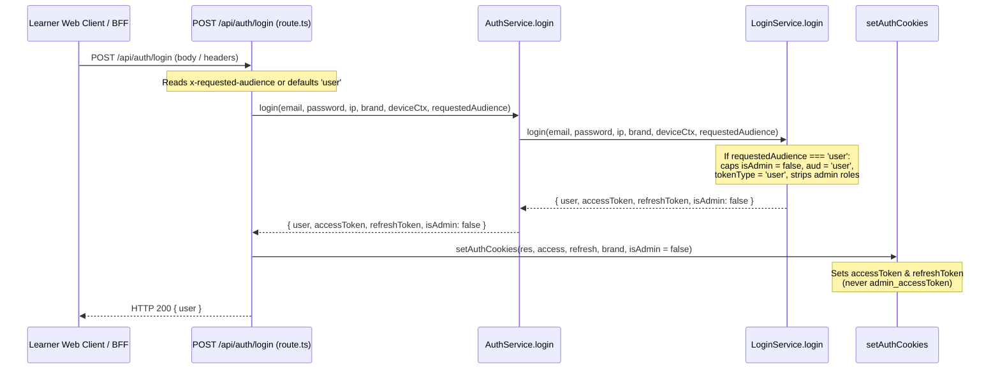

# W1.2-GUARD-02 Principal Scope and SHC Compatibility Contract

**Ticket Reference**: `W1.2-GUARD-02`
**Governing Task**: [`audit/W1.2_Gemini_Controlled_Batch_05_Task.md`](file:///E:/onlinewebsites/quiz-platform/audit/W1.2_Gemini_Controlled_Batch_05_Task.md) (Task B)
**Governing Review & Corrections**: [`audit/W1.2_Gemini_Controlled_Batch_05_Corrections.md`](file:///E:/onlinewebsites/quiz-platform/audit/W1.2_Gemini_Controlled_Batch_05_Corrections.md) & [`audit/W1.2_Batch_05_Sol_Review_9ec71675.md`](file:///E:/onlinewebsites/quiz-platform/audit/W1.2_Batch_05_Sol_Review_9ec71675.md)
**Governing Root Cause**: `RC-ID-01`
**Task Type**: Architecture Contract & Policy Design Only (Strictly Read-Only; No Runtime Source Changes Authorized)
**Implementer**: Gemini 3.8 (Sole authorized worker per Batch 05 instructions)
**Base Assignment Commit**: `cdd9e23d`
**Branch**: `remediation/w1-2-batch-05-targeted`
**Status**: `IMPLEMENTED_UNVERIFIED` (Contract submitted; pending independent review and Sol acceptance)

---

## 1. Executive Summary & Provenance

Task B of Gemini Controlled Batch 05 builds upon the accepted source findings of [`W1.2-GUARD-01`](file:///E:/onlinewebsites/quiz-platform/audit/W1.2-GUARD-01_Principal_Qualification.md) and [`W1.2_Batch_04_Sol_Acceptance.md`](file:///E:/onlinewebsites/quiz-platform/audit/W1.2_Batch_04_Sol_Acceptance.md). It formulates three precise, bounded authorization contracts:
1. **Decision 1: Tenant `_verifyAdmin` Audience & Class Preconditions** (Hardening the low-level RBAC helper against unverified caller elevation and foreign-store leakage).
2. **Decision 2: Learner-Purpose Login Policy** (Establishing purpose-bound session scoping versus unrestricted role-derived session minting).
3. **Decision 3: SkillHubCore (SHC) GUI Compatibility & Refresh Contract** (Reconciling shared-client callers, 4-cookie issuance, missing database persistence, unmounted microservice helpers, and the 8-hour access token reality).

### Governance Commitments:
- **Strictly Documentation-Only**: No production files, schemas, configs, or routes are modified in this ticket.
- **Explicit Unknowns**: Deployed ingress routing, production secret keys, and browser journey execution remain unverified and are not assumed.
- **Separation of Stores**: SHC `@quiz/db-people` user identifiers must never be queried against tenant RBAC database tables.

---

## 2. Decision 1: Tenant `_verifyAdmin` Audience & Class Preconditions

### 2.1 Current Source Behavior & Execution Ordering
The low-level RBAC helper is implemented in `apps/api-server/src/modules/auth/rbac.service.ts:11-66`:

```ts
export async function _verifyAdmin(_payload: TokenPayload): Promise<boolean> {
    const tokenRoles = _payload.roles !== undefined && _payload.roles.some(r =>
        ['admin', 'super_admin', 'infrastructure'].includes(r.toLowerCase())
    );
    const isAdminInToken = _payload.isAdmin === true || tokenRoles;
    const brand = _payload.brand === 'skillup' ? 'skillup' : 'realtutorialhub';
    const authContext = shouldUseBrandBinding()
        ? getAuthBrandContext(brand as RequestBrand)
        : getAuthBrandContext('realtutorialhub');

    // 0. Security: Check if _user is blocked (Always hit DB for Admin actions)
    try {
        const _users = await authContext.db.select({ isBlocked: authContext.tables.users.isBlocked })
            .from(authContext.tables.users)
            .where(eq(authContext.tables.users.id, _payload.userId))
            .limit(1);

        if (_users.length === 0) {
            log.warn({ userId: _payload.userId, brand }, 'RBAC admin check: user not found in brand auth DB - denying');
            return false;
        }

        if (_users[0].isBlocked === true) {
            log.warn({ userId: _payload.userId }, 'RBAC admin check: user is blocked');
            return false;
        }
    } catch (err) {
        log.error({ userId: _payload.userId, message: err instanceof Error ? err.message : String(err) },
            'RBAC admin check failed — denying (fail closed)');
        return false;
    }

    // 1. JWT Payload Check (Fast Payout)
    if (isAdminInToken === true) {
        return true;
    }

    // 2. Database Verification (Strict)
    const userRole = await authContext.db.select()
        .from(authContext.tables.userRoles)
        .innerJoin(authContext.tables.roles, eq(authContext.tables.userRoles.roleId, authContext.tables.roles.id))
        .where(and(
            eq(authContext.tables.userRoles.userId, _payload.userId),
            sql`lower(${authContext.tables.roles.name}) IN ('admin', 'super_admin', 'infrastructure')`
        ))
        .limit(1);

    const passed = userRole.length > 0;
    return passed;
}
```

### 2.2 Execution Ordering & Exception Behavior Analysis
1. **Step 0 (Account Verification)**: Always hits the tenant database first. If the user is missing (`_users.length === 0`) or blocked (`isBlocked === true`), it returns `false`. Crucially, database exceptions during Step 0 are **caught and return `false`**.
2. **Step 1 (JWT Fast Path)**: If `isAdminInToken === true`, it returns `true` immediately without querying roles.
3. **Step 2 (Role Fallback DB Query)**: Queries `userRoles` in the tenant database. Unlike Step 0, Step 2 is **NOT wrapped in a try/catch block**; database exceptions thrown in Step 2 propagate as unhandled errors to the caller.
4. **Vulnerability Analysis (Elevation & Cross-Store Leakage)**:
   - `_verifyAdmin` evaluates neither `_payload.aud` nor `_payload.tokenType`.
   - If an active learner (`aud: 'user'`, `tokenType: 'user'`, `isAdmin: false`) is granted an admin role in PostgreSQL, Step 0 succeeds (user exists and is active), Step 1 is bypassed, and Step 2 executes, finding the role in PostgreSQL and returning `true`.
   - A learner access token is thus treated as an administrative bearer token without any admin portal authentication.
   - If `brand: 'skillhubcore'` is passed, `_payload.brand === 'skillup' ? 'skillup' : 'realtutorialhub'` silently coerces the brand to `'realtutorialhub'`, querying SHC `db-people` UUIDs against the RTH database.

### 2.3 Proposed Runtime Class & Audience Contract
Before any database query or role check, `_verifyAdmin` must enforce strict principal preconditions:

1. **Token Class Contract (`tokenType` and `isAdmin`)**:
   - `isAdmin` must be a strict boolean (`typeof _payload.isAdmin === 'boolean'`).
   - `tokenType` must be one of `'admin'` or `'infra'`.
   - **Contradictory / Malformed Rejection**: If `isAdmin: true` with `tokenType: 'user'`, or `isAdmin: false` with `tokenType: 'admin'`, or if either property is missing, null, or malformed, `_verifyAdmin` must immediately fail closed and return `false`.
2. **Audience Preconditions**:
   - Scalar audience must be `'admin'` or `'infra'`.
   - If `aud` is an array: It must contain `'admin'` or `'infra'`, and **must not contain contradictory classes** (e.g. mixed array `['user', 'admin']` must be rejected as an ambiguous principal).
   - If `aud === 'user'`, if `aud` is missing/empty, or if `aud === 'shc-admin'`, immediately return `false`.
3. **Canonical Tenant Brand & Non-Empty Identity**:
   - `brand` must strictly equal `'realtutorialhub'` or `'skillup'`. Any absent, null, empty, unknown, or `'skillhubcore'` brand must return `false` immediately before database access.
   - `_payload.userId` must be a non-empty string (`typeof userId === 'string' && userId.trim().length > 0`). Empty or whitespace strings must return `false` before database access.
4. **Infrastructure Role Scoping in Tenant Helper**:
   - `_verifyAdmin` is a **tenant-scoped helper** querying tenant PostgreSQL tables (`authContext.tables.users` and `userRoles`).
   - Infrastructure tokens (`aud: 'infra'`, `tokenType: 'infra'`) represent system/service principals that do not have rows in tenant user tables.
   - **Recommended Policy**: Reject `infra` in `_verifyAdmin` with `false`, delegating infrastructure authorization entirely to dedicated infra guards (`verifyAdminOrInfraToken`). If infra compatibility is retained, it must fast-path on verified JWT claims without querying tenant user tables for non-existent infra UUIDs.
5. **Database Failure Policy Distinction**:
   - Step 0 catches DB errors to `false`.
   - For Step 2 role-fallback: A fail-closed design that catches DB errors and returns `false` alters existing exception semantics (where errors previously threw). The contract documents this distinction: returning `false` prevents 500 crashes and fails closed safely, but callers must log the failure as an internal error.

### 2.4 Proposed Future Test Matrix
| Test Case ID | Test Scenario | Payload Claims | DB State | Expected Result |
|---|---|---|---|---|
| **PROP-PRE-01** | Promoted learner token | `aud: 'user'`, `tokenType: 'user'`, `isAdmin: false` | User active, has admin role in DB | Returns `false` (blocks learner elevation). |
| **PROP-PRE-02** | Valid tenant admin token | `aud: 'admin'`, `tokenType: 'admin'`, `isAdmin: true`, `brand: 'realtutorialhub'` | User active | Returns `true` (fast-path after Step 0). |
| **PROP-PRE-03** | Array audience valid | `aud: ['admin', 'internal']`, `tokenType: 'admin'`, `isAdmin: true` | User active | Returns `true`. |
| **PROP-PRE-04** | Mixed contradictory audience | `aud: ['user', 'admin']`, `tokenType: 'admin'`, `isAdmin: true` | User active | Returns `false` (rejects mixed principal). |
| **PROP-PRE-05** | SHC brand exclusion | `aud: 'shc-admin'`, `brand: 'skillhubcore'` | User exists in `db-people` | Returns `false` (zero tenant DB query). |
| **PROP-PRE-06** | Contradictory class claims | `isAdmin: true`, `tokenType: 'user'` | Any | Returns `false` (fail closed). |
| **PROP-PRE-07** | Contradictory class claims | `isAdmin: false`, `tokenType: 'admin'` | Any | Returns `false` (fail closed). |
| **PROP-PRE-08** | Missing / empty user ID | `userId: '   '`, `aud: 'admin'` | Any | Returns `false` (zero DB query). |
| **PROP-PRE-09** | Missing user in DB | `userId: 'non-existent'`, `aud: 'admin'`, `isAdmin: true` | `_users.length === 0` | Returns `false` (Step 0 rejection). |
| **PROP-PRE-10** | Blocked user in DB | `userId: 'user-blocked'`, `aud: 'admin'`, `isAdmin: true` | `isBlocked === true` | Returns `false` (Step 0 rejection). |
| **PROP-PRE-11** | Step 0 DB failure | `userId: 'user-1'`, `aud: 'admin'`, `isAdmin: true` | DB select throws | Returns `false` (caught to false). |
| **PROP-PRE-12** | Step 2 DB failure (fallback) | `userId: 'user-1'`, `aud: 'admin'`, `isAdmin: false` | Step 2 select throws | Contract: fail closed (`false`) with error log. |

---

## 3. Decision 2: Learner-Purpose Login Policy

### 3.1 Current Source Behavior & Ingress Elevation
- **Current Behavior** (`apps/api-server/src/modules/auth/login.service.ts:174-191`):
  In generic `POST /api/auth/login`:
  ```ts
  const isAdmin = roles.some(r => ['admin', 'super_admin', 'infrastructure'].includes(r.toLowerCase()));
  const tokenType = isAdmin ? 'admin' : 'user';
  const aud = isAdmin ? 'admin' : 'user';
  ```
- **Session Minting Reality**:
  - Generic login mints a **NEW session** upon credential validation.
  - A database role grant does **not** alter an in-flight learner JWT by itself (stateless JWT claims remain fixed until expiration).
  - However, when an administrative user subsequently logs in through the public learner web client (`user.skillupitacademy.com` or `user.realtutorialhub.com`), `LoginService.login` mints an elevated administrative token (`aud: 'admin'`, `tokenType: 'admin'`, `isAdmin: true`) and stores admin cookies in the browser.
- **Correction to Prior Assertions**:
  - `AdminAuthService.login` (`apps/api-server/src/modules/auth/admin-auth.service.ts`) does **not** implement MFA/OTP verification. It performs password verification, checks administrative roles, and mints admin tokens.

### 3.2 Full Propagation Path for `requestedAudience`
To implement purpose-bound session scoping without breaking existing callers, the `requestedAudience` contract must be traced across the complete invocation chain:



1. **Caller / BFF Ingress**:
   - `apps/skillup-web` and `apps/realtutorialhub-web` call `POST /api/auth/login`.
   - The route handler can accept an optional header `x-requested-audience: user` or default `requestedAudience = 'user'` for all requests arriving at the generic login endpoint.
2. **Route Handler (`apps/api-server/src/app/api/auth/login/route.ts`)**:
   - Current line 101: `await container.get(AuthService).login(email, password, ip, brand, deviceContext)`.
   - Propagation: Pass `requestedAudience: 'user'` to `AuthService.login`.
3. **`AuthService.login` (`apps/api-server/src/modules/auth/auth.service.ts:49-52`)**:
   - Current signature:
     ```ts
     async login(email: string, password: string, ip: string = 'unknown', brand: RequestBrand = 'realtutorialhub', deviceContext?: DeviceContext)
     ```
   - Extended signature:
     ```ts
     async login(email: string, password: string, ip: string = 'unknown', brand: RequestBrand = 'realtutorialhub', deviceContext?: DeviceContext, requestedAudience?: string)
     ```
   - Passes `requestedAudience` to `LoginService.login`.
4. **`LoginService.login` (`apps/api-server/src/modules/auth/login.service.ts`)**:
   - When `requestedAudience === 'user'`:
     - Sets `isAdmin = false`.
     - Sets `tokenType = 'user'`.
     - Sets `aud = 'user'`.
     - Filters out administrative role names (`admin`, `super_admin`, `infrastructure`) from the token's `roles` array.
   - When `requestedAudience` is omitted (legacy callers): Preserves existing role-derived behavior for seamless backwards compatibility.
5. **Cookie Selection & Compatibility**:
   - In `apps/api-server/src/app/api/auth/login/route.ts:146`:
     `setAuthCookies(response, accessToken, refreshToken, cookieBrand, isAdmin)`
   - When `isAdmin` is `false`, `setAuthCookies` sets `accessToken` and `refreshToken`.
   - It **never sets `admin_accessToken` or `admin_refreshToken`**, ensuring that public learner browsers never hold administrative session cookies.
6. **Isolation of Dedicated Admin Portals**:
   - `POST /api/admin/auth/login` (`AdminAuthService.login`) and `POST /api/shc/auth/login` (`SHCAuthService.login`) remain completely separate endpoints with separate routes, separate services, and separate cookies. They are not modified by this change.

---

## 4. Decision 3: SkillHubCore (SHC) GUI Compatibility & Refresh Contract

### 4.1 Current Source Evidence & Baseline Findings
1. **Login Flow & Store Target**:
   - `apps/skillhubcore-admin/src/app/api/auth/login/route.ts` proxies login requests to `POST /api/shc/auth/login` (`apps/api-server/src/app/api/shc/auth/login/route.ts`).
   - `SHCAuthService.login` (`apps/api-server/src/modules/auth/shc-auth.service.ts`) validates credentials against `@quiz/db-people` (`users` table where `platform = 'skillhubcore'`).
   - It issues an access token (`aud: 'shc-admin'`, `brand: 'skillhubcore'`, `isAdmin: true`) and a refresh token.
   - **Missing Database Persistence**: `shc-auth.service.ts:129-132` notes refresh token generation but **does not insert the refresh token into `@quiz/db-people` or any other database**.
2. **GUI 4-Cookie Issuance Reality**:
   - In `apps/skillhubcore-admin/src/lib/admin-session-cookies.ts:3-10`:
     ```ts
     const cookieNames = ['accessToken', 'admin_accessToken', 'refreshToken', 'admin_refreshToken'] as const;

     export function setAdminSessionCookies(response: NextResponse, accessToken: string, refreshToken: string) {
       for (const name of cookieNames) {
         response.cookies.set(name, name.includes('refresh') ? refreshToken : accessToken, {
           path: '/', httpOnly: true, secure: process.env.NODE_ENV === 'production', sameSite: 'lax',
         });
       }
       for (const name of cookieNames) {
         response.headers.append('set-cookie', `${name}=; Path=/; Domain=.skillhubcore.in; HttpOnly; Secure; SameSite=Lax; Max-Age=0`);
       }
     }
     ```
   - The GUI login handler sets **four cookies**: both access tokens and refresh tokens under both prefixed (`admin_`) and unprefixed names as host-only cookies.
3. **Shared Client Caller & Refresh Failure Reality**:
   - `AdminGuard.tsx` sets `apiClient.client.setPortalIdentity('admin')`.
   - On 401, `packages/api-client/src/core/fetch-client.ts` calls `POST /auth/refresh` on the shared API server.
   - `POST /api/auth/refresh` receives `x-brand: skillhubcore` and resolves to the default `@quiz/db` store (`brand-db.ts:99-102`), not `db-people`.
   - Because `SHCAuthService.login` never persisted a row in `@quiz/db`, `TokenRefreshService.refresh` returns `null` from `findByHash`, resulting in HTTP 401 `Invalid refresh token`.
4. **Specialized Microservice Status (`services/skillhubcore-service`)**:
   - `services/skillhubcore-service/src/modules/auth/token-rotation.service.ts` implements token family tracking, Redis compromise tracking (`skillhubcore:refresh:${familyId}`), and session revocation in `db-people`.
   - **Crucial Architectural Status**: `services/skillhubcore-service/src/index.ts:26-31` **does not mount** `createAuthRoutes` in `createApp`. It is unmounted library code.
5. **Access Token Lifetime Reality**:
   - In `packages/auth/src/token.service.ts:117`, access tokens default to **8 hours** (`8h`).
   - SHC administrative sessions remain valid for 8 hours without requiring background refresh. `AdminGuard.tsx` provides screen-lock re-authentication.

### 4.2 Producer and Consumer Compatibility Matrix
| Component | Role | Expectation / Behavior | Compatibility Implication |
|---|---|---|---|
| `apps/skillhubcore-admin/src/app/api/auth/login/route.ts` | Producer | Proxies login to API server, calls `setAdminSessionCookies` | Requires valid access and refresh tokens returned from API server. |
| `apps/skillhubcore-admin/src/lib/admin-session-cookies.ts` | Producer | Sets 4 host-only cookies, clears `.skillhubcore.in` | Consumers expecting any of the 4 cookies continue to find them. |
| `apps/skillhubcore-admin/src/components/auth/AdminGuard.tsx` | Consumer | Validates admin session, provides screen-lock password dialog | Relies on 8-hour access token; triggers re-auth or lock screen on expiration. |
| `packages/api-client/src/core/fetch-client.ts` | Consumer | Automatically calls `POST /auth/refresh` on 401 | Currently fails with 401 due to unpersisted refresh token; triggers redirect to `/login`. |
| `apps/api-server/src/app/api/auth/refresh/route.ts` | Consumer | Reads `x-brand`, queries `@quiz/db` | Fails closed with 401 for SHC tokens; does not touch `db-people`. |
| `services/skillhubcore-service` | Unmounted Provider | Specialized Redis/family rotation service | Unmounted; cannot be called by browser or reverse proxy without gateway routing. |

### 4.3 Recommended Staged Policy & Open Owner Choices
Rather than forcing a disruptive binary between immediate microservice mounting or deleting unmounted code, the contract specifies a **phased, staged adoption**:

- **Recommended Bounded Policy (Phase 1 / KISS)**:
  1. **Preserve Current Cookie Issuance**: Do not alter `setAdminSessionCookies` or remove cookie names. Both access and refresh tokens continue to be issued and set.
  2. **Preserve 8-Hour Session Contract**: Rely on the existing 8-hour access token lifetime. For administration, 8-hour sessions with screen-lock re-authentication represent standard enterprise posture.
  3. **Configure API Client for SHC**: In `AdminGuard.tsx`, configure `apiClient` to disable background auto-refresh on 401, redirecting gracefully to screen-lock or login without generating noisy 401 refresh errors.
  4. **Defer Microservice Auth Mounting**: Keep `services/skillhubcore-service/src/modules/auth` unmounted for now. Deferral avoids premature Redis cluster dependencies or cross-service gateway routing changes.
- **Genuine Open Owner Choices**:
  - **Choice 1 (Session Continuity Architecture)**:
    - *Option A (Recommended)*: Formalize 8-hour access tokens with lock-screen re-authentication.
    - *Option B*: Implement stateful refresh for SHC by persisting tokens into `@quiz/db-people` and mounting a dedicated refresh route.
  - **Choice 2 (Service Topology)**:
    - *Option A (Recommended)*: Consolidate auth routing within `apps/api-server`, keeping `services/skillhubcore-service` as an internal microservice.
    - *Option B*: Expose `services/skillhubcore-service` directly under a sub-path (e.g. `api.skillhubcore.in/auth`) behind an ingress controller.

---

## 5. Authoritative Six-Host Matrix Reference

All proposals in this contract strictly adhere to the six authoritative environment hostnames established in `W1.2-REFRESH-05_Authority_Contract.md` Section 7:

| Portal / Tenant Scope | Production Hostname | Local Hostname | Cookie Domain Rule |
|---|---|---|---|
| **SUIA Learner Web** | `user.skillupitacademy.com` | `skillup.localhost:<port>` | `.skillupitacademy.com` / host-only |
| **RTH Learner Web** | `user.realtutorialhub.com` | `realtutorialhub.localhost:<port>` | `.realtutorialhub.com` / host-only |
| **SkillHubCore Portal** | `skillhubcore.in` | `skillhubcore.localhost:<port>` | Host-only (clears `.skillhubcore.in`) |

*(Note: Production hostnames represent design targets. Local testing uses `localhost` or mock origins without assuming live network connectivity).*

---

## 6. Status and Governance Declaration

- **Ticket**: `W1.2-GUARD-02`
- **Current Status**: `IMPLEMENTED_UNVERIFIED` (Contract deliverable submitted; strictly documentation-only).
- **Review Requirement**: Distinct read-only verification followed by Sol acceptance decision.
