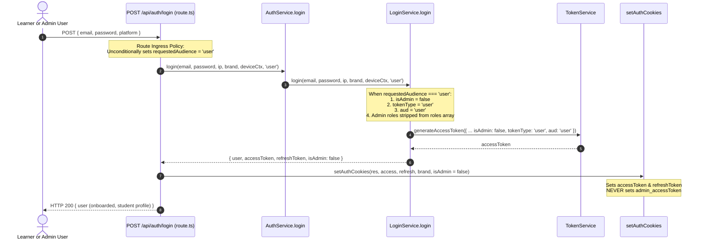

# W1.2-GUARD-03: Learner-Purpose Login Implementation Scope

**Date:** 2026-11-04
**Implementer:** Gemini
**Acceptance Reviewer:** Sol
**Governing Task:** [`audit/W1.2_Gemini_Controlled_Batch_06_Task.md`](file:///E:/onlinewebsites/quiz-platform/audit/W1.2_Gemini_Controlled_Batch_06_Task.md) (Task B)
**Governing Architecture:** [`audit/FinalAechitecture.md`](file:///E:/onlinewebsites/quiz-platform/audit/FinalAechitecture.md)
**Accepted Foundations:** [`audit/W1.2-GUARD-01_Principal_Qualification.md`](file:///E:/onlinewebsites/quiz-platform/audit/W1.2-GUARD-01_Principal_Qualification.md), [`audit/W1.2-GUARD-02_Principal_And_SHC_Contract.md`](file:///E:/onlinewebsites/quiz-platform/audit/W1.2-GUARD-02_Principal_And_SHC_Contract.md)
**Status:** `IMPLEMENTED_UNVERIFIED` (Implementation Specification Only; Strictly Zero Runtime Code Changes Authorized)

---

## 1. Executive Summary & Objective

This specification details the server-enforced **learner-purpose login policy** required under `W1.2-GUARD-03`. Currently, when a user who holds administrative roles in the tenant database authenticates through the public learner login interface (`/login`), the backend mints an administrative session (`aud: 'admin'`, `tokenType: 'admin'`, `isAdmin: true`) and writes administrative cookies (`admin_accessToken`, `admin_refreshToken`) into the learner's browser.

This violates the principle of **Least Privilege**, creates cross-portal cookie contamination, and creates privilege confusion between learner browsing and governance actions.

### Target Principle:
- **Server-Fixed Ingress Scoping:** The public learner endpoint (`POST /api/auth/login`) must fix the session purpose server-side as `requestedAudience: 'user'`. The server does NOT trust a client-selected header or assume that possessing database admin roles grants an admin session on a public learner route.
- **Dedicated Administrative Ingress:** Legitimate administrative access requires authenticating through the dedicated administrative endpoint (`POST /api/admin/auth/login` via `AdminAuthService`), which validates governance credentials and mints admin tokens.

---

## 2. Ingress Trace & Caller Analysis

### 2.1 The Actual Call Chain
1. **Learner Web Client BFF:**
   - [`apps/skillup-web/src/app/api/auth/login/route.ts`](file:///E:/onlinewebsites/quiz-platform/apps/skillup-web/src/app/api/auth/login/route.ts)
   - [`apps/realtutorialhub-web/src/app/api/auth/login/route.ts`](file:///E:/onlinewebsites/quiz-platform/apps/realtutorialhub-web/src/app/api/auth/login/route.ts)
   - Both invoke `proxyAuthRequest(request, { authPath: 'login' })`, forwarding the client body `{ email, password, platform }` to the API server.
2. **API Server Public Login Route:**
   - [`apps/api-server/src/app/api/auth/login/route.ts:101`](file:///E:/onlinewebsites/quiz-platform/apps/api-server/src/app/api/auth/login/route.ts#L101):
     ```ts
     const { _user, accessToken, refreshToken, isAdmin } = await container.get(AuthService).login(
       email, password, ip, brand, deviceContext
     );
     ```
3. **`AuthService.login` Facade:**
   - [`apps/api-server/src/modules/auth/auth.service.ts:49-52`](file:///E:/onlinewebsites/quiz-platform/apps/api-server/src/modules/auth/auth.service.ts#L49-L52):
     ```ts
     async login(email: string, password: string, ip: string = 'unknown', brand: RequestBrand = 'realtutorialhub', deviceContext?: DeviceContext) {
       const service = await this.getLoginService();
       return service.login(email, password, ip, brand, deviceContext);
     }
     ```
4. **`LoginService.login` Engine:**
   - [`apps/api-server/src/modules/auth/login.service.ts:174-210`](file:///E:/onlinewebsites/quiz-platform/apps/api-server/src/modules/auth/login.service.ts#L174-L210):
     ```ts
     const roleNames = user.userRoles
       .map((ur) => normalizeRoleName(ur.role.name))
       .filter((role): role is string => role !== null);
     const isAdmin = roleNames.includes('admin') || roleNames.includes('super_admin') || roleNames.includes('infrastructure');

     const accessToken = await this.tokenService.generateAccessToken({
       userId: user.id,
       originalUserId: user.id,
       shadowUserId,
       email: user.email,
       roles: roleNames,
       isAdmin,
       tokenType: isAdmin ? 'admin' : 'user',
       brand,
     });
     ```
5. **Cookie Selection:**
   - [`apps/api-server/src/app/api/auth/login/route.ts:146`](file:///E:/onlinewebsites/quiz-platform/apps/api-server/src/app/api/auth/login/route.ts#L146):
     ```ts
     setAuthCookies(response, accessToken, refreshToken, cookieBrand, isAdmin);
     ```
   - When `isAdmin === true`, `packages/auth/src/middleware/cookie.middleware.ts` sets `admin_accessToken` and `admin_refreshToken`.

### 2.2 Complete Enumeration of Callers to `AuthService.login` & `LoginService.login`

| Caller File | Line | Context | Proposed Impact & Adaptation |
|---|---|---|---|
| `apps/api-server/src/app/api/auth/login/route.ts` | 101 | Public learner login route | **Primary Target.** Must pass `requestedAudience: 'user'`. |
| `apps/api-server/src/app/api/auth/signup/route.ts` | 45 | Public learner signup auto-login | Passes `requestedAudience: 'user'` (new signups are always learners). |
| `apps/api-server/src/modules/auth/auth.service.ts` | 51 | Facade method forwarding to `LoginService` | Add optional parameter `requestedAudience?: string`. |
| `apps/api-server/src/modules/auth/__tests__/auth.service.test.ts` | 118, 124, 133 | Unit tests for auth service | Signature remains backward compatible; tests pass without changes. |
| `apps/api-server/src/modules/auth/__tests__/auth.login.block.test.ts` | 60 | Blocked account login tests | Backward compatible; no changes needed. |
| `apps/api-server/src/modules/auth/__tests__/auth.tail.test.ts` | 109 | Legacy tail tests | Backward compatible; no changes needed. |
| `apps/api-server/src/modules/auth/__tests__/auth.tail2.test.ts` | 71, 84, 97 | Legacy tail tests | Backward compatible; no changes needed. |

*Note on Administrative Login Routes:* Dedicated administrative logins do NOT call `AuthService.login` or `LoginService.login`.
- Tenant Admin: uses `AdminAuthService.login` ([`apps/api-server/src/app/api/admin/auth/login/route.ts:46`](file:///E:/onlinewebsites/quiz-platform/apps/api-server/src/app/api/admin/auth/login/route.ts#L46)).
- SkillHubCore Admin: uses `SHCAuthService.login` ([`apps/api-server/src/app/api/shc/auth/login/route.ts:41`](file:///E:/onlinewebsites/quiz-platform/apps/api-server/src/app/api/shc/auth/login/route.ts#L41)).
These dedicated issuers are completely preserved and unaffected by learner login scoping.

---

## 3. Server-Enforced Policy Specification



### 3.1 Behavior for Accounts Holding Admin Roles
When a user whose database record has roles `['admin', 'super_admin']` logs in through `POST /api/auth/login`:
1. **Authentication Succeeds:** The password hash and active account status are verified against the tenant database.
2. **Session Purpose Scoped:** Because `requestedAudience === 'user'`, `LoginService` forces:
   - `isAdmin = false`.
   - `tokenType = 'user'`.
   - `aud = 'user'`.
3. **Role Claim Sanitization:**
   - Any administrative role (`'admin'`, `'super_admin'`, `'infrastructure'`) is stripped from the token's `roles` array.
   - If the user has learner roles (e.g. `'student'`), they are retained. If only admin roles exist, the token's roles default to `['student']` for the duration of the learner session.
4. **Cookie Scoping:**
   - The route handler invokes `setAuthCookies(response, accessToken, refreshToken, cookieBrand, false)`.
   - Browser receives standard `accessToken` and `refreshToken`.
   - Browser **never receives `admin_accessToken` or `admin_refreshToken`**.
5. **Security Invariant Established:**
   - This session can access all learner routes, courses, exams, and dashboards.
   - It **cannot** access `/api/admin/...`, because `verifyAdminAccessToken` and `_verifyAdmin` reject `aud: 'user'` and `tokenType: 'user'`.

### 3.2 Concrete Before & After Token Claims

#### Before (Current Vulnerability):
```json
{
  "userId": "usr_tenant_100",
  "email": "faculty-admin@skillupitacademy.com",
  "brand": "skillup",
  "roles": ["admin", "student"],
  "isAdmin": true,
  "tokenType": "admin",
  "aud": "admin"
}
```
*Cookies issued:* `admin_accessToken`, `admin_refreshToken`.
*Result:* Admin bearer tokens issued through public login into learner browser cookies.

#### After (Hardened Server-Scoped Policy):
```json
{
  "userId": "usr_tenant_100",
  "email": "faculty-admin@skillupitacademy.com",
  "brand": "skillup",
  "roles": ["student"],
  "isAdmin": false,
  "tokenType": "user",
  "aud": "user"
}
```
*Cookies issued:* `accessToken`, `refreshToken`.
*Result:* Clean learner session. Admin privileges remain locked behind `AdminAuthService.login`.

---

## 4. Caller Compatibility & Legacy Options Contract

To prevent breaking existing unit tests and internal callers:

1. **Explicit Parameter Extension:**
   - Update `AuthService.login` signature:
     ```ts
     async login(
       email: string,
       password: string,
       ip: string = 'unknown',
       brand: RequestBrand = 'realtutorialhub',
       deviceContext?: DeviceContext,
       requestedAudience?: string
     )
     ```
   - Matches the existing signature style of `AuthService.refresh` (`requestedAudience: string = 'user'`).
2. **Backward-Compatible Service Implementation:**
   - In `LoginService.login`:
     ```ts
     const isExplicitLearner = requestedAudience === 'user';
     const isAdmin = isExplicitLearner ? false : (roleNames.includes('admin') || ...);
     const effectiveTokenType = isExplicitLearner ? 'user' : (isAdmin ? 'admin' : 'user');
     const effectiveAud = isExplicitLearner ? 'user' : (isAdmin ? 'admin' : 'user');
     const effectiveRoles = isExplicitLearner
       ? roleNames.filter(r => !['admin', 'super_admin', 'infrastructure'].includes(r))
       : roleNames;
     ```
   - When `requestedAudience` is omitted (legacy callers in test suites), the existing role-derived behavior is preserved so tests do not break unexpectedly.
   - The public route `apps/api-server/src/app/api/auth/login/route.ts` explicitly passes `requestedAudience: 'user'`.

---

## 5. Source Whitelist & Test Plan for Future Implementation Ticket

### 5.1 Source Whitelist
- [`apps/api-server/src/app/api/auth/login/route.ts`](file:///E:/onlinewebsites/quiz-platform/apps/api-server/src/app/api/auth/login/route.ts) (Pass `requestedAudience: 'user'`).
- [`apps/api-server/src/app/api/auth/signup/route.ts`](file:///E:/onlinewebsites/quiz-platform/apps/api-server/src/app/api/auth/signup/route.ts) (Pass `requestedAudience: 'user'`).
- [`apps/api-server/src/modules/auth/auth.service.ts`](file:///E:/onlinewebsites/quiz-platform/apps/api-server/src/modules/auth/auth.service.ts) (Add `requestedAudience` parameter).
- [`apps/api-server/src/modules/auth/login.service.ts`](file:///E:/onlinewebsites/quiz-platform/apps/api-server/src/modules/auth/login.service.ts) (Implement scoping and role filtering).

### 5.2 Required Integration & Unit Tests
1. **`PROP-LEARN-01`**: Authenticate pure learner -> receives `isAdmin: false`, `aud: 'user'`, `accessToken` cookie.
2. **`PROP-LEARN-02`**: Authenticate user with admin roles via `POST /api/auth/login` -> receives `isAdmin: false`, `aud: 'user'`, admin roles stripped from token, `accessToken` cookie (no `admin_` cookies).
3. **`PROP-LEARN-03`**: Authenticate same admin user via `POST /api/admin/auth/login` -> receives `isAdmin: true`, `aud: 'admin'`, admin cookies.
4. **`PROP-LEARN-04`**: Verify token from `PROP-LEARN-02` against `requireAdminRouteAccess` -> rejected with HTTP 401/403.
5. **`PROP-LEARN-05`**: Verify legacy programmatic call without `requestedAudience` -> preserves legacy behavior without breaking tests.
