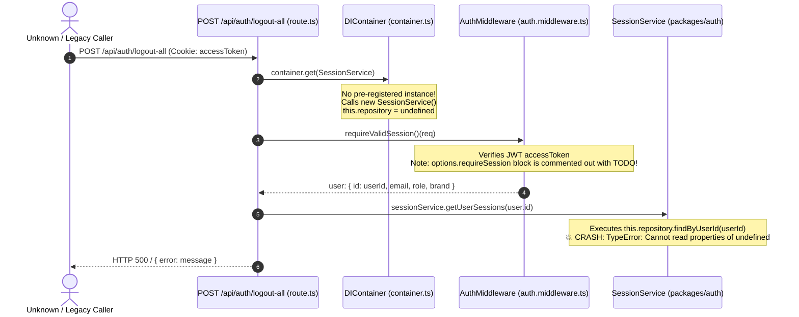
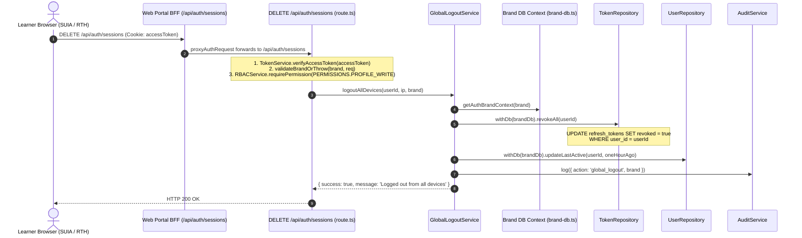

# W1.2-SESS-02 Legacy Logout-All Wiring Qualification

**Ticket Reference**: `W1.2-SESS-02`
**Governing Task**: [`audit/W1.2_Gemini_Controlled_Batch_05_Task.md`](file:///E:/onlinewebsites/quiz-platform/audit/W1.2_Gemini_Controlled_Batch_05_Task.md) (Task C)
**Governing Root Cause**: `RC-ID-01` (RC-EVENT-01 is not closed or advanced by this investigation)
**Audit Context**: `SU-AUTH-004`
**Task Type**: Read-Only Source Qualification & Architectural Investigation (Strictly Read-Only; No Code Changes)
**Implementer**: Gemini 3.8 (Sole authorized worker per Batch 05 instructions)
**Base Assignment Commit**: `cdd9e23d`
**Branch**: `remediation/w1-2-batch-05-targeted`
**Status**: `CLOSED` (Source qualification accepted with Sol editorial limits; see W1.2_Batch_05_Sol_Review_9ec71675.md. Runtime correction/decommissioning remains separately gated.)

---

## 1. Executive Summary

Task C of Gemini Controlled Batch 05 conducts a comprehensive source trace of `POST /api/auth/logout-all` across `apps/`, `packages/`, and `services/`, comparing it directly against the active canonical session revocation route `DELETE /api/auth/sessions`.

### Primary Discoveries:
1. **Zero Active Callers**:
   - `POST /api/auth/logout-all` has **no literal caller found by the inspected source search** across frontend GUIs (`apps/skillup-web`, `apps/realtutorialhub-web`, `apps/skillhubcore-admin`), BFF proxies, and client SDKs.
   - Active web portals (`apps/skillup-web/src/app/api/auth/sessions/route.ts` and `apps/realtutorialhub-web/src/app/api/auth/sessions/route.ts`) exclusively route session revocation to `DELETE /api/auth/sessions`.
2. **Broken DI Container Instantiation**:
   - `logout-all/route.ts:19, 29` invokes `container.get(SessionService)`.
   - `SessionService` (`packages/auth/src/session.service.ts:27-28`) has constructor `constructor(private repository: SessionRepository) {}`.
   - In `apps/api-server/src/modules/core/container.ts:38`, `DIContainer` lazily executes `new token()`. Because no instance of `SessionService` is pre-registered in `container`, it calls `new SessionService()` with no parameters.
   - On the inspected lazy construction path (absent an external explicit registration), `this.repository` is initialized as `undefined`. Any runtime invocation of `sessionService.getUserSessions(user.id)` throws an unhandled `TypeError: Cannot read properties of undefined (reading 'findByUserId')`.
3. **Incomplete AuthMiddleware**:
   - In `packages/auth/src/middleware/auth.middleware.ts:72-79`, the session verification block inside `requireValidSession()` is commented out with a `// TODO: Implement refresh token extraction from cookies`.
4. **Missing Tenant Database Binding**:
   - `SessionService` in `@quiz/auth` operates on generic in-memory or single-store abstractions, lacking the brand-bound tenant routing (`getAuthBrandContext`, `brandTokenRepo`) implemented in `GlobalLogoutService`.
5. **Architectural Recommendation**:
   - **Decommission `POST /api/auth/logout-all`** in a subsequent authorized maintenance ticket (or delegate it to `GlobalLogoutService.logoutAllDevices` if external backward-compatibility is required). Decommissioning is only a proposal: absent literal repository callers does not prove absent external, dynamically constructed or deployed consumers. Compatibility must be qualified before removing a public route.

---

## 2. Caller & Execution Matrix Comparison

| Evaluation Metric | Legacy Route: `POST /api/auth/logout-all` | Canonical Route: `DELETE /api/auth/sessions` |
|---|---|---|
| **Route Path** | `apps/api-server/src/app/api/auth/logout-all/route.ts` | `apps/api-server/src/app/api/auth/sessions/route.ts` |
| **BFF Forwarding** | **None**. No BFF route forwards to `/logout-all`. | `apps/skillup-web` & `apps/realtutorialhub-web` (`/api/auth/sessions`) |
| **Primary Service** | `SessionService` (`@quiz/auth/session.service.ts`) | `GlobalLogoutService` (`apps/api-server/.../global-logout.service.ts`) |
| **DI Registration** | **Unregistered**. Lazily instantiates `new SessionService()`. | Lazily instantiated/cached; default constructor resolves TokenRepository/UserRepository/AuditService through container.get. |
| **Repository Store** | Expects `SessionRepository`; passed `undefined` -> Runtime TypeError. | Injects `TokenRepository` and `UserRepository` bound to tenant DB. |
| **Brand Isolation** | **No concrete persistence binding**. AuthMiddleware copies a JWT brand, but this route does not select a brand-scoped SessionRepository. | Enforces brand parity via `validateBrandOrThrow` (`brand-db.ts`). |
| **RBAC Enforcement** | Minimal role mapping; does not check explicit permissions. | Explicitly checks `RBACService.requirePermission(..., PERMISSIONS.PROFILE_WRITE)`. |
| **Session Predicate** | Attempts `revokeAllForUser(userId)`. | Executes atomic `brandTokenRepo.revokeAll(userId)` in PostgreSQL. |
| **User Activity State**| Does not update user record. | Updates `users.lastActive` to force offline status (`updateLastActive`). |
| **Audit Logging** | Logs via `console.log` only. | Persists structured audit record via `AuditService.log('global_logout')`. |
| **Response Contract**| `{ message: string, revokedSessions: number, timestamp: string }` | `{ success: true, message: 'Logged out from all devices' }` |

---

## 3. Detailed Source Call Graph & Trace Analysis

### 3.1 Trace of `POST /api/auth/logout-all`

**Verified Source Evidence**:
- Route definition: `apps/api-server/src/app/api/auth/logout-all/route.ts:17-49`.
- Middleware stub: `packages/auth/src/middleware/auth.middleware.ts:72-79`.
- Constructor requirement: `packages/auth/src/session.service.ts:28` (`constructor(private repository: SessionRepository)`).
- Container instantiation fallback: `apps/api-server/src/modules/core/container.ts:38` (`const newInstance = new token()`).

---

### 3.2 Trace of Canonical `DELETE /api/auth/sessions`

**Verified Source Evidence**:
- Learner BFF callers: `apps/skillup-web/src/app/api/auth/sessions/route.ts:21-25`, `apps/realtutorialhub-web/src/app/api/auth/sessions/route.ts:21-25`.
- Route handler: `apps/api-server/src/app/api/auth/sessions/route.ts:103-176`.
- Service implementation: `apps/api-server/src/modules/auth/global-logout.service.ts:25-55`.

---

## 4. Distinction Between Cookie Clearance & JWT Revocation

A critical finding for browser qualification and session security:
1. **Stateless JWT Lifetime**:
   - Access tokens are signed JWTs with an expiration claim (`exp`).
   - In `packages/auth/src/token.service.ts:117`, access tokens default to **8 hours** (`8h`).
2. **What `global_logout` Revokes**:
   - `GlobalLogoutService.logoutAllDevices` revokes all rows in `refresh_tokens` for the specified `userId` (`revoked = true`).
   - Consequently, when any client device attempts to use a refresh token to obtain a new access token, `TokenRefreshService.refresh` fails closed with HTTP 401.
3. **What `global_logout` Does NOT Automatically Revoke**:
   - An already-issued access token remains cryptographically valid until its 8-hour `exp` timestamp elapses, unless downstream route handlers check an online blacklist or verify `users.lastActive`.
   - Browser cookie clearance (`Set-Cookie: accessToken=; Max-Age=0`) clears the token from the initiating browser, but does not invalidate access tokens cached on other devices.
4. **Browser Qualification Implication**:
   - Real Chromium browser tests must not equate client cookie deletion with server-side token invalidation.
   - Tests must verify:
     a) Post-logout refresh attempts with existing refresh tokens are denied (HTTP 401).
     b) Post-logout API requests without cookies fail (HTTP 401).
     c) Re-login requires valid credentials.

---

## 5. Architectural Recommendation: Decommission vs. Delegation

### Option A: Decommission `POST /api/auth/logout-all` (Recommended / KISS / YAGNI)
- **Rationale**:
  - The literal source search found the legacy route definition/comment but no direct caller in apps/packages/services/src. This is not proof that no deployed caller exists.
  - It relies on obsolete, broken DI wiring and an incomplete middleware implementation.
  - Keeping it introduces confusing duplication with `DELETE /api/auth/sessions`.
- **Implementation (When Authorized)**:
  - Remove `apps/api-server/src/app/api/auth/logout-all/route.ts`.
  - No direct in-repository caller change was identified; external/dynamic consumer impact remains unknown. Removal requires a separately scoped compatibility decision.

### Option B: Bounded Delegation to `GlobalLogoutService`
- **Rationale**:
  - If third-party external integrations or legacy mobile apps require `POST /api/auth/logout-all`, delegate the route handler directly to `GlobalLogoutService.logoutAllDevices(userId, ip, brand)`.
  - Preserve or explicitly version the existing response/count/error contract. GlobalLogoutService currently returns no count; do not invent one or infer affected-row count from a prior session list. Trace verified identity, tenant selection and permission policy before delegation.

---

## 6. Proposed Negative Test Matrix for Future Runtime Work

When runtime changes are authorized by Sol in a future ticket, the following tests should be implemented:

| Test Case | Scenario | Target Component | Expected Invariant |
|---|---|---|---|
| **PROP-SESS-01** | Missing Access Token on Logout | Logout Endpoint | Rejects with HTTP 401 `Unauthorized`. |
| **PROP-SESS-02** | Brand Mismatch on Logout | Logout Endpoint | Rejects with HTTP 403 `BRAND_MISMATCH`. |
| **PROP-SESS-03** | Colliding User IDs across Tenants | `GlobalLogoutService` | Revokes only target tenant sessions; foreign tenant sessions remain active. |
| **PROP-SESS-04** | Post-Logout Refresh Attempt | `POST /api/auth/refresh` | With valid brand/cookie context, rejects HTTP 401; token_not_found is the internal audit reason, not a guaranteed response-body code. |
| **PROP-SESS-05** | Unauthorized Cross-User Revocation | `DELETE /api/auth/sessions/:id` | Preserve accepted owner-scoped safe no-op behavior: foreign row remains unchanged; do not require a new status or leak session existence. |

---

## 7. Status and Governance Declaration

- **Ticket**: `W1.2-SESS-02`
- **Current Status**: `CLOSED` for source investigation only; the broken legacy wiring remains open for a separately authorized runtime decision.
- **Review Requirement**: Distinct read-only verification followed by Sol acceptance decision.

## Sol source acceptance qualifications (2026-11-03)

Reviewed source submission: 9ec71675; Task C implementation/document commit: 3c494af7.
Codex / Sol independently searched literal logout-all and auth/sessions references,
read the actual middleware/container/SessionService/GlobalLogoutService routes, and
executed container.get(SessionService).getUserSessions on an isolated fake user ID.
It rejected with the expected missing-repository TypeError (exit 0 for the probe),
without a DB client or request. This confirms the dependency gap, not a live HTTP 500.
A full route request must first pass authentication; absent/invalid credentials can
reject earlier. The route catch maps a later ordinary TypeError to HTTP 500.
GlobalLogoutService itself is lazy/default-injected, not explicitly pre-registered.
The undefined legacy SessionRepository has no established concrete default database;
its interface must not be confused with the working brand-bound TokenRepository.
Canonical DELETE /sessions revokes refresh rows and updates presence but does not
clear cookies in that handler or instantly revoke every stateless access JWT.
The source uses a non-empty-owner conditional in related exam paths; no universal
resource/tenant isolation certification follows from this session investigation.
Source routing is not evidence of physical deployment topology.
W1.2-SESS-03 retains the proposed compatibility/remediation decision in the register.
No route deletion, delegation, schema change or production test is authorized here.
