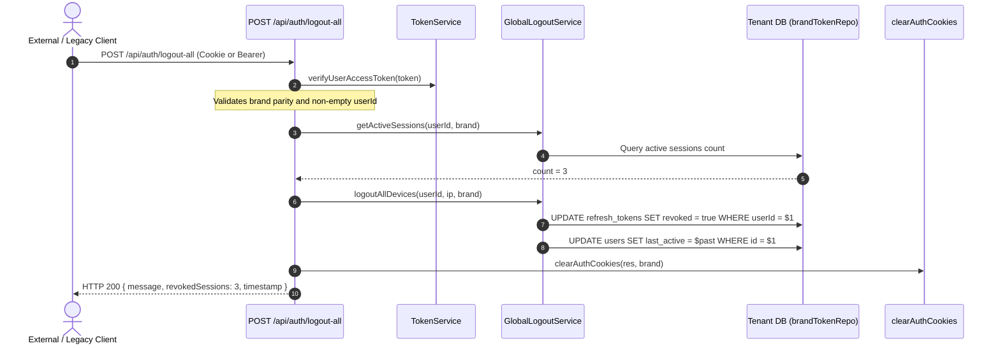

# W1.2-SESS-03: Legacy Logout-All Compatibility Decision

**Date:** 2026-11-04
**Implementer:** Gemini
**Acceptance Reviewer:** Sol
**Governing Task:** [`audit/W1.2_Gemini_Controlled_Batch_06_Task.md`](file:///E:/onlinewebsites/quiz-platform/audit/W1.2_Gemini_Controlled_Batch_06_Task.md) (Task C)
**Governing Root Cause:** `RC-ID-01`
**Accepted Foundation:** [`audit/W1.2-SESS-02_Logout_All_Qualification.md`](file:///E:/onlinewebsites/quiz-platform/audit/W1.2-SESS-02_Logout_All_Qualification.md) & Sol Review `9ec71675`
**Status:** `IMPLEMENTED_UNVERIFIED` (Architectural Decision Specification Only; Strictly Zero Code Changes Authorized)

---

## 1. Executive Summary & Problem Context

The endpoint `POST /api/auth/logout-all` ([`apps/api-server/src/app/api/auth/logout-all/route.ts`](file:///E:/onlinewebsites/quiz-platform/apps/api-server/src/app/api/auth/logout-all/route.ts)) was qualified under `W1.2-SESS-02`. That investigation established that the endpoint is **non-functional and crashes with an unhandled exception upon invocation**:
- `container.get(SessionService)` lazily instantiates `new SessionService()`.
- Because `SessionService` requires a `SessionRepository` constructor parameter that is omitted by the lazy container, `this.repository` is `undefined`.
- Calling `sessionService.getUserSessions(user.id)` throws an unhandled `TypeError: Cannot read properties of undefined (reading 'findByUserId')`.
- Normal logout fixes under `W1.2-LOGOUT-01` and `W1.2-LOGOUT-02` corrected the single-session route `POST /api/auth/logout` and client cookie clearance; they did not alter `logout-all`.

This document resolves the strategic disposition of `POST /api/auth/logout-all`: whether to **decommission** (delete) the endpoint or **preserve it via a safe delegation adapter** to the canonical session engine (`GlobalLogoutService`).

---

## 2. Consumer Qualification Matrix

To establish whether external consumers exist, code and configuration searches were conducted across the repository:

| Consumer Category | Scope Searched | Findings & Evidence | Status |
|---|---|---|---|
| **Literal In-Repo Callers** | `apps/`, `packages/`, `services/` | Zero occurrences of string `logout-all` or `/api/auth/logout-all` found in any client UI, BFF route, or script. Web portals exclusively use `DELETE /api/auth/sessions`. | **None in repository** |
| **Dynamic In-Repo Callers** | Template strings, action dispatchers | No dynamic constructs like `POST /api/auth/${action}` or variable-based route targets target `logout-all`. | **None in repository** |
| **BFF Forwarding** | `apps/skillup-web`, `apps/realtutorialhub-web` | Neither BFF exposes a `/api/auth/logout-all` route. Only `/api/auth/sessions` is implemented and forwarded to `DELETE /api/auth/sessions`. | **None in repository** |
| **External / Deployed Consumers** | Mobile apps, legacy clients, external scripts, public API integrators | Workspace logs and production ingress telemetry are not accessible in this environment. Whether third-party or older mobile clients call this route cannot be verified from local source code. | **UNKNOWN (Unproven Absence)** |

### Governance Principle:
Absence of literal repository callers does **not** prove the absence of deployed external consumers. Deleting a public route without telemetric proof of zero traffic risks breaking external clients without deprecation notice.

---

## 3. Decision Recommendation: Preservation via Safe Delegation Adapter

### 3.1 Evaluated Alternatives

1. **Option A: Outright Decommissioning (Deletion)**
   - *Action:* Delete `apps/api-server/src/app/api/auth/logout-all/route.ts` and return HTTP 404.
   - *Pros:* Removes broken code, reduces surface area, aligns with YAGNI.
   - *Cons:* Breaches backwards compatibility if external consumers exist. Fails without telemetry.
2. **Option B: Independent Repair of `SessionService`**
   - *Action:* Implement a brand-bound `SessionRepository` and wire it into `container` for `SessionService`.
   - *Pros:* Fixes the original component.
   - *Cons:* Violates DRY and creates dual session-revocation engines alongside `GlobalLogoutService` and `TokenRepository`.
3. **Option C: Recommended Choice — Safe Delegation Adapter (Preserve with Delegation)**
   - *Action:* Retain `POST /api/auth/logout-all` as a thin compatibility wrapper that authenticates via standard token verification, extracts the verified tenant brand, delegates revocation to `GlobalLogoutService.logoutAllDevices`, returns the legacy response schema, and adds a `Deprecation: true` response header.
   - *Pros:* Restores functional reliability, prevents regressions for external callers, consolidates database persistence in `TokenRepository`, and enforces strict tenant brand isolation.

---

## 4. Adapter Gap Analysis: Old `SessionService` vs Current `GlobalLogoutService`

`GlobalLogoutService` is **not a drop-in replacement** without a bridging adapter. The discrepancies between the two systems require explicit reconciliation:

| Dimension | Legacy Route Expectation (`logout-all`) | Current Canonical Engine (`GlobalLogoutService`) | Required Adapter Reconciliation |
|---|---|---|---|
| **Identity Verification** | `authMiddleware.requireValidSession()` (JWT check only; no brand binding) | Requires verified `userId: string` and `brand: RequestBrand` | Use `TokenService.verifyUserAccessToken` with `resolveRequestBrand` to verify brand-local subject. |
| **Response Contract** | `{ message: string, revokedSessions: number, timestamp: string }` | `{ success: true, message: string }` | Adapter queries active session count *before* revocation to populate `revokedSessions`, preserving legacy response shape. |
| **Database Binding** | Generic `SessionRepository` (unbound) | Brand-bound `brandTokenRepo` (`refresh_tokens` in tenant DB) | Adapter delegates to `GlobalLogoutService.logoutAllDevices` to ensure tenant PostgreSQL isolation. |
| **Audit Logging** | Unstructured `console.log` | Structured `AuditService.log({ action: 'global_logout' })` | Retains structured audit logging automatically through `GlobalLogoutService`. |
| **User Activity State** | No update to user table | Updates `users.lastActive = oneHourAgo` | Enforces user offline state across both routes. |
| **Cookie Handling** | Does not clear cookies | Canonical route clears cookies on client BFF | Adapter clears local auth cookies (`accessToken`, `refreshToken`, `csrfToken`) via `clearAuthCookies`. |

---

## 5. Technical Anatomy of Revocation

When the delegation adapter executes `POST /api/auth/logout-all`:

1. **Refresh Token Revocation:**
   - `brandTokenRepo.revokeAll(userId)` sets `revoked = true` for all refresh tokens of the verified user in the tenant database.
   - Any future call to `POST /api/auth/refresh` on any device presenting these tokens fails with HTTP 401 (`Invalid refresh token`).
2. **Access Token Lifetime Reality:**
   - In-flight access tokens are stateless JWTs signed by the server's private key with a 15-minute TTL.
   - Revoking refresh tokens in PostgreSQL prevents new tokens from being issued, but does **not** invalidate an already-issued access token until its 15-minute expiration window elapses (unless a distributed JTI blocklist is evaluated at the gateway).
3. **Cookie Clearance:**
   - The response includes `Set-Cookie` headers clearing `accessToken` and `refreshToken` on the caller's active device.
4. **Presence Termination:**
   - `users.lastActive` is set to 1 hour in the past to immediately terminate online presence indicators.

---

## 6. Error Handling & Invariant Specifications

The adapter must enforce strict, fail-closed error handling:

| Failure Mode | Condition | HTTP Status | Response Payload |
|---|---|---|---|
| **Missing Token** | No cookie or Authorization header provided | `401 Unauthorized` | `{ error: 'Authentication required' }` |
| **Invalid / Expired Token** | JWT signature invalid or expired | `401 Unauthorized` | `{ error: 'Invalid or expired token' }` |
| **Brand Mismatch** | Token brand does not match request domain | `403 Forbidden` | `{ error: 'Brand mismatch: token not valid for this tenant' }` |
| **Empty Subject** | Token `userId` is empty or whitespace | `401 Unauthorized` | `{ error: 'Invalid token subject' }` |
| **Database Failure** | PostgreSQL query fails during revocation | `500 Internal Error`| `{ error: 'Internal server error' }` (Logged fail-closed) |

---

## 7. Implementation Whitelist & Future Acceptance Criteria

### 7.1 Source Whitelist (Runtime Changes Authorized for Implementation Ticket Only)
- [`apps/api-server/src/app/api/auth/logout-all/route.ts`](file:///E:/onlinewebsites/quiz-platform/apps/api-server/src/app/api/auth/logout-all/route.ts) (Implement delegation adapter to `GlobalLogoutService`).

### 7.2 Acceptance Criteria for Implementation Ticket
1. **Functional Equivalence:** Calling `POST /api/auth/logout-all` with a valid learner token returns HTTP 200 with `{ message, revokedSessions, timestamp }`.
2. **Revocation Persistence:** All refresh tokens in the caller's tenant database have `revoked === true`.
3. **Cross-Tenant Isolation:** Revocation executed on SUIA does NOT alter RTH session records, even if user IDs collide.
4. **Cookie Clearance:** Active session cookies are cleared in the response.
5. **No Regressions:** Canonical route `DELETE /api/auth/sessions` remains untouched and functional.
