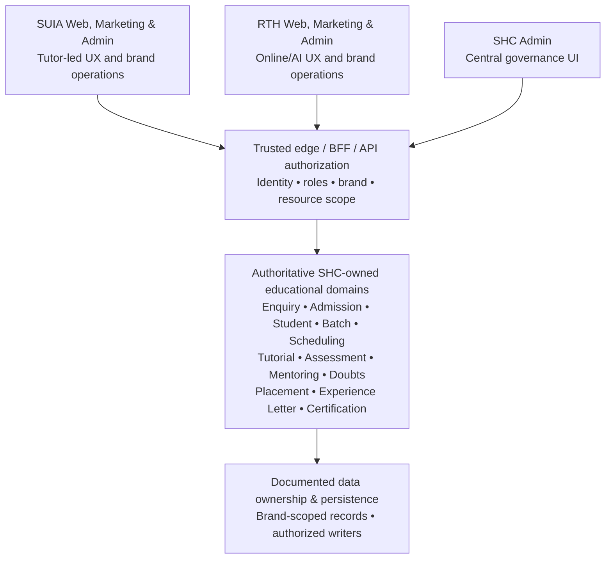

# Project-Wide Software Architecture & Engineering Governance Standard

**Document ID:** PSEG-001  
**Version:** 1.1 — Proposed for project-owner approval; **working audit baseline**  
**Scope:** The entire SHC–SUIA–RTH ecosystem, not just SHC Admin. Applies to all existing applications and all future features, educational domains, APIs, BFFs, packages, data stores, workers, and deployments.  
**Project stage:** Development; no current student end users. Current developer-managed Docker deployment to a Hostinger VPS. Paid GitHub CI/CD is **not** mandated.  
**Audit baseline:** `skillupitacademy-alt/SUIA_RTH_SHC`, `feature/project-llm-linux-worker`, SHA `4207cb1ca11abc29ca263310f5a4d54b859cd77f` for the existing SHC Admin source reports; **revalidate against actual HEAD**. Git source is not proof of the current Hostinger image.  
**Source basis:** The agreed project architecture discussions; `FinalAechitecture.md`, `ProjectSoftwareArchitectureStandard.md`, `ProjectServiceAcceptanceStandard.md`, and `ProjectImplementationWorkflow.md`. Historical audits are evidence leads, not current source truth.

> **Purpose:** This is the ONE umbrella governance standard for project-wide architecture decisions, engineering quality, audits, future module implementation, and release approval. The detailed architecture, acceptance, and workflow documents are **supporting annexes** under it—not competing standards. Nothing here by itself authorizes code changes or certifies the repository.

## 1. Governing decisions that must remain stable

1. Adopt a **centralized modular multi-brand education platform**, with **SHC logically owning shared educational capabilities** and their API/data contracts. Modular monolith or distributed deployment are both acceptable; do not demand one microservice per capability.
2. **SUIA (SkillUp IT Academy)** is a separate **tutor-led** brand with its own student/staff experiences and **brand-scoped administration**.
3. **RTH (Real Tutorial Hub)** is a separate **online/AI-led** brand with its own student/staff experiences and **brand-scoped administration**.
4. **SHC Admin** is the **platform-governance UI**, not a synonym for the shared service backend. It manages shared policies, curriculum, identity/permission governance, services/content, and strictly authorized cross-brand oversight.
5. **SUIA Admin and RTH Admin retain their respective administrative screens**, student operations and delivery-specific user experience. They consume shared SHC domain rules; they do not independently own equivalent canonical educational business rules.
6. Global person/identity is not automatically an enrollment, admission, permission, subscription or entitlement for either brand. Each brand grant is explicit and enforced.
7. Audit and preserve the existing system first. A current shared capability may physically reside under `apps/api-server` or another existing service; **a directory move is not architecture compliance**. Determine one authoritative writer and owner from actual calls and database use.
8. Current physical DBs (including historically mentioned `people_prod`, `skillup_prod`, `rth_prod`) are assets to map, not permission to redesign persistence without a separate approved plan.
9. Hostinger is a **current infrastructure choice**, not an architectural dependency. Keep OCI Docker images, config, storage contracts, and data migration portable to another VPS/Azure/AWS/GCP when evidence and cost justify it.
10. **No code migration, deletion, database mutation, deployment, paid CI adoption or service consolidation is authorized by an audit document.** The project owner must authorize each implementation work item.

## 2. Applicability and hierarchy of documents

**Source of authority** (highest to lowest, subject to an explicit new project-owner decision):

1. The owner's latest explicit architectural/business decisions and approvals, recorded in this standard or a decision record (ADR).
2. **This Project-Wide Software Architecture & Engineering Governance Standard (PSEG-001).**
3. `ProjectSoftwareArchitectureStandard.md` — deeper target boundaries, principles, portability.
4. `ProjectServiceAcceptanceStandard.md` — detailed verification and mandatory pass criteria.
5. `ProjectImplementationWorkflow.md` — auditable workflow, local release gates, migration practices.
6. Application-specific and domain-specific checklists (e.g. SHC Admin `SHCA-*`), which **add** criteria but may not weaken universal security and architecture gates.
7. Historical audit reports, findings snapshots and plans — **evidence leads**, not governing law or proof of current implementation.

**Facts versus policy:** Current implementation facts are determined by exact Git source, runtime responses, safely executed tests, database schema/migration evidence and deployed image metadata, **not** by whichever audit document is newest. If policy documents disagree, log `GOV-CONFLICT` with exact citations and ask the project owner to settle it; do not silently substitute a model preference.

**Status:** This is an agreed **working audit baseline** but still labeled **proposed** until the owner approves the actual document. After approval, change via versioned ADR/change request; retain old versions and their applicability dates.

## 3. Logical boundaries and one service owner



- **Frontend / UI:** renders the appropriate brand experience, forms, table views and navigation. Frontend visibility is not authorization.
- **BFF:** verifies a trusted session and mutation origin; maps the UI contract; forwards to an authoritative service. Small orchestration is allowed; **authoritative educational state transitions and cross-brand data writes do not belong in a brand BFF**.
- **Application/domain service:** owns state machines, validation of business invariants, consistency, entitlement/brand policy, idempotency and events.
- **Repository / data boundary:** owns persistence contracts, scopes reads/writes, constraints and approved migrations. Avoid direct multi-database writes from UI routes; map cross-DB failures and compensating recovery explicitly.
- **Background workers / providers:** manage asynchronous email, SMS, AI, analytics, jobs and generated documents with bounded retries/timeouts and safe secrets.

A service is an **authoritative logical capability**, not necessarily a separately deployed container. Do not add a separate process, message broker, orchestration platform, or interface without demonstrated need.

## 4. Platform ownership and administration matrix

| Area | Authoritative logic/data policy | SHC Admin | SUIA Admin | RTH Admin |
|---|---|---|---|---|
| Identity & platform grants | SHC-governed identity/entitlement authority | Global policy; explicitly privileged review | SUIA membership/role actions via approved API | RTH membership/role actions via approved API |
| Curriculum, taxonomy, common content | SHC-owned catalog/content domain | Own shared resource governance and authoring | Consume/configure approved SUIA experiences | Consume/configure approved RTH experiences |
| Enquiry & admissions | One SHC-owned lifecycle and writer | Shared rules / authorized reporting | Operate only SUIA enquiries and admissions | Operate only RTH enquiries and admissions |
| Students, cohorts, batches, schedules | Shared rules with brand-scoped records | Shared policies and oversight | Manage SUIA students, tutors, faculty, timetable | Manage RTH students, online/AI sessions |
| Tutorial, assessment, exams, progress | Shared engines, approved brand/delivery policy | Shared content, academic rules, audit | Tutor-led participation and reports | Online/AI participation and reports |
| Mentoring, doubt solving & guidance | Shared state/permission contracts | Shared policy, quality/safety governance | Tutor/faculty mentoring | AI-led or approved human escalation |
| Placement, letters, certificates | Shared eligibility, issuance, verification rules where applicable | Shared templates, rules and oversight | SUIA-scoped requests and actions | RTH-scoped requests and actions |
| Billing/payments/subscriptions | One documented authority per monetary/entitlement rule; may be existing service pending audit | Shared product/policy oversight | Authorized SUIA transactions | Authorized RTH transactions |
| Marketing & analytics | Shared bounded platform contracts, brand-aware records | Cross-brand governance per permission | SUIA channel/content | RTH channel/content |

**Non-negotiable:** Shared SHC logic does NOT imply SHC administrators have unlimited access to individual students or that records are automatically visible across brands. Define least-privilege cross-brand grants and audit their use.

## 5. Universal acceptance gates (PSEG-U)

These apply to **every** relevant change or audit target. For a UI-only/static site some checks are justified N/A, not silently skipped. The detailed tests live in the Acceptance Standard.

| ID | Gate | Required outcome / proof |
|---|---|---|
| PSEG-U01 | Ownership | One documented canonical owner for every educational business rule and writer; no competing implementations. |
| PSEG-U02 | Separation & SRP | UI, BFF, domain, persistence and infra responsibilities appropriately separated. |
| PSEG-U03 | SOLID/dependency direction | Low coupling/high cohesion; no unintended cyclic or cross-app dependencies; practical DIP/ISP/OCP/LSP. |
| PSEG-U04 | DRY/KISS/YAGNI | Avoid genuine rule duplication and needless layers, helpers and infrastructure. |
| PSEG-U05 | Typed contracts | Request/response/events validated, typed, versioned where needed; consumers tested for compatibility. |
| PSEG-U06 | Brand isolation | Trusted server-resolved brand; scoped records, aggregates, object access and entitlements; negative cross-brand tests. |
| PSEG-U07 | Security | Authn/authz/RBAC, least privilege, CSRF/origin as applicable, secrets, input limits, abuse defenses, PII/privacy. |
| PSEG-U08 | Data integrity | Single writer/owner, correct FK/unique indexes, transactions, idempotency and migration/restore safety. |
| PSEG-U09 | Resilience | Appropriate timeouts/retries, safe failures, event reliability, no misleading success or silent corruption. |
| PSEG-U10 | Observability | Correlation, actionable logs/metrics, incident traceability, no PII/secret leakage. |
| PSEG-U11 | Frontend UX | Responsive, accessible, accurate states/data, loading/error/empty states and destructive-action safeguards. |
| PSEG-U12 | Tests | Risk-appropriate unit, contract, integration, authz-negative, E2E and performance evidence. |
| PSEG-U13 | Portability | OCI Docker, portable env/secret contracts, provider-neutral domain logic and stateful migration plan. |
| PSEG-U14 | Release traceability | Exact source SHA, commands/results, image build identity, smoke checks and rollback/recovery plan. |

**Mandatory blocker:** A critical/high security flaw, successful cross-brand privilege bypass, unsafe unrecoverable data migration, broken required tests/builds, or an incorrect monetary/academic record cannot be waived through a percentage score. A requirement can be `N/A` only with rationale; an exception must name the owner, risk, scope, expiry and mitigation and cannot override a hard blocker.

## 6. Component-specific acceptance profiles (PSEG-C)

Choose the applicable profile(s) **in addition to** the universal gates; do not force one checklist on unlike components.

| Profile ID | Component | Additional checks |
|---|---|---|
| PSEG-C01 | SHC Admin UI | Shared governance vs student operations; real data vs demos; restricted administration, durable workflows, audit, role visibility. |
| PSEG-C02 | SUIA learner web | Tutor-led sessions, schedule, enrollment, progress, private student records, exact SHC contract and accessibility. |
| PSEG-C03 | RTH learner web | Online/AI study runtime, rate/cost/AI safety, progress, visibility, SHC contract and RTH isolation. |
| PSEG-C04 | SUIA/RTH brand admins | Brand-scoped student/enquiry/batch/admission operations; retain correct UI; no independent domain authority. |
| PSEG-C05 | Marketing websites | SEO, accessibility, content provenance, consent, anti-abuse enquiry APIs, performance, brand attribution and security. |
| PSEG-C06 | SHC domain services | Lifecycle invariants, persistence writer ownership, authorization, idempotency, failure recovery, published API contracts. |
| PSEG-C07 | BFF/API gateways | Session/source/origin auth, safe header forwarding, resource scoping, strict validation, safe error/timeout behavior. |
| PSEG-C08 | DB/migrations | Schema/migration compatibility, access grants, backups, deletion/retention, concurrency and controlled releases. |
| PSEG-C09 | AI/content workflows | Human approval durable state, prompt/provider boundary, token budget/rate limit, safe retrieval, provenance/quality, retries. |
| PSEG-C10 | Deployment/infra | Docker/config secrets, liveness/readiness, data durability, backup/restore, version match and cost-aware scale triggers. |

**SHC Admin checklist (`SHCA-*`) is an extension of this table**, not an alternative standard. Future applications use `SUIA-WEB-*`, `RTH-WEB-*`, `SUIA-MKT-*`, `RTH-MKT-*` or suitably defined identifiers; future services use domain-specific IDs while linking applicable PSEG-U and PSEG-C gates.

## 7. Educational service review order (after application baseline)

After completing application-level audits, review the **existing implementations**, not new reference implementations, in this agreed order:

1. Enquiry.
2. Admission and student identity/membership.
3. Batch, capacity and scheduling.
4. Tutorial/study/lectures/notes.
5. Assessment and examinations.
6. Mentoring and guidance.
7. Doubt solving.
8. Placement.
9. Experience letter.
10. Certification.

For **every** domain first inspect current implementation in SUIA Admin, RTH Admin, SHC and relevant `api-server`/packages, including consumers/data owner. Then determine **PRESERVE / CONSOLIDATE / REFACTOR / DEPRECATE**. Deprecation and deletion follow *only after* both brand integrations, data parity, tests and rollback are proven. Do not copy code to SHC based on names alone. Domain-specific acceptance additions: enquiry source/consent/anti-spam; admission grants and workflow; batch capacity/conflicts; tutorial entitlements/progress; assessments authoritative grading; mentoring/doubts escalation; placement eligibility; letters/certificates issuance, authenticity, revocation.

## 8. Standard implementation workflow (PSEG-W)

### Phase A — application audit baseline (current phase)

1. Record repo and actual commit; determine whether local checkout/Hostinger deployed image differs.
2. Inventory every page, component, BFF API route, downstream module/service, repository, table, test and deployment boundary for **one app at a time**.
3. Trace important paths `page → component/hook → client contract → BFF/gateway → domain service → repository → DB/event/provider`.
4. Compare against PSEG-U, relevant PSEG-C, the detailed Service Acceptance Standard and application checklist.
5. Classify `PASS / FAIL / PENDING / N/A` and implementation maturity; record source refs + test command + actual result; distinguish source-only evidence from runtime.
6. Publish a single app-specific ledger and an executive/report summary. Do not modify code as part of audit.

**Agreed app order:** `skillhubcore-admin` → `skillup-web` → `realtutorialhub-web` → SUIA marketing website → RTH marketing website → cross-application reconciliation. Brand-admin apps are separately audited **in their relevant service ownership/migration workstream**, along with any newly identified dependencies; this does not remove their security obligations.

### Phase B — verified-gap remediation (only after approval)

Prioritize proven critical security or data-integrity risks; prepare minimal change proposal, affected SHC/SUIA/RTH contracts, test plan, rollback and explicit approval. Correct the existing authoritative implementation; avoid introducing a second service or needless folder migration. After changes, re-audit against the **new** SHA.

### Phase C — future feature/module development

Requirement & brand variants → owner/ADR → API/event/schema contract & threat model → small implementation plan → code → automated tests → integration/cross-brand testing → architecture review → safe local release gate → Docker image/smoke → evidence/approval.

### Phase D — safe retirement of duplicated legacy code

Only after the new shared interface is verified and both brands consume it, compare data/behavior, decommission old writers behind flags or routing, verify monitoring and rollback, then remove obsolete code in a separately approved step. **Never delete before dependency closure and rollback verification.**

## 9. Quality gates, without paid CI/CD

The current development-stage workflow allows **locally run commands** rather than GitHub Actions. A local release evidence bundle must still record target app, exact SHA, dependency versions, command exit codes, tests, Docker digest/tag, config/migration version, operator, smoke results and rollback pointer.

- Use the repo's actual scripts, e.g. `pnpm install --frozen-lockfile`, app lint, type checking, relevant unit/security/integration tests, gateway/RBAC validation when impacted, build, Docker Compose config validation and isolated test smoke. **A command's existence is not a PASS.**
- Before running anything DB-backed, confirm isolated test DB and safe credentials; never run destructive tests, migrations or load tests on Hostinger or shared real data as part of a read-only audit.
- Commit SHA and running image are independent facts. A successful Git build does not establish Hostinger running-state compliance.
- Acceptance requires **zero unresolved hard blockers**, 100% mandatory tests passing for the relevant risk profile, documented limited exceptions, and owner sign-off. Do not use an arbitrary 90% score.
- Before real student onboarding or payments, reassess whether manual checks provide enough assurance; CI/CD can be added later based on cost/risk, without redesigning domains.

## 10. Scalable, provider-portable baseline

- Build standard OCI/Docker images; use env validation, external secret injection and explicit health endpoints.
- Keep application/domain code free of hosting-provider SDK assumptions where avoidable; isolate AI/mail/SMS/storage/queue/payment provider adapters when realistic changes are expected.
- Keep provider-bound Compose and infrastructure config **outside domain rules**; document reverse proxy, TLS/DNS, routing and allowlists.
- Document databases, owned tables, file/object storage, queues, stateful volumes, migrations, backup/restore and export/import. Test restore before a high-risk change.
- Scale on measured concurrency/RPS, p95/p99 latency, database saturation, worker queue depth, provider cost and stability—not speculative volume targets.
- Hostinger → Azure/AWS/GCP/another VPS migration means planned networking and data migration; application educational business logic should remain reusable, not imply zero-effort migration.

## 11. Evidence policy and single-source-of-truth record

Each audit criterion must have: `requirement_id`, `app/module`, `owner`, `source path:line`, `exact SHA`, `observation`, `test`, `execution result`, `status`, `risk/severity`, `decision`, `reviewer`, `date`, `dependency`, `exception/expiry` (if any). Evidence links and test logs must be retained and redact PII/secrets.

**Acceptance states:**

- `PASS`: applicable requirements satisfied **and required evidence actually executed** and tied to the inspected SHA/environment.
- `FAIL`: source-level violated requirement or a failed mandatory test; distinguish unexecuted tests from failure.
- `PENDING`: partial verification, absent run/results, or unresolved owner/contract question.
- `N/A`: justified nonapplicability, approved by reviewer.

Separately record maturity as `Implemented+Verified / Implemented+Unverified / Partial / Not Implemented / N/A`. Never equate source-visible safeguard to runtime-verified PASS; never equate a mock page to an operational service. Historical findings may be `CONFIRMED / FALSE_POSITIVE / RESOLVED_AT_NEW_SHA / UNVERIFIED` independently from acceptance status.

**One current record per workstream:** For SHC Admin, update the `SHC_ADMIN_ACCEPTANCE_LEDGER.csv` only; generate one `SHC_ADMIN_TECHNICAL_VERIFICATION_REPORT.md` derived from it. Later each app/module gets its **own** ledger plus an indexed project-wide register. Previous snapshots remain immutable, so no competing live truth exists.

## 12. Who decides, who verifies, and what is authorized

- **Project owner (user):** approves this governance standard, material architecture/ADR changes, implementation, access to real systems, migrations, deletions and deployment.
- **ChatGPT (architecture reviewer):** maintains architecture interpretation, reviews evidence/results, proposes bounded next tasks; does not independently declare runtime PASS without results.
- **Project AI agent (technical verifier):** follows these written rules, inspects exact repo state, executes only safe read-only checks, updates the ledger and writes its report; does **not** refactor, delete, commit, push, deploy, change infra, or access production DB as a consequence of audit instructions.
- **Developer/release operator:** when separately authorized, performs implementation and local release gates, records immutable evidence and rollback steps.

## 13. Required approval at each gate

| Gate | Decision | Approval/evidence |
|---|---|---|
| G0 — Scope | Identify the app, SHA, scope, safety constraints | Audit coordinator; no code changes |
| G1 — Architecture | Owner, dependency, brand/data policy and contracts | Architecture review |
| G2 — Implementation | Change proposal, affected consumers, migration/rollback | **Explicit project-owner approval** |
| G3 — Verification | All applicable standards and mandatory tests, risk report | Signed evidence review, no false PASS |
| G4 — Release | Exact image, local gates, smoke, backups and rollback | Project-owner/delegated operator approval |
| G5 — Retirement | Every caller migrated, parity and rollback proven | **Separate approval** for deletion/deprecation |

## 14. Reuse this template for every subsequent app and service

For each new app audit create: (a) scope and exact SHA, (b) page + API inventory, (c) frontend/BFF/backend/data trace, (d) PSEG-U applicability matrix, (e) matching PSEG-C profile, (f) app-specific requirements, (g) finding register with critical/high/medium/low evidence, (h) test execution manifest, (i) explicit `NOT RUN` list, (j) one living acceptance ledger, (k) bounded next-action recommendation. No app is certified until G3 is actually met.

For each **future module or new SHC service**, create a `MODULE_ID`, one owner, brand policies, use-case/state diagram, typed API and data contract, authorization threat cases, state/transaction/idempotency rules, performance/resource budget, tests/evidence, rollout and rollback plan. **The same PSEG-U gates apply** with the relevant PSEG-C and domain-specific additions.

## 15. Current SHC Admin audit: a deliberately narrow execution scope

- **SHC Admin only now:** `apps/skillhubcore-admin` and its directly used backend/package dependencies. Do not start SUIA/RTH application audits or enquiry/admission refactoring in this work package.
- Original `SHCA-*` checklist defines **62** criteria. Prior **source-only** snapshot: **25 FAIL, 37 PENDING, 0 runtime-verified PASS** at SHA `4207cb1ca11abc29ca263310f5a4d54b859cd77f`. These are **criterion rows, not 25 separate security defects**; reverify at the actual checkout SHA.
- Project AI reads the package entry README, **then this standard**, then detailed architecture/acceptance/workflow and SHC-specific checklist/reports; updates only the SHC Admin ledger. Previous audits are leads, not permission to implement.
- All findings remain proposals. No host deployment, test execution, git modifications, code deletion or database operation is represented as having occurred in these supplied audit documents.

## 16. Changes to this standard

Any change to SHC ownership, brand boundaries, hard gates, data authority, deletion approval or deployment approach requires: `ADR ID`, owner, date, reason, options, security/data impact, affected apps/modules, migration plan, approval and new standard version. Small editorial changes require version and change log. Other applications must never silently work from a different version of the governing policy.

**Document lifecycle:** Proposed v1.0 → owner approval → version-controlled canonical file in the shared repository → versioned future updates. Until approval, Project AI may use it as a *working review baseline*, not a license to modify code.


---

# Part II — Explicit Architecture Contracts for Global Readiness (v1.1)

> **Version change from 1.0:** Sections 17–23 formalize critical architecture domains, API-first standards, nonfunctional and worldwide scale-readiness requirements. The original decisions, existing `PSEG-U01`–`PSEG-U14`, `PSEG-C01`–`PSEG-C10`, application-specific checks, audit-first workflow and authorization boundaries remain intact. **These are amendments within PSEG-001, not a second standard or authorization to implement new infrastructure.** This expanded coverage is **proposed** until project-owner approval. Source audit outcomes remain unchanged pending verification.

## 17. Architecture domain coverage and audit applicability (PSEG-AR)

Each applicable architecture domain has an explicit contract and evidence requirement. `PSEG-ARxx` references can be mapped to the existing app ledger's notes/requirement references; do **not** silently change the count or identity of the original 62 SHC Admin checklist rows. Apply each to the real function of the component and record N/A with rationale where it does not apply.

| ID | Domain | Required governing outcome | Stage |
|---|---|---|---|
| PSEG-AR01 | Frontend UI & design system | Reusable accessible components, appropriate SSR/CSR, safe state, responsive UX, measurable user-facing performance, supported browser matrix | Contract now |
| PSEG-AR02 | BFF & UI-to-service boundary | One BFF role per app; verified session/CSRF; trusted context; bounded transformations; no duplication of SHC canonical rules | Contract now |
| PSEG-AR03 | Public/internal API design | Contract-first HTTP API standards in §18; versioning, idempotency, pagination, security, limits, evolution and documentation | Contract now |
| PSEG-AR04 | Authentication | Global identities vs brand sessions; admin/student separation, secure token lifecycle, MFA for sensitive operations, revocation | Contract now |
| PSEG-AR05 | Authorization & entitlement | Server-side role, permission, brand, resource and field-level decisions; centralized policy semantics, default deny, negative tests | Contract now |
| PSEG-AR06 | Domain authority & ownership | Explicit SHC authoritative service/writer, brand policy, data owner, state machine and actor per operation | Contract now |
| PSEG-AR07 | Backend & module architecture | Modular domain services, well-defined dependency direction, transaction boundaries, KISS and single rule owner | Contract now |
| PSEG-AR08 | Data, DB & consistency | Logical tenant keys and constraints; concurrency control; migrations; integrity; indexing; recovery; conditional partition/shard strategy | Contract now |
| PSEG-AR09 | Caching & content delivery | Cache classification, scoped keys, TTL/invalidation/ETag, CDN and negative cache rules; forbid private cross-user leakage | Contract now |
| PSEG-AR10 | Zero-trust & application security | No implicit network/client trust, OWASP risks, secrets, encryption, least privilege, identity verification across boundaries | Contract now |
| PSEG-AR11 | Reliability & resilience | Failure-mode design, timeouts, retry budgets, circuit-breakers, bulkheads, backpressure, idempotent recovery | Contract now |
| PSEG-AR12 | Events, queues & asynchronous work | Document events, publisher/consumer ownership, outbox where applicable, dedupe, DLQ, replay, retention and observability | Contract now |
| PSEG-AR13 | Distributed systems & consistency | State which workflows are atomic or eventually consistent; avoid naive distributed transactions; recovery/compensation | Contract now |
| PSEG-AR14 | Scalability & performance | Defined workload profiles, capacity budgets, SLOs, realistic load/soak tests, stateless replicas where feasible | Contract now; capacity later |
| PSEG-AR15 | Edge, networking & infrastructure | TLS/DNS/routing, network isolation, secrets, connectivity, WAF/CDN as risk warrants, infrastructure topology/runbook | Contract now; expand later |
| PSEG-AR16 | Portable build & deployment | Reproducible OCI image, env validation, provider adapters, runtime health, image provenance, staged rollback | Contract now |
| PSEG-AR17 | Observability & auditability | Correlation/trace IDs, metrics, logs, traces, security audit trails, actionable alerts, privacy redaction | Contract now |
| PSEG-AR18 | Disaster recovery & continuity | Backups, restoration drills, RPO/RTO by criticality, runbooks, failover and recovery exercises | Design now; test before users |
| PSEG-AR19 | DevSecOps & supply chain | Dependency/scanning, pinned builds, security regression, test pyramid, architectural fitness checks, local evidence gates | Contract now |
| PSEG-AR20 | Privacy, retention & compliance | Personal/minor data classification; consent; residency; erasure/export; retention and jurisdictional legal review | Contract now |
| PSEG-AR21 | AI, content and learning-delivery | AI/tutor-specific delivery policy, model/provider abstraction where justified, provenance, prompt safety, spend and quota controls | Contract now |
| PSEG-AR22 | Educational business-domain correctness | Enquiry→admission→batch→tutorial→assessment→credentials chain, integrity, state machines, progress, issuer authority | Contract now |
| PSEG-AR23 | Internationalization & global operations | UTC timestamps/time-zone boundaries, localization, date/calendar/number formatting, WCAG, low-bandwidth UX, regional operations | Contract now |
| PSEG-AR24 | Financial, quota & cost engineering | Payment truth, ledger correctness, provider spend caps, per-brand cost visibility, cost/per-request and capacity planning | Contract now |
| PSEG-AR25 | Evolution, ADRs & deprecation | Versioned decisions/contracts, migration windows, backward compatibility, safe retirement, owner authorization | Contract now |

**Additional nonfunctional cross-cuts:** accessibility, developer experience, sustainability/energy, data analytics/reporting lineage, search architecture, notifications/communications, storage/media pipeline, infrastructure-as-code, incident management and abuse prevention are mapped into AR01/07/08/09/15/17/19/20/21/23/24 as applicable. New standalone subsystems are not required merely to achieve coverage.

## 18. API Design Architecture — mandatory contract (PSEG-API)

Every SHC canonical domain capability must expose an **explicit internal or external contract**, even when its first implementation remains inside a modular monolith or existing `api-server`. BFF endpoints may adapt the contract but must not become a second independent domain owner. Prefer the REST/HTTP style already present unless evidence supports another protocol. API specifications should use a team/toolchain-supported OpenAPI version (3.1.x or 3.2.x where compatible); do not upgrade tooling solely to claim the latest revision. Schemas may be generated from authoritative validated code if they remain synchronized and contract-tested.

| Gate | Mandatory criterion and evidence |
|---|---|
| API-01 Ownership and catalog | Unique API owner, consumers, public/internal classification, operation purpose, deprecation contact, source path and version. Do not expose internal DB tables as public API by default. |
| API-02 Resource semantics | Consistent nouns/resource IDs, correct GET/POST/PATCH/PUT/DELETE behavior, HTTP statuses, explicit safe/idempotent method semantics; avoid action endpoints except documented state transitions. |
| API-03 Typed schemas | Validate path/query/body/headers and returned fields; bounded strings, enumerations, dates, nested depth, uploads, list sizes and max response sizes; reject unknown mutable fields for sensitive resources. |
| API-04 Documentation | OpenAPI or equivalent machine-readable HTTP contract; request/response/error examples; privacy/role/brand preconditions and accurate generated client types. |
| API-05 Authentication | Endpoint classification and exact audience/scope/session rules; admin vs student vs public tokens; caller-supplied identity headers are not trusted. |
| API-06 Authorization | Apply role + action + brand + resource-owner + field visibility on **every** query, mutation, export and aggregate. Deny mismatched record IDs and cross-brand access; prove with negative tests. |
| API-07 Context provenance | Determine SUIA/RTH from trusted host/session/client registration or verified service-to-service context; URL/body `brandId` may select permitted scope but never grant permission itself. |
| API-08 Standard errors | Stable error code, human-safe message, request/correlation ID, actionable validation details, appropriate 400/401/403/404/409/422/429/5xx semantics; never leak stack traces or secrets. |
| API-09 Pagination/query efficiency | Default and maximum page sizes, stable cursor ordering, bounded filters/sort/search, database-index alignment and no accidental full-table queries; include next cursor and deletion semantics as needed. |
| API-10 Idempotency & concurrency | Explicit idempotency key for side-effecting enrollment/payment/issuance or other replay-prone operations; uniqueness/transactions; version/ETag or equivalent optimistic concurrency for collaborative edits; 409/412 conflict semantics as designed. |
| API-11 Versioning and compatibility | Document URL/header/schema version policy, additive change rules, sunset/deprecation timeline and consumer compatibility tests for SHC, SUIA and RTH; do not break existing clients silently. |
| API-12 Abuse/resource controls | Per-identity/brand/IP route-aware rate limits and quotas, authenticated public submission anti-abuse as applicable, bounded CPU/memory/time/AI tokens/uploads/batch sizes; return 429 and Retry-After when relevant. |
| API-13 Resilience | Bounded timeouts/retries/backoff, cancellation and backpressure; prevent retry storms, duplicate domain transitions and indefinite upstream hangs; specify failure semantics for external dependencies. |
| API-14 Cache and HTTP semantics | Clearly classify publicly cacheable, shared-brand, private-user and noncacheable responses; Cache-Control, ETag/conditional requests; cache keys include permission/brand context or disable cache. No private data in shared caches. |
| API-15 Asynchrony and webhooks | For long jobs use explicit async job state/status endpoints (e.g. 202 when appropriate), deduped events and webhook signature/replay protection. Worker retries must be safe. |
| API-16 Security tests | OWASP API risk mapping: object-level/function/property-level authorization, authentication, resource consumption, SSRF, misconfiguration, asset inventory and unsafe upstream consumption. |
| API-17 Telemetry and SLO | Versioned route metric names, request/trace correlation, latency and error-rate budgets, per-brand attribution without high-cardinality PII, load test evidence. |
| API-18 Data exposure and privacy | Field-level allowlists, PII classification, redacted logs, export controls, retention/consent behavior, no secrets in query strings or error bodies. |
| API-19 Test coverage | Positive + malformed + anonymous + wrong-role + wrong-brand + wrong-owner + duplicate + stale-version + backend-down + timeout + throttled + contract-change scenarios as applicable. |
| API-20 Evolution and audit | Changed endpoints have ADR/contract-diff, consumer impact list, deployment compatibility window, rollback and release evidence tied to exact SHA. |

**Illustrative—not claimed existing—API contract:**

```text
POST  /v1/enquiries              (public submission; server determines trusted channel/brand)
GET   /v1/enquiries?limit=...    (authenticated; brand+actor scoped; cursor paginated)
GET   /v1/enquiries/{id}        (authorized object read)
POST  /v1/admissions             (authorized transition; idempotency key)
GET   /v1/tutorials/{id}        (authorized content read; version/ETag)
PATCH /v1/tutorials/{id}        (authorized optimistic update; If-Match or version)
POST  /v1/tutorials/{id}/publish (explicit authorized state transition)
```

Suggested success envelope and error representation should be decided consistently; avoid automatically wrapping responses when existing clients already depend on another contract. Example **error** response for a validated API design: `{"error":{"code":"VERSION_CONFLICT","message":"Content changed; reload before saving."},"requestId":"..."}`. This is an illustration, not permission to change deployed routes.

### 18.1 Frontend → BFF → canonical API: authority and security

- Browser may supply a requested domain resource ID, selected brand scope and an idempotency key but **may not assert granted roles, user identity, administrative level, billing entitlement or tenant ownership**.
- Brand BFF validates session/origin, anti-CSRF where applicable, maps requests and prepares server-verified identity context. It may aggregate reads with bounded timeouts; it must never authorize by merely hiding UI or trusting `x-brand`/`x-user-id` from the browser.
- SHC backend independently checks service-to-service trust as needed, authoritative permissions, domain invariants, resource owner, transaction, brand scope and data constraints. A trusted gateway alone does not justify removing authorization checks in the domain boundary.
- Data/repository layer uses scoped queries, unique/FK/check constraints, and row-level policy where justified; platform administration can cross brands **only** by explicit audited grant.
- Cache/storage layer must not allow a higher-privilege or other-brand response to be replayed to a lower-privilege caller.

### 18.2 Mandatory API change and acceptance artifacts

For each domain module or nontrivial endpoint: owner and consumers; OpenAPI/typed schema; error and auth policy; brand/resource matrix; lifecycle/idempotency; storage and cache behavior; baseline latency/throughput budget; conformance/security/contract tests; deprecation and rollback; exact SHA/test evidence. A public form and an administrative API may reuse one SHC service but need distinct threat models and auth/rate limits.

## 19. Authentication, Authorization, Authority and Zero Trust are different contracts

1. **Authentication:** Which human, service or device is making the request? How were identity, session, MFA, recovery and token revocation established? A verified JWT without the correct audience and active-grant semantics is insufficient.
2. **Authorization:** May this authenticated principal perform this action on *this particular brand, object, field and workflow state*? RBAC is a starting point; subject/resource/brand attributes and entitlements may require ABAC or explicit policy checks. Admin access is not unlimited cross-brand access.
3. **Authority:** Which **SHC service/module and storage writer** is allowed to make the canonical domain decision? A correct user permission does not make a brand-admin BFF the authoritative admission/certificate writer.
4. **Zero Trust:** Neither being inside a Docker network nor possessing an internally forwarded header is sufficient trust. Verify workload identity and sensitive requests at meaningful trust boundaries; least privilege, private network paths and short-lived credentials where justified. Align threat assessment with NIST SP 800-207 principles.
5. **Zero Tolerance (release policy):** This is **not an architecture style** and not a promise of zero bugs. Hard stop on demonstrated cross-brand/IDOR access, exposed credentials, unauthenticated privileged writes, fabricated academic/financial records, missing authoritative money/exam/credential controls, unsafe destructive migrations and critical/high unmitigated security vulnerabilities. Other risks receive justified severity, owner and expiry; no arbitrary percentage waives a hard blocker.

## 20. Architecture for worldwide users and extreme concurrency

### 20.1 Define workload truth before selecting infrastructure

"Millions of registered learners," "millions of daily active learners" and "millions of learners concurrently watching videos, taking exams or interacting with AI" are **different** architecture problems. Specify scenario-based demand, not one unsupported number:

- Per brand and region: registered/active/concurrent users, peak requests per second and burst duration, expected reads vs writes.
- Learning-mode mix: marketing and discovery, video downloads/streaming, live tutor sessions, interactive tutorials, concurrent exam submissions, AI token generation, payments and reports.
- Request costs: payload size, database queries, network egress, CPU/memory, third-party tokens/calls and cost/request.
- Performance objectives: p50/p95/p99 latency and error rate for key user journeys, asset load and Core Web Vitals where relevant. Agree on separate SLOs for enquiry, login, tutorial reads, exam submission and payments; avoid a universal arbitrary latency threshold.
- Resilience objectives: availability target, acceptable degraded modes, rate limits and queue delay, RPO/RTO; define business-approved error budgets before users rely on the platform.

**Capacity model:** `expected_RPS = concurrent_active_users × average_requests_per_user_per_second`, then model peak/burst factor and distinct cost per workflow. This is a planning formula; no concurrency or capacity result is claimed without a workload profile and measured tests.

### 20.2 Scale in layers, not by premature infrastructure purchases

- **Client/CDN:** Efficient assets, cache immutable static content, optimized video delivery, region-aware edge strategy. Interactive personalized student responses must never be public-CDN cached.
- **BFF/API:** Stateless services wherever viable; horizontal replica capability; consistent limits, safe retry semantics, request identity propagation and health/readiness probes.
- **Canonical domains:** Separate CPU-heavy jobs (AI generation, certificate rendering, analytics, bulk imports, email) from short-lived API request threads. Bounded worker pools and admission control prevent saturation.
- **Database:** Correct indexes, projections, query plans, controlled connection pools and transaction duration. Consider read replicas, table partitioning, tenant/region sharding only **after measurement and data-locality justification**. A future scaling path must be documented before large-scale load is claimed.
- **Cache:** Introduce Redis/distributed cache when workload evidence justifies it; design keys/consistency/invalidation now. Never use shared cache as an authorization bypass or source of financial truth.
- **Asynchronous messaging:** Outbox + at-least-once delivery and deduplicated consumers for side effects where required. Do not claim exactly-once across distributed dependencies without tested guarantees.
- **Multi-region:** Design data residency, failover, object storage and region affinity in advance; deploy active-active or cross-region DB only once justified by actual user demand and operational maturity. Geography and regulatory requirements affect the choice.
- **Cost control:** Provider neutrality, monthly budgets, service/brand cost visibility, alerts, API/AI token caps, storage/egress awareness and simple recovery. Overprovisioning for hypothetical millions is an architecture and financial risk, not proof of readiness.

### 20.3 Resilience and failure semantics

For each business-critical flow document failure modes and recovery: replayed payments/admissions, enrollment capacity race, exam deadline/network interruption, AI timeout, queue backlog, duplicate event, database failover, expired session, partial content publication and cache staleness. Define user-visible feedback and durable auditability. Prefer **graceful degradation** of noncritical AI/analytics without breaking completed student records.

## 21. Additional contracts commonly missed in education platforms

- **Exams and grading:** Accurate server-side time authority, attempt locking, predictable submission retries, immutable evidence, grade revisions, anti-tampering and auditable result calculations; avoid fairness claims without explicit exam policy.
- **Student progress:** Event idempotency, source of progress truth, offline/reconnection semantics, time zone boundaries and dependable completion-to-certificate provenance.
- **Digital media/live lessons:** Video/content storage provider abstraction where needed, CDN, access tokens/URLs, playback entitlements, bandwidth costs and approved recording/retention policy.
- **Search/reporting:** Dedicated read models or indexes only if justified; strong scoping of search, exports and cross-brand aggregates; data lineage and correct timestamps.
- **Global identity and minors:** One person may participate in both brands with separate enrollment, role and consent. Age/guardian consent, safeguarding, privacy and cross-border data handling require jurisdiction-specific legal review before launch.
- **Payments and taxation:** Idempotent collection, authoritative transaction/ledger and reconciliation, webhook signatures, refunds, jurisdiction-specific tax and currency choices, no invented financial success state.
- **AI learning & mentoring:** Model/provider budget, retrieval trust, prompt injection defenses, restricted personal data, evaluation, human override, escalation and tutor/AI differentiation by validated policy.
- **Support and abuse operations:** Account recovery, complaints, content moderation, incident response, fraud/spam/credential-stuffing response, privacy requests and audit traceability.
- **Internationalization and accessibility:** UTC storage plus explicit local display, IANA time zones, localization, student bandwidth/device constraints, accessible keyboard/screen-reader flows. Target WCAG 2.2 AA for applicable UIs, with documented test evidence.
- **Data lifecycle:** Retention, export, deletion/anonymization, backup exclusion/expiry where required, authoritative timestamps and documented per-country constraints.
- **Developer experience and maintainability:** Repository conventions, ADRs, local parity, schema/API generation, dependency ownership, secure defaults, architecture regression tests and safe onboarding documentation.

## 22. What must exist NOW versus what can scale LATER

| Stage | Required engineering evidence | Not automatically necessary |
|---|---|---|
| **S0 — before first real student** | Secure SHC/SUIA/RTH ownership and permissions; API/auth/brand contracts; real data and academic correctness; DB indexes/constraints and migration safety; backup/restore; deploy/release evidence; PII/consent policy; functional/security/E2E tests for onboarding, teaching and records; baseline SLO/traffic assumptions and cost ceilings | Kubernetes, multi-region active-active databases, sharding, expensive paid monitoring, one microservice per domain |
| **S1 — early production users** | Metrics/tracing/alerts; tested basic load/soak and failure recovery; effective rate/resource limits; isolated async heavy jobs; query and pool tuning; capacity/run-cost tracking; reliable payments/AI quota controls as applicable | Large fleet, multi-cloud deployment, global replicas without demand |
| **S2 — sustained multi-brand growth** | Repeated load tests at observed peaks; scalable cache and worker queues, autoscaling or repeatable replica procedures; DB profiling/read strategy; capacity/on-call/runbook maturity; tested disaster recovery and regional strategy | Prematurely complex distributed coordination |
| **S3 — global high concurrency** | Region- and workload-specific traffic modeling; validated CDN/media delivery; horizontal capacity, DB partition/replication as measured, regional compliance, failover exercises, chaos/load tests, cost and incident SLOs | Claiming millions of *simultaneous* learners without repeatable production-like load test results |

**Release rule:** "Designed for future scale" is a design posture; "verified at N simultaneous users" requires named realistic workload, infrastructure profile, measured load/soak outcomes, error/latency/cost evidence and tested resilience. Do **not** certify worldwide million-concurrency capacity at current pre-user Hostinger deployment without those facts. Capacity claims are scoped to the tested scenario and time.

## 23. Governing rule updates, review matrix and reference alignment

### 23.1 Preserve one standard and one ledger

- `PSEG-001` **v1.1** is the sole umbrella standard; v1.0 remains immutable historical record. Supporting documents keep their subordinate roles; application acceptance rows remain stable unless a separately approved checklist change is issued.
- An app or module review identifies which `PSEG-ARxx` and `PSEG-APIxx` sections apply. To minimize token and report cost, annotate them in the **existing** app-specific ledger and verification report rather than launching another project-wide live checklist.
- Future modules add a domain contract with: canonical owner, workflow/state diagram, API specification, auth/resource/brand policy, consistency/idempotency, events, caching and retention, SLO/cost budget, verification plan, rollout and rollback. This extends, never replaces, `PSEG-U` and `PSEG-C` gates.
- Current SHC Admin verification is **still read-only**. The new design contract should be used as reference, but do not rewrite existing historical finding counts or treat untested gates as failures merely because the standard expanded. Record newly observed gaps with source evidence and link them to current criteria.

### 23.2 Recommended architecture fitness checks

Where practical and cost-free, evaluate: API OpenAPI schema/consumer compatibility diff; forbidden frontend→database or brand BFF→cross-brand direct writer imports; security middleware guards; secrets scanning; cross-brand and object-level negative tests; response cache headers; index/limit validation; version/idempotency tests; failure handling; Docker image and environment portability; static dependency/circular-import checks. Automated checks are **supplemental** to review and runtime evidence, not proof of complete safety.

### 23.3 Reference standards (informative, not a promise of certification)

- OpenAPI Specification: https://spec.openapis.org/oas/
- OWASP API Security Top 10: https://api-security.owasp.org/editions/2023/en/0x00-header/
- NIST Zero Trust Architecture SP 800-207: https://csrc.nist.gov/pubs/sp/800/207/final
- AWS Well-Architected Framework: https://wa.aws.amazon.com/index.en.html
- Azure Well-Architected Framework: https://learn.microsoft.com/en-us/azure/well-architected/what-is-well-architected-framework
- Google Cloud Well-Architected Framework: https://docs.cloud.google.com/architecture/framework
- OpenTelemetry: https://opentelemetry.io/docs/
- W3C WCAG 2.2: https://www.w3.org/TR/wcag/

### 23.4 Change control

Version 1.1: **Proposed addition** of architecture domains (PSEG-AR01–25), detailed API Design contract (PSEG-API01–20), separate authentication/authorization/authority/Zero Trust/zero-tolerance definitions, future scale modeling, education-specific additional concerns and staged S0–S3 acceptance. All earlier business scope, app audit order, sign-off and no-modification restrictions preserved. Once approved, replace the repo's one canonical governance file via versioned change/ADR; do not leave two current competing contracts.
