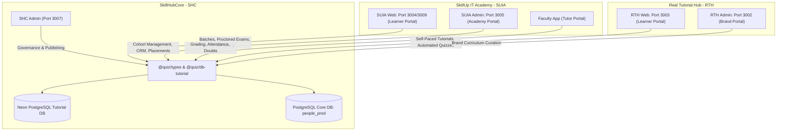

# Shared Brand Integration & Architectural Dependency Handoff

**Document Version:** 1.0.0  
**Date:** November 9, 2026  
**Governing Standard:** PSEG-001 (Project Software Architecture and Engineering Governance Standard)  
**Previous Verified Baseline:** `c6b005386786c5951cdcc952959f85d2c9013d8e`  
**Current Git Revision:** `ec82952d6852696d499e9ecfb15e2f554a120015`  
**Target Branch:** `main`  
**Primary Current Scope:** SHC Admin shared-resource ownership and integration analysis  
**Secondary Scope:** Read-only consumer contract inspection for SUIA and RTH  
**Status:** **PROPOSED ARCHITECTURAL REGISTER — ZERO SOURCE MUTATION — ZERO COMMITS/PUSHS**  

---

## 1. Executive Summary & Shared Architectural Model

SkillHubCore (SHC) acts as the **central authoritative governing engine** for shared educational assets across the platform ecosystem. SHC owns shared domain contracts, multi-tenant databases, canonical schemas, and platform policies. 

Two distinct consumer brands consume these shared capabilities under different business paradigms:
1. **SkillUp IT Academy (SUIA):** Tutor-led, cohort-based academy brand focusing on physical/live scheduled batches, faculty mentoring, proctored assessments, and formal career placement.
2. **Real Tutorial Hub (RTH):** Online, self-paced, AI-guided brand focusing on interactive rich tutorials, instant automated quizzes, and AI-driven learning assistance.



### Governing Architectural Rule:
$$\text{SHC Shared Resource Change} \implies \text{SUIA Compatibility} + \text{RTH Compatibility} + \text{Brand Isolation}$$
> A shared contract modification must never break tutor-led workflows in SUIA or AI/online delivery in RTH. Shared resources do not imply shared permissions; student enrollment in one brand never confers automatic access to the other.

---

## 2. Master Cross-Brand Comparison Matrix (13-Column Register)

| 1. Shared Capability | 2. SHC Logical Owner | 3. Actual Source Owner | 4. Authoritative Persistence Owner | 5. SUIA Web Consumer Path | 6. RTH Web Consumer Path | 7. Shared API / Schema Contract | 8. SUIA-Specific Policy | 9. RTH-Specific Policy | 10. Source Verification Status | 11. Integration Test Status | 12. Open Risks | 13. Future Acceptance Owner |
| :--- | :--- | :--- | :--- | :--- | :--- | :--- | :--- | :--- | :--- | :--- | :--- | :--- |
| **Academic Hierarchy** | SHC Taxonomy Governance | `@quiz/db-tutorial`, `@quiz/types`, `@quiz/db` | Multi-Database PostgreSQL: Core `@quiz/db` (`people_prod` / `DATABASE_URL`) & Tutorial `@quiz/db-tutorial` (`DATABASE_URL_TUTORIAL` Neon) | `apps/skillup-web/src/app/tutorial-v2/[domainSlug]/.../[navigationNodeId]/page.tsx`, `/programs` | `apps/realtutorialhub-web/src/app/tutorial-v2/[domainSlug]/.../[navigationNodeId]/page.tsx` | `TutorialPagePayload`, `TutorialNavigationTree`, `Domain`, `Subject`, `Topic`, `Subtopic`, `NavigationNode` | Semester-based curricula, batch-locked modules, faculty-guided pacing | Flat self-study index, open progression, AI search discovery | VERIFIED IN SOURCE | PARTIAL (Unit tests pass; cross-database sync unverified) | Cross-database taxonomy drift between Core PostgreSQL and Tutorial PostgreSQL navigation trees | SUIA Web / RTH Web |
| **Tutorial & Study Content** | SHC Tutorial Engine | `@quiz/db-tutorial` (`TutorialComposerService`, `TutorialDeliveryService`) | PostgreSQL Neon `tutorial_sections` | `apps/skillup-web/src/app/tutorial-v2/...` via `src/share-branding/LearningExperience/tutorialSidebarDelivery.ts` | `apps/realtutorialhub-web/src/app/tutorial-v2/...` via `src/share-branding/LearningExperience/tutorialSidebarDelivery.ts` | `TutorialDocumentSchema` (schemaVersion 1, blocks D1, C1, P1), `TutorialPagePayload` | Faculty lecture notes, cohort reading assignments, homework attachments | Interactive sandbox blocks, instant code run, AI summaries | VERIFIED IN SOURCE | VERIFIED (11/11 unit tests pass, read-only delivery verified) | Missing automated ISR delivery cache bust receiver in brand apps | SUIA Web / RTH Web |
| **Tutorial Versioning & Concurrency** | SHC Central Publishing | `@quiz/types`, `@quiz/db-tutorial` (`TutorialSectionRepository`) | PostgreSQL Neon `tutorial_sections.version` | Read-only delivery (no writer token required) | Read-only delivery (no writer token required) | `UpdateTutorialContentRequestSchema`, `AppendBlockRequestSchema` with `expectedVersion` | Protects centralized faculty syllabus updates; HTTP 409 mapped | Protects online author revisions from clobbering SHC changes; HTTP 409 mapped | VERIFIED IN SOURCE | VERIFIED (Unit tests pass; 409 handled in editor) | Legacy brand admin composer forms still execute unversioned writes | SHC Admin / Brand Admins |
| **Assessment & Examination** | SHC Question Governance | Central Question Bank in `@quiz/db`, Exam Engine in `src/share-branding/ExamEngine` | PostgreSQL Neon (`@quiz/db` schemas: `questionSchema`, `examSchema`) | `apps/skillup-web/src/app/exam/page.tsx`, `/exams`, `/launch-exam`, `/result` | `apps/realtutorialhub-quiz/src/app/learn`, `/report` | `AssessmentSchema`, `QuestionBank`, `loadExamSessionData` | Proctored exam windows, timed assessments, strict submission lock, faculty manual grading | Instant auto-graded chapter quizzes, retries, self-evaluations | VERIFIED IN SOURCE | PARTIAL (Exam loader verified; proctoring telemetry unverified) | Schema changes in central question bank risk breaking proctored exam UI | SUIA Web / RTH Quiz |
| **Enquiry, Admission & Enrollment** | Brand Membership with Central Identity | `apps/skillup-admin/src/app/(admin)/crm`, `apps/realtutorialhub-web` | PostgreSQL Neon (`@quiz/db-people` `users`, `@quiz/db-skillup` `enrollments`, `@quiz/db` `enums`) | `apps/skillup-web/src/app/student`, `apps/skillup-admin/src/app/(admin)/crm/enquiries` | `apps/realtutorialhub-web/src/app/(public)/register` | `Enrollment`, `ProgramMembership`, `requireBrandAccess(user, brandId)` | Application review, counselor verification, fee collection milestone, batch seat allocation | Instant self-service digital onboarding, open enrollment, freemium | VERIFIED IN SOURCE | UNVERIFIED (Manual test scenarios required) | Cross-brand entitlement leakage if brand scoping is bypassed | SUIA Admin / RTH Web |
| **Batches, Classes & Scheduling** | SUIA Academy Engine (Tutor-Led) | `packages/db-tutorial/src/schema/batch-schedules.ts`, `apps/faculty-app` | PostgreSQL Neon `batch_schedules`, `live_sessions` | `apps/skillup-web/src/app/batches/page.tsx`, `apps/skillup-admin/src/app/(admin)/batches` | NOT APPLICABLE (RTH uses on-demand asynchronous milestones) | `BatchSchedule`, `LiveSession` | Mandatory live class attendance, scheduled Zoom/Google Meet links, faculty allocation | Asynchronous, milestone-based self-study pacing | VERIFIED IN SOURCE | UNVERIFIED (Batch scheduling verified in admin UI only) | Faculty schedule collisions; time zone mismatches | SUIA Admin / Faculty App |
| **Mentoring & Doubt Solving** | Shared Live Sessions Dispatcher | `apps/api-server/src/lib/tutorial-faculty-access.ts`, `apps/faculty-app` | PostgreSQL Neon `live_session_requests` | `apps/faculty-app/src/app/(faculty)/sessions`, `apps/skillup-web` | `apps/realtutorialhub-web/src/components/tutorial/LiveSessionRequestPanel.tsx` | `liveSessionRequests` (`doubtText`, `subtopicId`, `status`) | Assigned human faculty / TA queue with scheduled office hours | 24/7 AI tutor chatbot resolution with community forum / ticket escalation | VERIFIED IN SOURCE | UNVERIFIED (Mocked routes pass; real WebRTC/Meet unverified) | Unassigned doubt ticket queues during peak academy hours | SUIA Faculty / RTH Web |
| **Placement & Experience Letters** | SUIA Placement Services | `apps/skillhub-placement`, `apps/skillup-admin/src/app/(admin)/placement` | PostgreSQL Neon (`@quiz/db-placement`, `@quiz/db` `jobsSchema`) | `apps/skillup-web/src/app/placement`, `apps/skillup-admin/src/app/(admin)/placement` | NOT APPLICABLE (RTH has no career placement guarantee) | `PlacementProfile`, `JobApplication` | Verified student resumes, corporate partner job drives, interview scheduling | Not applicable | VERIFIED IN SOURCE | UNVERIFIED (Placement portal routes verified in source) | Student eligibility calculation drift between LMS and placement portal | SUIA Admin / Placement |
| **Certification & Verification** | Central Verification Engine | `src/share-branding/CertificatesPage.tsx`, `@quiz/types` | PostgreSQL Neon (`@quiz/db` `reportSchema`, verification records) | `apps/skillup-web/src/app/certificates/page.tsx` (`brand={skillUpConfig}`) | `apps/realtutorialhub-web/src/app/certificates/page.tsx` (`brand={rthConfig}`) | `CertificateDefinition`, `VerificationRecord`, `/verify/:id` | Formal graduation diploma with academy seal, batch ID, faculty signature, and QR code | Digital skill mastery badges and course completion certificates for LinkedIn sharing | VERIFIED IN SOURCE | PARTIAL (Page rendering verified; public QR resolver unverified) | Verification slug collision; unverified student completion fraud | Shared Engine / Both Brands |
| **Marketing & Analytics** | Central Analytics with Brand Sites | `apps/skillupitacademy-site`, `apps/realtutorialhub-site`, SHC Admin Dashboard | Isolated Marketing Analytics Stores | `apps/skillupitacademy-site` | `apps/realtutorialhub-site` | UTM Attribution, Lead Capture API, System Baseline Metric Schema | Academy lead capture, course syllabus download tracking | Tutorial traffic analytics, SEO conversion tracking | VERIFIED IN SOURCE | VERIFIED (SHC Admin baseline disclaimer mounted) | Marketing tracking failures impacting LMS performance | Brand Marketing / SHC Admin |
| **Authentication & RBAC** | Central Auth Architecture | `@quiz/auth`, `src/share-branding/auth/` | PostgreSQL Neon (`@quiz/db` `authSchema` & `@quiz/db-people` `users`, `refresh_tokens`, `roles`) | `apps/skillup-web/src/app/api/auth/login`, `/logout` | `apps/realtutorialhub-web/src/app/api/auth/login`, `apps/realtutorialhub-admin/src/app/api/auth/logout` | `proxyAuthRequest`, `clearAuthCookies`, `buildAuthCookie`, `Role` matrix | Academy roles (`faculty`, `student`, `counselor`); Lock Screen unmounted | Online roles (`learner`, `author`, `moderator`); Lock Screen active | VERIFIED IN SOURCE | VERIFIED (Security suite 61/61 pass; Scope B1 20/20 pass) | Cookie domain fallback `.realtutorialhub.com` failing on plain localhost | Shared Auth / Both Brands |
| **Brand Isolation & Multi-Tenancy** | Central Authorization Engine | `@quiz/types`, `@quiz/db-tutorial` assertion guards | PostgreSQL Neon `tutorial_sections.brand_id`, brand foreign keys | Scoped to `brandId = 'skillup'` or `NULL` | Scoped to `brandId = 'realtutorialhub'` or `NULL` | `requireBrandAccess(user, brandId)`, `assertCanEditTutorial(context, tutorial)` | Strict isolation from RTH learner records and internal SHC controls | Strict isolation from SUIA cohort data and internal SHC controls | VERIFIED IN SOURCE | VERIFIED (Service assertion unit tests pass) | Application-level query filtering bypassing database row-level security | Shared Backend / Both Brands |

---

## 3. Common Shared-Resource Integration Register (`SHARED-INT-*`)

| Field | Detail |
| :--- | :--- |
| **Issue ID** | **SHARED-INT-001** |
| **Capability** | Cross-Database Academic Hierarchy & Taxonomy Synchronization (PostgreSQL Core DB vs Neon Tutorial DB) |
| **Logical owner** | SHC Taxonomy Governance |
| **Current implementation owner** | `@quiz/db-tutorial` (PostgreSQL Neon) & `@quiz/db` (PostgreSQL `DATABASE_URL` / `people_prod`) |
| **Affected consumer** | Both SUIA Web and RTH Web |
| **Evidence** | `packages/db-tutorial/src/schema/tutorial-sections.ts` vs `packages/db/src/schema/domain.ts` |
| **SHA** | `ec82952d6852696d499e9ecfb15e2f554a120015` |
| **Observation** | **RETRACTED HISTORICAL NOTE:** The initial assessment erroneously cited a MongoDB core database. Forensic source audit confirms zero MongoDB packages or runtime dependencies in the codebase; all platform data layers use PostgreSQL (`@neondatabase/serverless` + Drizzle ORM).<br><br>**CORRECTED OBSERVATION:** Course and curriculum taxonomy (domains, subjects, topics, subtopics) is defined in `@quiz/db` (`packages/db/src/schema/domain.ts` connecting via `DATABASE_URL` / `people_prod`), while tutorial navigation nodes and block content are stored in `@quiz/db-tutorial` (`packages/db-tutorial/src/schema/` connecting via `DATABASE_URL_TUTORIAL`). Because these are physically separate PostgreSQL connection pools / Neon database instances, transactions spanning academic hierarchy definitions and tutorial delivery structures cannot participate in 2PC. Mutations in SHC Admin write to `DATABASE_URL_TUTORIAL` without automated cross-database synchronization with the core `@quiz/db` taxonomy. |
| **Risk** | Taxonomy drift: A topic or subtopic slug renamed or deleted in the Core PostgreSQL database causes broken breadcrumbs and 404 errors on `/tutorial-v2/` in both SUIA Web and RTH Web if navigation nodes in `@quiz/db-tutorial` are not synchronized. |
| **Severity** | **High** |
| **Finding state** | **RETRACTED** (Historical MongoDB Finding) / **CONFIRMED ARCHITECTURE GAP** (Cross-Database PostgreSQL Sync) |
| **Implementation maturity** | Partial |
| **Future acceptance test** | Create, update, and rename a topic node in SHC Admin; verify that `/api/tutorial-v2/` in both SUIA and RTH immediately reflects the updated slug without manual database synchronization. |
| **Recommended correction** | Implement an Event Outbox synchronizer using the existing `event_outbox` table in `packages/db-tutorial` to publish taxonomy change events from Core PostgreSQL to the Tutorial PostgreSQL database (or consolidate taxonomy ownership into a unified PostgreSQL schema). |
| **Dependency** | `packages/db-tutorial`, `packages/db`, PostgreSQL event outbox worker. |
| **Future workstream** | Shared Backend / Database Architecture |
| **Governance mapping** | PSEG-001 §4.2 (Data Architecture), SHCA-U01, SHCA-U02, SHCA-A06 |
| **Owner approval** | **Required** (Storage architecture decision) |

---

| Field | Detail |
| :--- | :--- |
| **Issue ID** | **SHARED-INT-002** |
| **Capability** | Tutorial Delivery Cache Invalidation Broadcast |
| **Logical owner** | SHC Tutorial Engine |
| **Current implementation owner** | `apps/skillhubcore-admin/src/lib/cache-invalidation.ts` |
| **Affected consumer** | Both SUIA Web (`apps/skillup-web`) and RTH Web (`apps/realtutorialhub-web`) |
| **Evidence** | `apps/skillhubcore-admin/src/lib/cache-invalidation.ts#L10-L40` |
| **SHA** | `ec82952d6852696d499e9ecfb15e2f554a120015` |
| **Observation** | `invalidateTutorialDeliveryCache` triggers local Next.js cache tags within SHC Admin, but lacks an external HTTP webhook, Redis pub/sub, or message queue trigger to invalidate Next.js ISR caches on `user.skillupitacademy.com` or `user.realtutorialhub.com`. |
| **Risk** | Stale content delivery: When an administrator publishes updated tutorial content in SHC Admin, learners on SUIA and RTH continue viewing cached stale versions until CDN/ISR TTL expiration. |
| **Severity** | **Medium** |
| **Finding state** | **CONFIRMED** |
| **Implementation maturity** | Implemented but unverified across brands |
| **Future acceptance test** | Publish a revision to a deployed tutorial in SHC Admin; verify that an immediate HTTP GET to SUIA Web (port 3004) and RTH Web (port 3003) returns the updated content blocks without delay. |
| **Recommended correction** | Add an authorized internal cache-bust webhook endpoint (`POST /api/revalidate`) in both brand web applications, triggered by SHC Admin upon successful publish. |
| **Dependency** | `apps/skillup-web`, `apps/realtutorialhub-web`, shared webhook secret. |
| **Future workstream** | SUIA Web / RTH Web / Delivery Architecture |
| **Governance mapping** | PSEG-001 §7.3 (Caching & Performance), SHCA-F18 |
| **Owner approval** | Not required (Standard integration task) |

---

| Field | Detail |
| :--- | :--- |
| **Issue ID** | **SHARED-INT-003** |
| **Capability** | Shared Auth Cookie Domain Compatibility on Local Development |
| **Logical owner** | Central Authentication Architecture |
| **Current implementation owner** | `packages/auth/src/middleware/cookie.middleware.ts#L37-L72` |
| **Affected consumer** | Both SUIA Apps and RTH Apps on local development ports |
| **Evidence** | `packages/auth/src/middleware/cookie.middleware.ts#L41` (`getCookieDomainFallback`) |
| **SHA** | `ec82952d6852696d499e9ecfb15e2f554a120015` |
| **Observation** | `getCookieDomainFallback` defaults to `.realtutorialhub.com` for RTH and `.skillupitacademy.com` for SUIA. When testing locally on `localhost:3002`, `localhost:3003`, `localhost:3004`, or `localhost:3005`, browsers reject cookies set with `Domain=.realtutorialhub.com` or `Secure` over HTTP. |
| **Risk** | Developer session drop: Local authentication loops occur during development unless specific environment variables (`COOKIE_DOMAIN_RTH=""`) are configured in local `.env`. |
| **Severity** | **Medium** |
| **Finding state** | **CONFIRMED** |
| **Implementation maturity** | Implemented and verified in production; fragile in local development |
| **Future acceptance test** | Execute full login/logout flow on `http://localhost:3003` and `http://localhost:3004` without custom `.env` domain overrides; verify session cookie persists across page reloads. |
| **Recommended correction** | Update `getCookieDomain` in `cookie.middleware.ts` to check if request hostname is `localhost` or `127.0.0.1` and omit the `Domain` attribute (host-only cookie) with `secure: false` in development mode. |
| **Dependency** | `packages/auth`, `cookie.middleware.ts` |
| **Future workstream** | Shared Auth Backend |
| **Governance mapping** | PSEG-001 §5.1 (Authentication & Session Security), SHCA-S01 |
| **Owner approval** | Not required (Developer DX & test stability) |

---

| Field | Detail |
| :--- | :--- |
| **Issue ID** | **SHARED-INT-004** |
| **Capability** | Multi-Tenant Database Partitioning & Row-Level Isolation |
| **Logical owner** | Central Database Architecture |
| **Current implementation owner** | `packages/db-tutorial/src/schema/tutorial-sections.ts` & assertion guards |
| **Affected consumer** | All applications (SHC, SUIA, RTH) |
| **Evidence** | `packages/db-tutorial/src/services/tutorial-composer.service.ts#L550-L585` |
| **SHA** | `ec82952d6852696d499e9ecfb15e2f554a120015` |
| **Observation** | Multi-tenant brand isolation is enforced at the application/service layer (`assertCanEditTutorial`). Database queries rely on application code explicitly appending `WHERE brand_id = ...`. The PostgreSQL database does not enforce PostgreSQL Row-Level Security (RLS) policies. |
| **Risk** | Cross-tenant data leakage if a future direct query or ORM call omits the `brand_id` filter in a new endpoint. |
| **Severity** | **Medium** |
| **Finding state** | **RESOLVED AT SERVICE LAYER / PENDING AT DB LAYER** |
| **Implementation maturity** | Partial |
| **Future acceptance test** | Execute adversarial cross-brand queries simulating an authenticated SUIA tutor requesting an RTH private section; verify rejection at both service and query levels. |
| **Recommended correction** | Introduce Drizzle ORM query middleware or PostgreSQL RLS policies that automatically enforce tenant isolation based on session context. |
| **Dependency** | `packages/db-tutorial`, Neon PostgreSQL schema |
| **Future workstream** | Shared Backend / Database Architecture |
| **Governance mapping** | PSEG-001 §5.2 (Multi-Tenancy & Authorization), SHCA-A05 |
| **Owner approval** | **Required** (Database RLS policy decision) |

---

| Field | Detail |
| :--- | :--- |
| **Issue ID** | **SHARED-INT-005** |
| **Capability** | Central Question Bank Schema Versioning for Dual-Engine Delivery |
| **Logical owner** | SHC Assessment Engine |
| **Current implementation owner** | `@quiz/db` & `src/share-branding/ExamEngine` |
| **Affected consumer** | SUIA Exam Engine (`apps/skillup-web`) & RTH Quiz Engine (`apps/realtutorialhub-quiz`) |
| **Evidence** | `apps/skillup-web/src/app/exam/page.tsx` vs `apps/realtutorialhub-quiz/src/app/learn` |
| **SHA** | `ec82952d6852696d499e9ecfb15e2f554a120015` |
| **Observation** | Questions authored in central SHC tools serve both SUIA proctored milestone exams and RTH self-paced chapter quizzes. Question schemas must support polymorphic question types (MCQ, code compilation, subjective) without breaking either consumer. |
| **Risk** | Adding new interactive question types (e.g. multi-step AI drills) in SHC might cause parse errors in SUIA's proctored exam engine if the renderer does not support the type. |
| **Severity** | **Medium** |
| **Finding state** | **UNVERIFIED** |
| **Implementation maturity** | Implemented but unverified across brands |
| **Future acceptance test** | Author test questions of all types in SHC Admin; verify seamless loading and submission in both SUIA `/exam` and RTH `/learn`. |
| **Recommended correction** | Formalize a typed `QuestionEnvelopeSchema` in `@quiz/types` with versioned discriminators and fallback renderers for unsupported question types. |
| **Dependency** | `@quiz/types`, `@quiz/db`, `ExamEngine` |
| **Future workstream** | Shared Assessment Architecture |
| **Governance mapping** | PSEG-001 §3.1 (Contract Compatibility), SHCA-F05, SHCA-F06 |
| **Owner approval** | Not required |

---

## 4. Cross-Brand Security & Authorization Invariants

```
                                  [Incoming Request]
                                           │
                       ┌───────────────────┴───────────────────┐
                       ▼                                       ▼
            [SUIA Request: port 3004/3005]          [RTH Request: port 3002/3003]
                       │                                       │
                       ▼                                       ▼
             `brandId = 'skillup'`                   `brandId = 'realtutorialhub'`
             `suia_user_token`                       `rth_user_token`
                       │                                       │
                       └───────────────────┬───────────────────┘
                                           ▼
                            [Shared Service Authorization]
                                           │
                       ┌───────────────────┴───────────────────┐
                       ▼                                       ▼
        [Cross-Tenant Match Check]                  [Identity & Entitlement]
     context.brandId == tutorial.brandId          Enrolled in requested brand?
         (Mismatch -> HTTP 403)                     (No -> HTTP 403 Forbidden)
```

1. **Identity vs Entitlement:** A single user ID existing in the core database does NOT grant access across brands. Entitlement is determined by `brand_id` scoped memberships.
2. **Read-Only Consumer Exemption:** While content authors in SHC Admin or Brand Admin MUST provide `expectedVersion` to prevent silent overwrites, read-only delivery consumers (`apps/skillup-web`, `apps/realtutorialhub-web`) query published state (`status = 'deployed'`) and do not require concurrency tokens.
3. **Fail-Closed Session Redirection:** Unauthenticated access to protected routes (`/dashboard`, `/batches`, `/exam`) redirects strictly to the host brand's native login route (`/login`).

---

## 5. Required Acceptance Test Protocols for Future Workstreams

### A. Shared Contract Tests (Run before any shared package release)
- [ ] **ST-01 (Document Schema Parity):** Verify `TutorialDocumentSchema` parses valid documents across all block types (D1, C1, P1) with 0 errors.
- [ ] **ST-02 (Optimistic Concurrency Collision):** Verify simultaneous writes with mismatched `expectedVersion` reject with HTTP 409 (`VERSION_CONFLICT`).
- [ ] **ST-03 (Brand Isolation Guard):** Verify `assertCanEditTutorial` throws when context brand differs from tutorial record brand.

### B. SUIA Web Integration Tests (Dedicated SUIA Batch)
- [ ] **SUIA-T01 (Tutor Cohort Navigation):** Real HTTP GET on port 3004 loads scheduled batch calendar with assigned faculty.
- [ ] **SUIA-T02 (Proctored Exam Delivery):** Verify timed exam flow locks student UI, enforces attempt limits, and saves responses.
- [ ] **SUIA-T03 (Cross-Brand Rejection):** Verify SUIA learner token cannot access private RTH course endpoints.

### C. RTH Web Integration Tests (Dedicated RTH Batch)
- [ ] **RTH-T01 (Delivery Hydration):** Real HTTP GET on port 3003 renders published tutorial blocks (D1, C1, P1) with code playgrounds.
- [ ] **RTH-T02 (Admin Logout BFF):** Real HTTP POST to port 3002 `/api/auth/logout` invalidates session and clears cookies.
- [ ] **RTH-T03 (Cross-Brand Rejection):** Verify RTH learner token cannot access private SUIA cohort batches.
